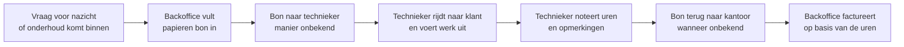
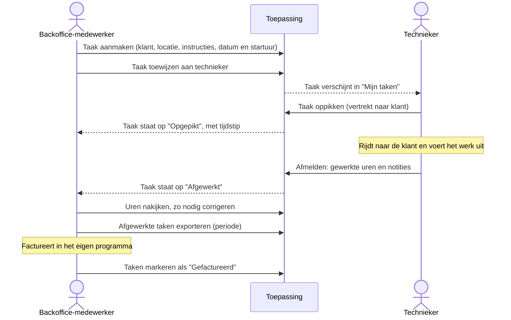
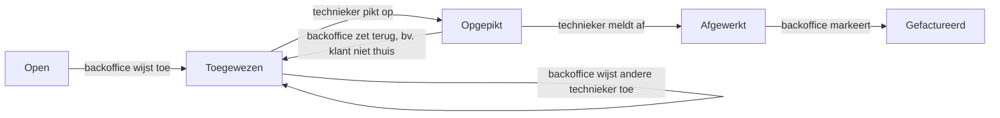

# Functionele analyse: Taakplanning

|               |                                                                                                                                                                     |
| ------------- | ------------------------------------------------------------------------------------------------------------------------------------------------------------------- |
| **Onderwerp** | taakplanning                                                                                                                                                        |
| **Status**    | Versie 2: klaar voor ontwerp, met aannames die nog bevestigd moeten worden                                                                                          |
| **Bronnen**   | Eerste gesprek, 23/11/2026 (`docs/input/taakplanning/2026-11-23-eerste-gesprek.txt`); tweede gesprek, 23/11/2026 (antwoorden van de klant, doorgegeven door Jurgen) |
| **Datum**     | 23/11/2026                                                                                                                                                          |

> **Lees dit eerst.** De input voor deze analyse komt uit twee korte gesprekken.
> Alles wat niet letterlijk door de klant gezegd is, staat in dit document als **aanname**
> (hoofdstuk 11) of als **open vraag** (hoofdstuk 12), nooit als feit.
> Er zijn **geen blokkerende vragen** meer: de vroegere blokkerende vragen zijn vervangen
> door een bescheiden aanname (A12 tot A22), zodat de designer kan starten.
> Die aannames moeten nog wel bij de klant bevestigd worden.

---

## 1. Samenvatting

Het bedrijf doet nazicht en onderhoud van aircos en geeft opdrachten vandaag via papieren bonnen door aan de techniekers. Dat werkt te traag (tweede gesprek, 23/11/2026). De klant wil een toepassing waarin de backoffice-medewerker taken inplant met instructies, locatie en klantinformatie, en elke taak toewijst aan één technieker (eerste gesprek, 23/11/2026). De technieker laat weten wanneer hij vertrekt ("oppikken") en meldt de taak af met de gewerkte uren en notities. De backoffice ziet dat en gebruikt de uren om te factureren (tweede gesprek). We stellen een kleine eerste versie voor die de papieren bon vervangt en een export van de gewerkte uren voor de facturatie geeft, zonder koppeling met andere software.

---

## 2. Context

### Het bedrijf

- Een kleine KMO die **nazicht en onderhoud van aircos** doet bij klanten (tweede gesprek, 23/11/2026).
- Er is minstens één backoffice-medewerker, en er zijn techniekers die taken uitvoeren (eerste gesprek, 23/11/2026).
- Alle techniekers werken apart, er zijn geen teams (tweede gesprek, 23/11/2026).
- Het aantal techniekers en gebruikers is niet gekend. Zie aanname A12 en open vraag V1.

### Betrokken mensen en rollen

| Rol                             | Wat we weten                                                                                                                                               | Bron                                          |
| ------------------------------- | ---------------------------------------------------------------------------------------------------------------------------------------------------------- | --------------------------------------------- |
| **Zaakvoerder / opdrachtgever** | Spreekt over "mijn backoffice medewerker"; is dus vermoedelijk de zaakvoerder. In het voorstel werkt die mee met dezelfde rechten als de backoffice (A15). | Eerste gesprek, 23/11/2026 (rol afgeleid, A1) |
| **Backoffice-medewerker**       | Plant taken in, wijst ze toe aan een technieker, bekijkt de afmeldingen en gebruikt de uren voor de facturatie.                                            | Eerste en tweede gesprek, 23/11/2026          |
| **Technieker**                  | Krijgt taken toegewezen, pikt een taak op (vertrekt ernaartoe), voert ze uit, meldt af met gewerkte uren en notities. Werkt alleen.                        | Eerste en tweede gesprek, 23/11/2026          |

### Begrippen van de klant

- **Nazicht**: een controle van een airco-installatie bij de klant (tweede gesprek). Of er een wettelijk verplicht nazicht bij is (met attest of logboek), is niet gekend (V19).
- **Onderhoud**: periodiek onderhoud van een airco (tweede gesprek).
- **Papieren bon**: het papieren formulier waarmee vandaag een opdracht wordt doorgegeven en/of teruggemeld (tweede gesprek). We hebben nog geen voorbeeld gezien (V3).
- **Taak**: een opdracht die bij een klant uitgevoerd moet worden, met instructies, locatie en klantinformatie (eerste gesprek). Een taak is klein genoeg om in één keer af te werken (tweede gesprek).
- **Inplannen**: een taak aanmaken en in de tijd zetten. De klant plant "in uren" (tweede gesprek). Wij lezen dat als een datum met een startuur (A22).
- **Oppikken**: de technieker geeft aan dat hij aan de taak begint: hij rijdt eerst naar de klant en voert dan het werk uit (tweede gesprek, 23/11/2026).
- **Afmelden** (onze term): de technieker geeft aan dat de taak gedaan is, met gewerkte uren en notities (eerste gesprek).

### Huidige tools

- **Papieren bonnen** (tweede gesprek, 23/11/2026).
- Er zijn geen andere tools genoemd. Het boekhoud- of facturatieprogramma is niet gekend (V12).

---

## 3. Huidig proces (as-is)

Volgens de klant werkt het vandaag met papieren bonnen (tweede gesprek, 23/11/2026).
De details van de stappen (wie de bon invult, hoe hij bij de technieker komt en terug naar
kantoor gaat) zijn nog niet beschreven. Onderstaande stappen moeten nog bevestigd worden (V3).

| #   | Stap                                                                             | Wie                   | Bron                                                   |
| --- | -------------------------------------------------------------------------------- | --------------------- | ------------------------------------------------------ |
| 1   | Er komt een vraag voor nazicht of onderhoud binnen                               | Onbekend              | Afgeleid (A2)                                          |
| 2   | Taak voorbereiden op een papieren bon: wat, waar, welke klant, wanneer (in uren) | Backoffice-medewerker | Eerste en tweede gesprek                               |
| 3   | Bon doorgeven aan een technieker                                                 | Backoffice-medewerker | Eerste gesprek; manier van doorgeven onbekend          |
| 4   | Naar de klant rijden en het werk uitvoeren                                       | Technieker            | Tweede gesprek                                         |
| 5   | Gewerkte uren en opmerkingen noteren                                             | Technieker            | Eerste en tweede gesprek; vermoedelijk op de bon (A13) |
| 6   | Bon terug naar kantoor                                                           | Technieker            | Afgeleid (A13)                                         |
| 7   | Uren van de bon gebruiken om te factureren                                       | Backoffice-medewerker | Tweede gesprek                                         |

---

## 4. Knelpunten

Genoemd door de klant:

- **De papieren bonnen werken te traag** (tweede gesprek, 23/11/2026).

Mogelijke knelpunten die hieruit volgen, nog te bevestigen bij de klant (V4):

- De backoffice weet pas dat een taak gedaan is als de bon terug op kantoor is. Daardoor kan ook de facturatie pas laat gebeuren.
- De backoffice weet niet wie onderweg is of aan een taak bezig is.
- De uren van de bon moeten overgetypt worden om te factureren. Daarbij kunnen fouten gebeuren, of een bon kan zoekraken (dan wordt het werk niet gefactureerd).
- Een handgeschreven bon kan slecht leesbaar of onvolledig zijn.

---

## 5. Gewenst proces (to-be)

Voorstel voor de **eerste versie**, gebaseerd op het eerste en tweede gesprek:

| #   | Stap                                                                                                                           | Wie                   |
| --- | ------------------------------------------------------------------------------------------------------------------------------ | --------------------- |
| 1   | Backoffice maakt een taak aan: klant, locatie, instructies, datum en startuur                                                  | Backoffice-medewerker |
| 2   | Backoffice wijst de taak toe aan één technieker                                                                                | Backoffice-medewerker |
| 3   | Technieker ziet zijn taken op zijn gsm (A4)                                                                                    | Technieker            |
| 4   | Technieker **pikt de taak op** wanneer hij vertrekt; de backoffice ziet dat hij onderweg of bezig is                           | Technieker            |
| 5   | Technieker rijdt naar de klant en voert het werk uit                                                                           | Technieker            |
| 6   | Technieker meldt af: gewerkte uren (zonder verplaatsing, A16) en notities                                                      | Technieker            |
| 7   | Backoffice kijkt de afgewerkte taken na en corrigeert zo nodig de uren                                                         | Backoffice-medewerker |
| 8   | Backoffice exporteert de afgewerkte taken per periode, factureert in het eigen programma en markeert de taken als gefactureerd | Backoffice-medewerker |

### Statussen van een taak

Het oppikken is een aparte stap (tweede gesprek). Daarom komt er een status **Opgepikt** tussen
Toegewezen en Afgewerkt. Omdat de uren gefactureerd worden, stellen we ook een status
**Gefactureerd** voor (A20). Daarna kunnen de uren niet meer gewijzigd worden.

| Status           | Betekenis                                        | Wie zet deze status       |
| ---------------- | ------------------------------------------------ | ------------------------- |
| **Open**         | Aangemaakt, nog geen technieker                  | Backoffice (bij aanmaken) |
| **Toegewezen**   | Toegewezen aan één technieker, nog niet gestart  | Backoffice                |
| **Opgepikt**     | De technieker is vertrokken of bezig             | Technieker                |
| **Afgewerkt**    | Afgemeld met gewerkte uren; nog te factureren    | Technieker                |
| **Gefactureerd** | De uren zijn gefactureerd; de taak is afgesloten | Backoffice                |

Er is geen status "Niet afgewerkt": volgens de klant raakt een taak in één keer af (tweede gesprek).
Lukt het toch eens niet, dan zet de backoffice de taak terug op Toegewezen (A21).

---

## 6. Rollen en rechten

Voorstel voor de eerste versie (A5, A15). Nog te bevestigen door de klant (V6, V7).

| Actie                                                 | Backoffice-medewerker (en zaakvoerder) | Technieker                      |
| ----------------------------------------------------- | -------------------------------------- | ------------------------------- |
| Taak aanmaken, wijzigen, toewijzen, opnieuw toewijzen | Ja, zolang de taak niet afgewerkt is   | Nee                             |
| Opgepikte taak terugzetten naar Toegewezen            | Ja                                     | Nee                             |
| Alle taken zien                                       | Ja                                     | Nee                             |
| Eigen toegewezen taken zien                           | n.v.t.                                 | Ja                              |
| Taken van andere techniekers zien                     | Ja                                     | Nee (V7)                        |
| Taak oppikken                                         | Nee                                    | Ja, enkel eigen taken           |
| Taak afmelden (uren, notities)                        | Nee (V10)                              | Ja, enkel eigen opgepikte taken |
| Gewerkte uren wijzigen na afmelding                   | Ja, tot de taak gefactureerd is (A19)  | Nee                             |
| Afgewerkte taken exporteren                           | Ja                                     | Nee                             |
| Taak markeren als gefactureerd                        | Ja                                     | Nee                             |
| Klanten beheren                                       | Ja                                     | Nee                             |
| Gebruikers (techniekers) beheren                      | Ja (A15)                               | Nee                             |

**Vervanging bij afwezigheid** (A15):

- Als de backoffice-medewerker afwezig is, neemt de zaakvoerder over. Die heeft dezelfde rechten.
- Als een technieker ziek is, wijst de backoffice zijn taken toe aan een andere technieker (US-04).

---

## 7. User stories

Prioriteit: **Must** = nodig in de eerste versie, **Should** = liefst in de eerste versie,
**Could** = later, als er vraag naar is.

De nummering van versie 1 blijft behouden. De nieuwe stories uit het tweede gesprek hebben
nummer US-11 tot US-14. Volgorde in de flow: US-01, US-02, US-03, **US-11**, US-05, US-06, **US-12**, **US-13**, **US-14**.

### US-01 Taak aanmaken (Must)

**Als** backoffice-medewerker **wil ik** een taak aanmaken met klant, locatie, instructies, datum en startuur **zodat** de technieker weet wat er waar en wanneer moet gebeuren.
Bron: eerste gesprek, 23/11/2026; "in uren gepland": tweede gesprek, 23/11/2026; verplichte velden: A14.

- **Gegeven** ik ben aangemeld als backoffice-medewerker
  **Wanneer** ik een nieuwe taak aanmaak met klant, locatie, instructies, datum en startuur, en bewaar
  **Dan** staat de taak in het takenoverzicht met status "Open".
- **Gegeven** ik maak een nieuwe taak aan
  **Wanneer** ik bewaar terwijl klant, locatie, instructies, datum of startuur ontbreekt
  **Dan** krijg ik een melding welk veld ontbreekt en wordt de taak niet bewaard.
- **Gegeven** ik maak een nieuwe taak aan
  **Wanneer** ik een geschatte duur in uren invul (niet verplicht)
  **Dan** wordt die duur bij de taak getoond.

### US-02 Taak toewijzen aan een technieker (Must)

**Als** backoffice-medewerker **wil ik** een taak aan één technieker toewijzen **zodat** duidelijk is wie ze uitvoert.
Bron: eerste gesprek, 23/11/2026; één technieker per taak, geen teams: tweede gesprek, 23/11/2026.

- **Gegeven** een taak met status "Open"
  **Wanneer** ik een technieker kies en bewaar
  **Dan** krijgt de taak status "Toegewezen" en verschijnt ze in de takenlijst van die technieker.
- **Gegeven** ik wijs een taak toe
  **Wanneer** ik de lijst met techniekers open
  **Dan** zie ik enkel actieve techniekers, en kan ik precies één technieker kiezen.

### US-03 Mijn taken bekijken (Must)

**Als** technieker **wil ik** op mijn gsm een lijst van mijn taken zien **zodat** ik weet wat ik moet doen.
Bron: eerste gesprek, 23/11/2026; gsm-gebruik: A4.

- **Gegeven** ik ben aangemeld als technieker en er zijn drie taken aan mij toegewezen
  **Wanneer** ik "Mijn taken" open
  **Dan** zie ik die drie taken, gesorteerd op datum en startuur, en geen taken van andere techniekers.
- **Gegeven** ik heb afgewerkte en niet-afgewerkte taken
  **Wanneer** ik "Mijn taken" open
  **Dan** zie ik standaard enkel de taken met status "Toegewezen" of "Opgepikt".
- **Gegeven** ik open een taak
  **Wanneer** het detail verschijnt
  **Dan** zie ik de instructies, de locatie, de klantgegevens, de datum en het startuur.
- **Gegeven** ik gebruik een gsm
  **Wanneer** ik de lijst en het detail bekijk
  **Dan** is alles leesbaar en bruikbaar zonder in te zoomen.

### US-04 Toewijzing wijzigen of taak terugzetten (Should)

**Als** backoffice-medewerker **wil ik** een taak aan een andere technieker toewijzen of een opgepikte taak terugzetten **zodat** ik kan bijsturen bij ziekte, drukte of als de klant niet thuis is.
Bron: A7 (afwezigheid) en A21 (uitzonderingen).

- **Gegeven** een taak met status "Toegewezen" aan technieker A
  **Wanneer** ik ze toewijs aan technieker B
  **Dan** verdwijnt de taak uit de lijst van A en verschijnt ze in de lijst van B.
- **Gegeven** een taak met status "Opgepikt"
  **Wanneer** ik "Terugzetten" kies
  **Dan** krijgt de taak opnieuw status "Toegewezen" en kan ik eventueel een andere technieker en een nieuwe datum kiezen.
- **Gegeven** een taak met status "Afgewerkt" of "Gefactureerd"
  **Wanneer** ik de toewijzing probeer te wijzigen
  **Dan** kan dat niet.

### US-05 Taak afmelden (Must)

**Als** technieker **wil ik** een opgepikte taak afmelden met de gewerkte uren en eventuele notities **zodat** de backoffice weet dat het werk gedaan is en het kan factureren.
Bron: eerste gesprek, 23/11/2026; uren en facturatie: tweede gesprek, 23/11/2026; vorm van de uren: A17; zonder verplaatsing: A16.

_Gewijzigd t.o.v. versie 1:_ afmelden kan enkel na het oppikken. Afmelden betekent altijd "gedaan", want een taak raakt in één keer af (tweede gesprek). De uren worden ingevuld per kwartier.

- **Gegeven** een taak met status "Opgepikt" die aan mij is toegewezen
  **Wanneer** ik "Afmelden" kies, de gewerkte uren invul (bv. 1u30) en bevestig
  **Dan** krijgt de taak status "Afgewerkt", met de ingevulde uren en het tijdstip van afmelding.
- **Gegeven** ik meld een taak af
  **Wanneer** ik geen gewerkte uren invul, of nul
  **Dan** krijg ik een melding dat de gewerkte uren verplicht zijn.
- **Gegeven** ik vul de gewerkte uren in
  **Wanneer** ik een duur kies
  **Dan** kan ik enkel kiezen per kwartier (0u15, 0u30, ...), en staat erbij dat de verplaatsing niet meetelt.
- **Gegeven** ik meld een taak af
  **Wanneer** ik een notitie invul
  **Dan** wordt die notitie bij de taak bewaard; een notitie is niet verplicht.
- **Gegeven** een taak die ik al afgemeld heb
  **Wanneer** ik ze opnieuw open
  **Dan** kan ik de uren en notities lezen, maar niet meer wijzigen.
- **Gegeven** een taak met status "Toegewezen" (nog niet opgepikt), of een taak van een andere technieker
  **Wanneer** ik die probeer af te melden
  **Dan** kan dat niet.

### US-06 Takenoverzicht en opvolging (Must)

**Als** backoffice-medewerker **wil ik** een overzicht van alle taken met hun status, technieker, uren en notities **zodat** ik zie wat gepland is, wie onderweg is en wat gefactureerd kan worden.
Bron: eerste gesprek, 23/11/2026 ("De backoffice medewerker moet dat dan kunnen zien"); "Opgepikt": tweede gesprek.

- **Gegeven** er zijn taken met verschillende statussen
  **Wanneer** ik het takenoverzicht open
  **Dan** zie ik per taak de klant, de datum en het startuur, de technieker en de status.
- **Gegeven** een taak met status "Opgepikt"
  **Wanneer** ik ze in het overzicht bekijk
  **Dan** zie ik sinds wanneer ze opgepikt is.
- **Gegeven** het takenoverzicht
  **Wanneer** ik filter op status, technieker of periode
  **Dan** zie ik enkel de taken die aan de filter voldoen.
- **Gegeven** een afgewerkte taak
  **Wanneer** ik ze open
  **Dan** zie ik de gewerkte uren, de notities, wie afmeldde, wanneer de taak opgepikt en afgemeld werd, en of de uren gecorrigeerd zijn.

### US-07 Klanten bijhouden (Should)

**Als** backoffice-medewerker **wil ik** een klant één keer invoeren en bij volgende taken terug kiezen **zodat** ik de klantgegevens niet telkens opnieuw moet typen.
Bron: A3 (een klant komt bij meerdere taken terug, bv. voor jaarlijks onderhoud). Of vrije tekst bij de taak volstaat: V11.

- **Gegeven** een klant die al bestaat
  **Wanneer** ik een nieuwe taak aanmaak
  **Dan** kan ik de klant zoeken op naam en kiezen, en worden adres en contactgegevens ingevuld.
- **Gegeven** een taak voor een klant
  **Wanneer** de werklocatie verschilt van het klantadres
  **Dan** kan ik voor deze taak een andere locatie invullen.

### US-08 Techniekers beheren (Must)

**Als** backoffice-medewerker (of zaakvoerder) **wil ik** techniekers toevoegen en uitschakelen **zodat** enkel wie bij het bedrijf werkt toegang heeft.
Bron: A15; nodig om taken te kunnen toewijzen.

- **Gegeven** een nieuwe technieker
  **Wanneer** ik naam en e-mailadres invul en bewaar
  **Dan** krijgt die persoon een uitnodiging om zich aan te melden.
- **Gegeven** een technieker die vertrekt
  **Wanneer** ik die uitschakel
  **Dan** kan die zich niet meer aanmelden, maar blijven zijn afgewerkte taken en uren zichtbaar.
- **Gegeven** een technieker met taken op "Toegewezen" of "Opgepikt"
  **Wanneer** ik die uitschakel
  **Dan** krijg ik een melding dat die taken eerst opnieuw toegewezen moeten worden.

### US-09 Locatie openen in navigatie (Could)

**Als** technieker **wil ik** vanuit de taak het adres openen in mijn navigatie-app **zodat** ik het niet moet overtypen.
Bron: A4. Ligt in het verlengde van "eerst er naartoe rijden" (tweede gesprek).

- **Gegeven** een taak met een adres
  **Wanneer** ik op het adres tik
  **Dan** opent het adres in de kaarten-app van mijn gsm.

### US-10 Foto's bij afmelding (Could)

**Als** technieker **wil ik** een foto toevoegen bij mijn afmelding **zodat** de backoffice ziet wat er gedaan of vastgesteld is.
Bron: niet gevraagd; enkel als de klant dit wil (V13).

- **Gegeven** ik meld een taak af
  **Wanneer** ik een foto neem of kies
  **Dan** wordt die foto bij de afmelding bewaard en kan de backoffice ze bekijken.

### US-11 Taak oppikken (Must) _nieuw_

**Als** technieker **wil ik** aangeven dat ik aan een taak begin **zodat** de backoffice weet dat ik onderweg of bezig ben.
Bron: tweede gesprek, 23/11/2026 ("aangeven dat die technieker er aan gaat starten; eerst er naartoe rijden en dan het werk uitvoeren").

- **Gegeven** een taak met status "Toegewezen" die aan mij is toegewezen
  **Wanneer** ik "Oppikken" kies
  **Dan** krijgt de taak status "Opgepikt" en wordt het tijdstip bewaard.
- **Gegeven** een taak met status "Opgepikt"
  **Wanneer** ik de taak open
  **Dan** zie ik de knop "Afmelden" in plaats van "Oppikken".
- **Gegeven** een taak van een andere technieker
  **Wanneer** ik die probeer op te pikken
  **Dan** kan dat niet.
- **Gegeven** ik heb per ongeluk de verkeerde taak opgepikt
  **Wanneer** ik dat merk
  **Dan** vraag ik de backoffice om ze terug te zetten (US-04). De technieker kan het oppikken niet zelf ongedaan maken (A21).

### US-12 Gewerkte uren corrigeren (Must) _nieuw_

**Als** backoffice-medewerker **wil ik** de gewerkte uren van een afgewerkte taak corrigeren **zodat** er geen verkeerde uren gefactureerd worden.
Bron: uren worden gefactureerd (tweede gesprek, 23/11/2026); wie mag corrigeren: A19.

- **Gegeven** een taak met status "Afgewerkt"
  **Wanneer** ik de gewerkte uren wijzig, een reden invul en bewaar
  **Dan** worden de nieuwe uren gebruikt voor overzicht en export, en blijven de oorspronkelijke uren van de technieker zichtbaar, met wie en wanneer er gecorrigeerd werd.
- **Gegeven** ik corrigeer de uren
  **Wanneer** ik geen reden invul
  **Dan** krijg ik een melding dat de reden verplicht is.
- **Gegeven** een taak met status "Gefactureerd"
  **Wanneer** ik de uren probeer te wijzigen
  **Dan** kan dat niet.

### US-13 Afgewerkte taken exporteren voor facturatie (Must) _nieuw_

**Als** backoffice-medewerker **wil ik** de afgewerkte taken van een periode exporteren naar Excel **zodat** ik ze kan factureren in ons facturatieprogramma.
Bron: uren worden gefactureerd (tweede gesprek, 23/11/2026); export in plaats van koppeling: A18.

- **Gegeven** er zijn afgewerkte taken in november
  **Wanneer** ik de export kies voor de periode 01/11 tot 30/11, met status "Afgewerkt"
  **Dan** krijg ik een bestand dat opent in Excel, met per taak: klant, adres, datum, technieker, omschrijving, gewerkte uren (na correctie) en notities.
- **Gegeven** een export
  **Wanneer** ik het bestand open
  **Dan** staan de uren als getal (bv. 1,5 voor 1u30), zodat ik ermee kan rekenen.
- **Gegeven** een periode zonder afgewerkte taken
  **Wanneer** ik exporteer
  **Dan** krijg ik een melding dat er niets te exporteren is.

### US-14 Taken markeren als gefactureerd (Should) _nieuw_

**Als** backoffice-medewerker **wil ik** afgewerkte taken markeren als gefactureerd **zodat** ik niets dubbel of niet factureer.
Bron: A20; volgt uit het gebruik van de uren voor de facturatie (tweede gesprek).

- **Gegeven** een lijst met taken op "Afgewerkt"
  **Wanneer** ik er een of meerdere aanvink en "Markeer als gefactureerd" kies
  **Dan** krijgen die taken status "Gefactureerd", met datum en wie het deed.
- **Gegeven** ik filter het overzicht op "Afgewerkt"
  **Wanneer** ik het bekijk
  **Dan** zie ik enkel taken die nog niet gefactureerd zijn.
- **Gegeven** een taak die per vergissing op "Gefactureerd" staat
  **Wanneer** ik "Markering ongedaan maken" kies
  **Dan** staat de taak terug op "Afgewerkt".

---

## 8. Gegevens

Functionele beschrijving, geen databaseontwerp.

### Taak

| Veld                               | Toelichting                                         | Bron                                              |
| ---------------------------------- | --------------------------------------------------- | ------------------------------------------------- |
| Omschrijving / instructies         | Wat er gedaan moet worden (bv. nazicht, onderhoud)  | Eerste gesprek; soort werk: tweede gesprek        |
| Locatie                            | Adres waar het werk gebeurt                         | Eerste gesprek                                    |
| Klant                              | Voor wie het werk is                                | Eerste gesprek                                    |
| Geplande datum en startuur         | Wanneer de taak moet gebeuren; verplicht            | "in uren gepland", tweede gesprek; invulling: A22 |
| Geschatte duur                     | In uren; niet verplicht                             | A22                                               |
| Toegewezen technieker              | Precies één technieker                              | Eerste en tweede gesprek ("geen teams")           |
| Status                             | Open, Toegewezen, Opgepikt, Afgewerkt, Gefactureerd | Opgepikt: tweede gesprek; Gefactureerd: A20       |
| Opgepikt op                        | Tijdstip van oppikken (automatisch)                 | Tweede gesprek; tijdstip bewaren: A16             |
| Gefactureerd op, gefactureerd door | Bij status Gefactureerd                             | A20                                               |
| Aangemaakt door, aangemaakt op     | Voor opvolging                                      | Aanname                                           |

### Afmelding (hoort bij één taak)

| Veld                                                    | Toelichting                                                | Bron                                     |
| ------------------------------------------------------- | ---------------------------------------------------------- | ---------------------------------------- |
| Gewerkte uren                                           | Duur in uren, per kwartier, zonder verplaatsing; verplicht | Eerste en tweede gesprek; vorm: A16, A17 |
| Notities                                                | Vrije tekst, niet verplicht                                | Eerste gesprek                           |
| Afgemeld door, afgemeld op                              | Wie en wanneer (automatisch)                               | Aanname                                  |
| Gecorrigeerde uren                                      | Enkel als de backoffice de uren aanpaste                   | A19                                      |
| Reden van correctie, gecorrigeerd door, gecorrigeerd op | Bij een correctie                                          | A19                                      |

Het veld "gedaan ja/nee" uit versie 1 is vervallen: afmelden betekent altijd dat de taak gedaan is,
want een taak raakt in één keer af (tweede gesprek).

### Klant

| Veld             | Toelichting                                               | Bron                                 |
| ---------------- | --------------------------------------------------------- | ------------------------------------ |
| Naam             | Persoon of bedrijf                                        | "klant informatie", eerste gesprek   |
| Adres            | Standaard werklocatie                                     | Aanname                              |
| Telefoon, e-mail | Om contact op te nemen, bv. als de technieker onderweg is | Aanname; welke gegevens precies: V11 |
| Opmerkingen      | Bv. "sleutel bij buren"                                   | Aanname                              |

Gegevens over de airco-toestellen zelf (merk, type, plaats) zitten niet in de eerste versie (V19).

### Gebruiker

| Veld              | Toelichting                                               |
| ----------------- | --------------------------------------------------------- |
| Naam, e-mailadres | Om aan te melden                                          |
| Rol               | Backoffice (ook voor de zaakvoerder, A15) of technieker   |
| Actief ja/nee     | Uitgeschakelde gebruikers kunnen zich niet meer aanmelden |

### Relaties

- Een **klant** heeft nul of meer **taken**.
- Een **taak** hoort bij precies één **klant** en is toegewezen aan hoogstens één **technieker** (geen teams, tweede gesprek).
- Een **taak** heeft hoogstens één **afmelding** (in één keer af, tweede gesprek).

### Persoonsgegevens en GDPR

- Klantgegevens (naam, adres, telefoon, e-mail) zijn **persoonsgegevens** als het om particulieren gaat. We bewaren enkel wat nodig is om de taak uit te voeren en te factureren.
- Gegevens van techniekers zijn ook persoonsgegevens: naam, e-mail, gewerkte uren en de tijdstippen van oppikken en afmelden. Die tijdstippen tonen wanneer iemand vertrekt en klaar is. De klant moet de techniekers informeren dat dit geregistreerd wordt en waarvoor (facturatie, tweede gesprek; zie V14).
- Omdat de uren voor de facturatie dienen, moeten afgewerkte taken waarschijnlijk minstens zo lang bewaard worden als de boekhouding vraagt. De klant beslist de bewaartermijn (V15).
- Data wordt in de EU bewaard (volgens de technologiekeuzes van het project).

---

## 9. Koppelingen

In de gesprekken wordt **geen koppeling** gevraagd. Wel worden de uren gebruikt voor de facturatie
(tweede gesprek, 23/11/2026). Het facturatieprogramma is niet gekend (V12).

**Eerste versie** (A18): geen koppeling, wel een **export naar Excel** van de afgewerkte taken per periode (US-13).

| Tool                                     | Richting                | Eerste versie                                 | Later                                                        |
| ---------------------------------------- | ----------------------- | --------------------------------------------- | ------------------------------------------------------------ |
| Boekhoud- of facturatieprogramma         | Toepassing → facturatie | Export naar Excel, de backoffice neemt over   | Rechtstreekse koppeling, afhankelijk van het programma (V12) |
| Loonadministratie / sociaal secretariaat | Toepassing → lonen      | Niet                                          | Na te vragen                                                 |
| Agenda (Google, Outlook)                 | Toepassing → agenda     | Niet                                          | Na te vragen                                                 |
| E-mail                                   | Toepassing → technieker | Enkel de uitnodiging om aan te melden (US-08) | Melding bij een nieuwe taak (V10)                            |

---

## 10. Niet in scope (eerste versie)

Voorstel; de klant kan items naar voren halen.

- Rechtstreekse koppeling met boekhouding, facturatie, loonadministratie of agenda (wel een export naar Excel).
- Facturen of offertes opmaken in de toepassing.
- Verplaatsingstijd of kilometers registreren (A16; V9).
- Gegevens over airco-toestellen per klant, wettelijke attesten of logboeken (V19).
- Terugkerende taken, bv. automatisch jaarlijks onderhoud plannen. Is voor een aircobedrijf mogelijk interessant voor een volgende versie.
- Materiaal- of voorraadbeheer (gebruikte onderdelen, koelmiddel).
- Handtekening van de klant bij afmelding.
- Kalenderweergave met slepen, routeplanning.
- Werken zonder internetverbinding (offline).
- Klanten die zelf taken aanvragen of de status opvolgen.
- Meldingen per sms of pushbericht.
- Foto's bij afmelding (US-10, Could).

---

## 11. Aannames

### Aannames uit versie 1

| #   | Aanname                                                   | Status na tweede gesprek                                                                   |
| --- | --------------------------------------------------------- | ------------------------------------------------------------------------------------------ |
| A1  | De gesprekspartner is de zaakvoerder.                     | Blijft een aanname.                                                                        |
| A2  | Taken zijn werk bij klanten op locatie.                   | **Bevestigd**: nazicht en onderhoud van aircos, er wordt naartoe gereden (tweede gesprek). |
| A3  | Eenzelfde klant komt bij meerdere taken terug.            | Blijft een aanname. Wordt waarschijnlijker door het soort werk (onderhoud).                |
| A4  | Techniekers gebruiken de toepassing op hun gsm, onderweg. | Blijft een aanname (V17).                                                                  |
| A5  | Er zijn twee rollen: backoffice en technieker.            | Blijft een aanname; aangevuld door A15.                                                    |
| A6  | Drie statussen volstaan.                                  | **Vervangen**: vijf statussen, met Opgepikt (tweede gesprek) en Gefactureerd (A20).        |
| A7  | De backoffice moet een toewijzing kunnen wijzigen.        | Blijft een aanname.                                                                        |
| A8  | Eén taak, één technieker, één bezoek.                     | **Bevestigd**: geen teams, taak raakt in één keer af (tweede gesprek).                     |
| A9  | Gewerkte tijd als duur, niet als begin- en einduur.       | **Deels bevestigd**: "in uren geregistreerd" (tweede gesprek); uitgewerkt in A17.          |
| A10 | Geen bestaande gegevens over te zetten.                   | Blijft een aanname (V16).                                                                  |
| A11 | Klein aantal gebruikers.                                  | Uitgewerkt in A12.                                                                         |

### Nieuwe aannames (vervangen de vroegere blokkerende vragen)

| #   | Aanname (bescheiden keuze om het ontwerp te kunnen starten)                                                                                                                                                                                                                                | Vervangt vraag         | Nog te bevestigen via |
| --- | ------------------------------------------------------------------------------------------------------------------------------------------------------------------------------------------------------------------------------------------------------------------------------------------ | ---------------------- | --------------------- |
| A12 | Er zijn **één backoffice-medewerker, de zaakvoerder en minder dan 10 techniekers**. Lijsten en overzichten moeten niet op honderden gebruikers voorzien zijn.                                                                                                                              | V1                     | V1                    |
| A13 | De papieren bon bevat wat in het eerste gesprek staat (instructies, locatie, klant) en wordt door de technieker aangevuld met uren en opmerkingen. De toepassing vervangt de bon volledig. Oude bonnen worden niet overgenomen.                                                            | V3, V4                 | V3, V16               |
| A14 | **Verplichte velden bij een taak**: klant (naam), locatie (adres), instructies, datum en startuur. Niet verplicht: geschatte duur, telefoon, e-mail, opmerkingen. Een technieker is verplicht voor de status Toegewezen.                                                                   | V5                     | V5                    |
| A15 | De **zaakvoerder heeft dezelfde rechten als de backoffice-medewerker** en vervangt die bij afwezigheid. Beiden kunnen techniekers toevoegen en uitschakelen. Er is geen aparte beheerdersrol.                                                                                              | V6                     | V6                    |
| A16 | De **gewerkte uren zijn de tijd bij de klant, zonder verplaatsing**. Verplaatsing wordt in de eerste versie niet geregistreerd of gefactureerd via de toepassing. De tijdstippen van oppikken en afmelden worden automatisch bewaard ter info, maar niet gebruikt om de uren te berekenen. | V9                     | V9                    |
| A17 | De technieker vult de gewerkte uren **zelf in als duur, per kwartier** (0u15, 0u30, ...). In de export staan de uren als decimaal getal (1u30 = 1,5).                                                                                                                                      | V9                     | V20                   |
| A18 | Er is **geen koppeling met een boekhoud- of facturatieprogramma**. De backoffice krijgt een export naar Excel van de afgewerkte taken per periode en factureert in het eigen programma.                                                                                                    | V12                    | V12                   |
| A19 | **Enkel de backoffice (en de zaakvoerder) mag de uren na afmelding corrigeren**, met een verplichte reden, zolang de taak niet gefactureerd is. De oorspronkelijke uren van de technieker blijven zichtbaar. De technieker kan na afmelden niets meer wijzigen.                            | Nieuw (facturatie)     | V21                   |
| A20 | Er is een status **Gefactureerd**, die de backoffice zelf zet. Daarna zijn de uren vergrendeld. Zo wordt er niets dubbel of niet gefactureerd.                                                                                                                                             | Nieuw (facturatie)     | V22                   |
| A21 | Er is **geen status "Niet afgewerkt"**. Lukt een taak uitzonderlijk niet (bv. klant niet thuis), dan belt de technieker naar kantoor en zet de backoffice de taak terug op Toegewezen. Oppikken is verplicht vóór afmelden, en een technieker kan het oppikken niet zelf ongedaan maken.   | V9 (deels), V8         | V23                   |
| A22 | "**In uren gepland**" betekent: een taak krijgt een datum en een startuur, en eventueel een geschatte duur in uren.                                                                                                                                                                        | Nieuw (tweede gesprek) | V24                   |

---

## 12. Open vragen voor de klant

Er zijn **geen blokkerende vragen meer**. De vragen die vroeger blokkerend waren, zijn vervangen door
een aanname (zie de kolom "Aanname"). Het ontwerp kan starten. Jurgen bevestigt deze vragen later
met de klant; als een antwoord afwijkt van de aanname, wordt het ontwerp bijgestuurd.

### Beantwoord in het tweede gesprek (23/11/2026)

| #   | Vraag (kort)                                                              | Antwoord                                                                                                                                     |
| --- | ------------------------------------------------------------------------- | -------------------------------------------------------------------------------------------------------------------------------------------- |
| V1  | Wat voor werk? Hoeveel gebruikers?                                        | **Deels**: nazicht en onderhoud van aircos. Het aantal gebruikers is nog open.                                                               |
| V3  | Hoe gebeurt het vandaag?                                                  | **Deels**: met papieren bonnen. Het voorbeeld van een bon ontbreekt nog (zie V3 hieronder).                                                  |
| V4  | Wat loopt er mis?                                                         | **Deels**: de papieren bonnen werken te traag.                                                                                               |
| V8  | Eén of meerdere techniekers per taak? Wat is "oppikken"?                  | **Beantwoord**: altijd één technieker, geen teams. Oppikken = aangeven dat hij gaat starten: eerst ernaartoe rijden, dan het werk uitvoeren. |
| V9  | Wat als een taak niet in één keer klaar raakt? Duur of begin- en einduur? | **Deels**: een taak raakt in één keer af; er wordt in uren gepland en geregistreerd. Verplaatsingstijd nog open.                             |
| V12 | Wat gebeurt er met de gewerkte tijd?                                      | **Deels**: de tijd wordt gebruikt voor de facturatie. Het facturatieprogramma is nog open.                                                   |

### Nog te bevestigen (niet blokkerend)

**Over het bedrijf en vandaag**

1. Met hoeveel mensen gaat u de toepassing gebruiken: hoeveel techniekers, en wie op kantoor? _(Aanname A12: één backoffice-medewerker, uzelf en minder dan 10 techniekers.)_
2. Werken de techniekers bij particulieren, bij bedrijven, of bij beide?
3. Kunt u ons een ingevulde papieren bon tonen (gerust met de klantgegevens onleesbaar gemaakt)? Wie vult wat in op de bon, en hoe komt die bij de technieker en terug op kantoor? _(Aanname A13.)_
4. Wat is precies het trage aan de papieren bonnen: het doorgeven aan de technieker, het terugkrijgen op kantoor, of het overtypen voor de facturatie?

**Over de taak** 5. Welke gegevens vult u verplicht in bij een taak? Wij stellen voor: klant, adres, instructies, datum en startuur. _(Aanname A14.)_ 6. Werkt u zelf ook in de toepassing, en neemt u over als de backoffice-medewerker afwezig is? Wie voegt nieuwe techniekers toe? _(Aanname A15: u en de backoffice-medewerker hebben dezelfde rechten.)_ 7. Mogen techniekers ook de taken van collega's zien, bijvoorbeeld om iets over te nemen? 9. Rekent u de verplaatsing aan de klant aan? Zo ja: als vast bedrag, of op basis van de tijd? _(Aanname A16: de toepassing registreert enkel de tijd bij de klant, zonder verplaatsing.)_ 10. Mag de backoffice een taak afmelden namens een technieker, bijvoorbeeld als die belt? Moet een technieker een e-mail krijgen als er een nieuwe taak voor hem is? 11. Welke klantgegevens heeft de technieker ter plaatse nodig? Wilt u een vaste klantenlijst bijhouden, of volstaat het om de gegevens telkens bij de taak te typen?

**Over de facturatie** 12. Met welk boekhoud- of facturatieprogramma werkt u? Volstaat in het begin een Excel-lijst van de afgewerkte taken per periode, met de uren? _(Aanname A18.)_ 20. Factureert u per kwartier, per half uur of per uur? Is er een minimum (bv. altijd minstens 1 uur)? _(Aanname A17: invullen per kwartier, afronden doet u zelf bij het factureren.)_ 21. Mag de backoffice de uren van een technieker achteraf aanpassen, bijvoorbeeld bij een vergissing? Moet de technieker dat dan te zien krijgen? _(Aanname A19: enkel de backoffice en u, met een reden, en zolang er niet gefactureerd is.)_ 22. Wilt u in de toepassing kunnen aanduiden welke taken al gefactureerd zijn? _(Aanname A20.)_

**Over het oppikken en uitzonderingen** 23. Wat gebeurt er als een technieker ter plaatse niet kan werken, bijvoorbeeld als de klant niet thuis is? Volstaat het dat hij naar kantoor belt en de backoffice de taak opnieuw inplant? _(Aanname A21.)_ 24. Als u zegt "in uren gepland": bedoelt u het uur van de afspraak (bv. dinsdag om 14u), hoe lang de taak ongeveer duurt (bv. 2 uur), of beide? _(Aanname A22: datum en startuur verplicht, geschatte duur niet verplicht.)_

**Over airco's** 19. Moet de technieker gegevens over het toestel noteren (merk, type, hoeveelheid koelmiddel), of moet u bij een nazicht een attest of een logboek invullen? Gebeurt dat vandaag op de papieren bon? _(Niet in de eerste versie, tenzij het nodig blijkt.)_

**Overige** 13. Wil de technieker foto's kunnen toevoegen bij een afmelding? Is een handtekening van de klant nodig? 14. Weten de techniekers dat hun gewerkte uren en het tijdstip van vertrekken en afmelden geregistreerd worden, en dat dit dient voor de facturatie? 15. Hoe lang wilt u afgewerkte taken en klantgegevens bijhouden? Voor facturatiegegevens geldt vaak een wettelijke bewaartermijn; wat zegt uw boekhouder? 16. Is er een klantenlijst die we in het begin moeten overnemen? In welke vorm (Excel, boekhoudprogramma, ...)? 17. Hebben alle techniekers een smartphone van het werk, en is er ter plaatse meestal internet (gsm-bereik), ook in technische ruimtes of kelders? 18. Wanneer wilt u de eerste versie gebruiken, en is er een rustige periode om te starten?

_Vraag 8 is volledig beantwoord en staat daarom niet meer in deze lijst. De nummers van versie 1 blijven behouden, zodat eerdere verwijzingen kloppen._
