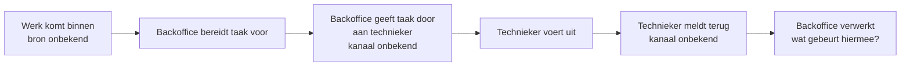
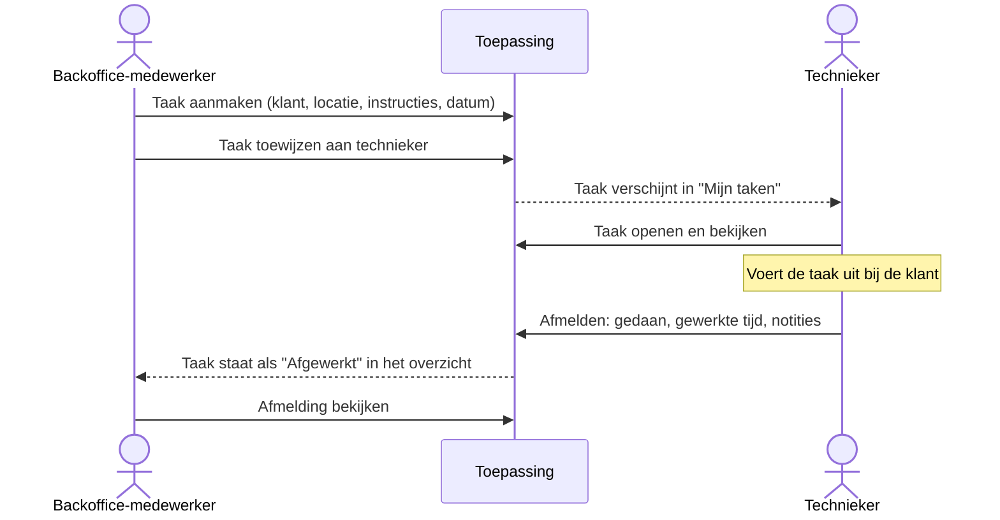

# Functionele analyse: Taakplanning

|               |                                                                                      |
| ------------- | ------------------------------------------------------------------------------------ |
| **Onderwerp** | taakplanning                                                                         |
| **Status**    | Ontwerp, wacht op antwoorden van de klant                                            |
| **Bron**      | Eerste gesprek, 23/11/2026 (`docs/input/taakplanning/2026-11-23-eerste-gesprek.txt`) |
| **Datum**     | 23/11/2026                                                                           |

> **Lees dit eerst.** De input voor deze analyse is één korte beschrijving uit een eerste gesprek.
> Alles wat niet letterlijk in dat gesprek staat, is in dit document als **aanname** (hoofdstuk 11)
> of als **open vraag** (hoofdstuk 12) opgenomen. Vragen gemarkeerd met **[BLOKKEREND]** moeten
> beantwoord zijn voor het ontwerp kan starten.

---

## 1. Samenvatting

De klant wil dat de backoffice-medewerker taken kan inplannen, met instructies, locatie en klantinformatie, en elke taak aan een technieker kan toewijzen (eerste gesprek, 23/11/2026). De technieker voert de taak uit en meldt af: of ze gedaan is, hoe lang er gewerkt is en eventuele notities. De backoffice-medewerker moet die afmelding kunnen zien. Hoe dit vandaag gebeurt en wat er precies misloopt, weten we nog niet. We stellen een kleine eerste versie voor: taken aanmaken, toewijzen, afmelden en opvolgen, zonder koppelingen met andere software.

---

## 2. Context

### Het bedrijf

- Een kleine KMO met minstens één backoffice-medewerker en techniekers die taken uitvoeren (eerste gesprek, 23/11/2026).
- Sector, aantal techniekers, soort werk en werkgebied zijn niet gekend (zie open vragen V1, V2).

### Betrokken mensen en rollen

| Rol                             | Wat we weten                                                                                                                           | Bron                                              |
| ------------------------------- | -------------------------------------------------------------------------------------------------------------------------------------- | ------------------------------------------------- |
| **Zaakvoerder / opdrachtgever** | Spreekt over "mijn backoffice medewerker"; is dus vermoedelijk de zaakvoerder. Of die zelf ook in de toepassing werkt, is niet gekend. | Eerste gesprek, 23/11/2026 (rol afgeleid, zie A1) |
| **Backoffice-medewerker**       | Plant taken in, wijst ze toe aan een technieker, bekijkt de afmeldingen. Er wordt over één persoon gesproken.                          | Eerste gesprek, 23/11/2026                        |
| **Technieker**                  | Pikt een toegewezen taak op, voert ze uit, meldt af met status, gewerkte tijd en notities. Er zijn er vermoedelijk meerdere.           | Eerste gesprek, 23/11/2026                        |

### Begrippen van de klant

- **Taak**: een opdracht die bij een klant uitgevoerd moet worden, met instructies, locatie en klantinformatie.
- **Inplannen**: een taak aanmaken en (vermoedelijk) een datum geven. Of "inplannen" ook een concreet tijdstip betekent, is een open vraag (V5).
- **Oppikken**: de technieker neemt een aan hem toegewezen taak op zich. Of dit een aparte stap is ("ik begin eraan") of gewoon "ik zie mijn taak", is een open vraag (V8).
- **Afmelden** (onze term): de technieker geeft aan dat de taak gedaan is, met gewerkte tijd en notities.

### Huidige tools

Niet gekend. Het gesprek vermeldt niet hoe taken vandaag worden doorgegeven (papier, telefoon, WhatsApp, Excel, agenda, ...). Zie open vraag V3.

---

## 3. Huidig proces (as-is)

Het huidige proces is **niet beschreven** in de input. Onderstaande stappen zijn enkel de
taakverdeling die de klant noemt; _hoe_ het vandaag gebeurt, moeten we nog navragen (V3, V4).

| #   | Stap                                                            | Wie                   | Bron                       |
| --- | --------------------------------------------------------------- | --------------------- | -------------------------- |
| 1   | Er komt werk binnen voor een klant                              | Onbekend              | Afgeleid (A2)              |
| 2   | Taak voorbereiden: wat moet er gebeuren, waar, voor welke klant | Backoffice-medewerker | Eerste gesprek, 23/11/2026 |
| 3   | Taak doorgeven aan een technieker                               | Backoffice-medewerker | Eerste gesprek, 23/11/2026 |
| 4   | Taak uitvoeren                                                  | Technieker            | Eerste gesprek, 23/11/2026 |
| 5   | Terugmelden: gedaan, gewerkte tijd, opmerkingen                 | Technieker            | Eerste gesprek, 23/11/2026 |
| 6   | Terugmelding verwerken (bv. voor facturatie?)                   | Backoffice-medewerker | Onbekend (V12)             |

---

## 4. Knelpunten

De klant heeft **geen knelpunten expliciet genoemd**. Dat er een toepassing gevraagd wordt,
doet vermoeden dat het vandaag beter kan, maar wat er concreet misloopt weten we niet.

Mogelijke knelpunten die we bij de klant moeten **toetsen** (geen feiten, zie V4):

- Informatie over een taak (adres, klantgegevens, instructies) raakt onderweg kwijt of is onvolledig.
- De backoffice weet niet goed welke taken klaar zijn en welke nog openstaan.
- Gewerkte uren worden laat, onvolledig of op papier doorgegeven en moeten overgetypt worden.
- Notities van techniekers (bv. "onderdeel ontbreekt, nieuwe afspraak nodig") komen niet of te laat aan.

---

## 5. Gewenst proces (to-be)

Voorstel voor de **eerste versie**, gebaseerd op wat de klant vraagt (eerste gesprek, 23/11/2026):

| #   | Stap                                                                             | Wie                   |
| --- | -------------------------------------------------------------------------------- | --------------------- |
| 1   | Backoffice maakt een taak aan: klant, locatie, instructies, (geplande datum)     | Backoffice-medewerker |
| 2   | Backoffice wijst de taak toe aan één technieker                                  | Backoffice-medewerker |
| 3   | Technieker ziet zijn toegewezen taken (op gsm, aanname A4)                       | Technieker            |
| 4   | Technieker opent de taak en voert ze uit                                         | Technieker            |
| 5   | Technieker meldt af: gedaan, gewerkte tijd, notities                             | Technieker            |
| 6   | Backoffice ziet in het overzicht welke taken afgemeld zijn, met tijd en notities | Backoffice-medewerker |

**Voorgestelde statussen van een taak** (aanname A6, ter bevestiging):
`Open` (aangemaakt, nog niet toegewezen) → `Toegewezen` → `Afgewerkt`.
Een tussenstatus `Bezig` of `Niet afgewerkt` voegen we pas toe als de klant dat nodig vindt (V8, V9).

---

## 6. Rollen en rechten

Voorstel voor de eerste versie (aanname A5). Te bevestigen door de klant (V6, V7).

| Actie                                  | Backoffice-medewerker | Technieker            |
| -------------------------------------- | --------------------- | --------------------- |
| Taak aanmaken, wijzigen, toewijzen     | Ja                    | Nee                   |
| Alle taken zien                        | Ja                    | Nee                   |
| Eigen toegewezen taken zien            | n.v.t.                | Ja                    |
| Taken van andere techniekers zien      | Ja                    | Nee (V7)              |
| Taak afmelden (status, tijd, notities) | Nee (V10)             | Ja, enkel eigen taken |
| Afmelding bekijken                     | Ja                    | Ja, enkel eigen taken |
| Klanten beheren                        | Ja                    | Nee                   |
| Gebruikers (techniekers) beheren       | Ja (V6)               | Nee                   |

**Vervanging bij afwezigheid** (vaak vergeten):

- Als de backoffice-medewerker afwezig is: wie plant dan in? Vermoedelijk de zaakvoerder (V6). In het voorstel krijgt de zaakvoerder dezelfde rechten als de backoffice.
- Als een technieker ziek is: de backoffice wijst diens taken toe aan iemand anders (zit in US-04).

---

## 7. User stories

Prioriteit: **Must** = nodig in de eerste versie, **Should** = liefst in de eerste versie,
**Could** = later, als er vraag naar is.

### US-01 Taak aanmaken (Must)

**Als** backoffice-medewerker **wil ik** een taak aanmaken met klant, locatie en instructies **zodat** de technieker weet wat er waar moet gebeuren.
Bron: eerste gesprek, 23/11/2026.

- **Gegeven** ik ben aangemeld als backoffice-medewerker
  **Wanneer** ik een nieuwe taak aanmaak met een klant, een locatie en instructies en bewaar
  **Dan** staat de taak in het takenoverzicht met status "Open".
- **Gegeven** ik maak een nieuwe taak aan
  **Wanneer** ik bewaar zonder instructies in te vullen
  **Dan** krijg ik een melding dat de instructies verplicht zijn en wordt de taak niet bewaard. _(Welke velden verplicht zijn: V5.)_
- **Gegeven** ik maak een taak aan
  **Wanneer** ik een geplande datum invul
  **Dan** wordt die datum bij de taak getoond. _(Datum of datum + uur: V5.)_

### US-02 Taak toewijzen aan een technieker (Must)

**Als** backoffice-medewerker **wil ik** een taak aan één technieker toewijzen **zodat** duidelijk is wie ze uitvoert.
Bron: eerste gesprek, 23/11/2026 ("Elke taak moet dan toegewezen worden aan een technieker").

- **Gegeven** een taak met status "Open"
  **Wanneer** ik een technieker kies en bewaar
  **Dan** krijgt de taak status "Toegewezen" en verschijnt ze in de takenlijst van die technieker.
- **Gegeven** ik wijs een taak toe
  **Wanneer** ik de lijst met techniekers open
  **Dan** zie ik enkel actieve techniekers.

### US-03 Mijn taken bekijken (Must)

**Als** technieker **wil ik** een lijst van mijn toegewezen taken zien op mijn gsm **zodat** ik weet wat ik moet doen.
Bron: eerste gesprek, 23/11/2026 ("die de taak kan oppikken"); gsm-gebruik is aanname A4.

- **Gegeven** ik ben aangemeld als technieker en er zijn drie taken aan mij toegewezen
  **Wanneer** ik "Mijn taken" open
  **Dan** zie ik die drie taken, gesorteerd op geplande datum, en geen taken van andere techniekers.
- **Gegeven** ik open een taak
  **Wanneer** het detail verschijnt
  **Dan** zie ik de instructies, de locatie en de klantgegevens.
- **Gegeven** ik gebruik een gsm
  **Wanneer** ik de lijst en het detail bekijk
  **Dan** is alles leesbaar en bruikbaar zonder in te zoomen.

### US-04 Toewijzing wijzigen (Should)

**Als** backoffice-medewerker **wil ik** een taak aan een andere technieker kunnen toewijzen **zodat** ik kan bijsturen bij ziekte of drukte.
Bron: aanname A7 (afwezigheid).

- **Gegeven** een taak met status "Toegewezen" aan technieker A
  **Wanneer** ik ze toewijs aan technieker B
  **Dan** verdwijnt de taak uit de lijst van A en verschijnt ze in de lijst van B.
- **Gegeven** een taak met status "Afgewerkt"
  **Wanneer** ik de toewijzing probeer te wijzigen
  **Dan** kan dat niet.

### US-05 Taak afmelden (Must)

**Als** technieker **wil ik** een taak afmelden met de gewerkte tijd en eventuele notities **zodat** de backoffice weet dat het werk gedaan is en hoe lang het duurde.
Bron: eerste gesprek, 23/11/2026.

- **Gegeven** een taak die aan mij is toegewezen
  **Wanneer** ik "Afmelden" kies, de gewerkte tijd invul en bewaar
  **Dan** krijgt de taak status "Afgewerkt" met de ingevulde tijd en de datum van afmelding.
- **Gegeven** ik meld een taak af
  **Wanneer** ik geen gewerkte tijd invul
  **Dan** krijg ik een melding dat de gewerkte tijd verplicht is. _(Te bevestigen, V9.)_
- **Gegeven** ik meld een taak af
  **Wanneer** ik een notitie invul
  **Dan** wordt die notitie bij de taak bewaard; een notitie is niet verplicht.
- **Gegeven** een taak die aan een andere technieker is toegewezen
  **Wanneer** ik die probeer af te melden
  **Dan** kan dat niet.

### US-06 Takenoverzicht en afmeldingen opvolgen (Must)

**Als** backoffice-medewerker **wil ik** een overzicht van alle taken met hun status, technieker, gewerkte tijd en notities **zodat** ik zie wat gedaan is en wat nog openstaat.
Bron: eerste gesprek, 23/11/2026 ("De backoffice medewerker moet dat dan kunnen zien").

- **Gegeven** er zijn taken met verschillende statussen
  **Wanneer** ik het takenoverzicht open
  **Dan** zie ik per taak de klant, de geplande datum, de technieker en de status.
- **Gegeven** het takenoverzicht
  **Wanneer** ik filter op status of op technieker
  **Dan** zie ik enkel de taken die aan de filter voldoen.
- **Gegeven** een afgewerkte taak
  **Wanneer** ik ze open
  **Dan** zie ik de gewerkte tijd, de notities, wie afmeldde en wanneer.

### US-07 Klanten bijhouden (Should)

**Als** backoffice-medewerker **wil ik** een klant één keer invoeren en bij volgende taken terug selecteren **zodat** ik klantgegevens niet telkens opnieuw moet typen.
Bron: aanname A3 (klant komt terug bij meerdere taken). Mogelijk volstaat in versie 1 vrije tekst bij de taak (V11).

- **Gegeven** een klant die al bestaat
  **Wanneer** ik een nieuwe taak aanmaak
  **Dan** kan ik de klant zoeken op naam en selecteren, en worden adres en contactgegevens ingevuld.
- **Gegeven** een taak voor een klant
  **Wanneer** de werklocatie verschilt van het klantadres
  **Dan** kan ik een andere locatie invullen voor deze taak.

### US-08 Techniekers beheren (Must)

**Als** backoffice-medewerker (of zaakvoerder) **wil ik** techniekers toevoegen en uitschakelen **zodat** enkel wie bij het bedrijf werkt toegang heeft.
Bron: aanname A5; noodzakelijk om taken te kunnen toewijzen.

- **Gegeven** een nieuwe technieker
  **Wanneer** ik naam en e-mailadres invul en bewaar
  **Dan** krijgt die persoon een uitnodiging om zich aan te melden.
- **Gegeven** een technieker die vertrekt
  **Wanneer** ik die uitschakel
  **Dan** kan die zich niet meer aanmelden, maar blijven zijn afgewerkte taken zichtbaar in de historiek.

### US-09 Locatie openen in navigatie (Could)

**Als** technieker **wil ik** vanuit de taak het adres openen in mijn navigatie-app **zodat** ik niet hoef over te typen.
Bron: aanname A4.

- **Gegeven** een taak met een adres
  **Wanneer** ik op het adres tik
  **Dan** opent het adres in de kaarten-app van mijn gsm.

### US-10 Foto's bij afmelding (Could)

**Als** technieker **wil ik** een foto toevoegen bij mijn afmelding **zodat** de backoffice ziet wat er gedaan of vastgesteld is.
Bron: niet gevraagd; enkel voorstellen als de klant dit wil (V13).

- **Gegeven** ik meld een taak af
  **Wanneer** ik een foto neem of kies
  **Dan** wordt die foto bij de afmelding bewaard en kan de backoffice ze bekijken.

---

## 8. Gegevens

Functionele beschrijving, geen databaseontwerp.

### Taak

| Veld                           | Toelichting                   | Bron                                            |
| ------------------------------ | ----------------------------- | ----------------------------------------------- |
| Omschrijving / instructies     | Wat er gedaan moet worden     | Eerste gesprek, 23/11/2026                      |
| Locatie                        | Adres waar het werk gebeurt   | Eerste gesprek, 23/11/2026                      |
| Klant                          | Voor wie het werk is          | Eerste gesprek, 23/11/2026                      |
| Geplande datum (en uur?)       | Wanneer de taak moet gebeuren | "inplannen", eerste gesprek; invulling: V5      |
| Toegewezen technieker          | Precies één technieker        | Eerste gesprek, 23/11/2026; één of meerdere: V8 |
| Status                         | Open, Toegewezen, Afgewerkt   | Aanname A6                                      |
| Aangemaakt door, aangemaakt op | Voor opvolging                | Aanname                                         |

### Afmelding (hoort bij één taak)

| Veld                       | Toelichting                                          | Bron                                 |
| -------------------------- | ---------------------------------------------------- | ------------------------------------ |
| Gedaan ja/nee              | Of de taak gedaan is                                 | Eerste gesprek, 23/11/2026           |
| Gewerkte tijd              | Hoe lang er gewerkt is (in uren en minuten, aanname) | Eerste gesprek, 23/11/2026; vorm: V9 |
| Notities                   | Vrije tekst, niet verplicht                          | Eerste gesprek, 23/11/2026           |
| Afgemeld door, afgemeld op | Wie en wanneer                                       | Aanname                              |

### Klant

| Veld             | Toelichting             | Bron                                           |
| ---------------- | ----------------------- | ---------------------------------------------- |
| Naam             | Persoon of bedrijf      | "klant informatie", eerste gesprek, 23/11/2026 |
| Adres            | Standaard werklocatie   | Aanname                                        |
| Telefoon, e-mail | Om contact op te nemen  | Aanname; welke gegevens precies: V11           |
| Opmerkingen      | Bv. "sleutel bij buren" | Aanname                                        |

### Gebruiker

| Veld              | Toelichting                                          |
| ----------------- | ---------------------------------------------------- |
| Naam, e-mailadres | Om aan te melden                                     |
| Rol               | Backoffice of technieker (zaakvoerder: V6)           |
| Actief ja/nee     | Uitgeschakelde gebruikers kunnen niet meer aanmelden |

### Relaties

- Een **klant** heeft nul of meer **taken**.
- Een **taak** hoort bij precies één **klant** en is toegewezen aan (hoogstens) één **technieker**.
- Een **taak** heeft hoogstens één **afmelding** (eerste versie; meerdere bezoeken voor één taak: V9).

### Persoonsgegevens en GDPR

- Klantgegevens (naam, adres, telefoon, e-mail) zijn **persoonsgegevens** als het om particulieren gaat. We bewaren enkel wat nodig is om de taak uit te voeren.
- Gegevens van techniekers (naam, e-mail, gewerkte tijd) zijn ook persoonsgegevens. Gewerkte tijd kan gebruikt worden om prestaties te beoordelen; de klant moet techniekers informeren waarvoor de tijd gebruikt wordt (V14).
- Hoe lang afgewerkte taken en klantgegevens bewaard blijven, moet de klant beslissen (V15).
- Data wordt in de EU bewaard (volgens de technologiekeuzes van het project).

---

## 9. Koppelingen

In het gesprek wordt **geen enkele koppeling** gevraagd. De eerste versie werkt daarom op zichzelf.

Mogelijke koppelingen om na te vragen (V12), niet in versie 1:

| Tool                                     | Mogelijke richting             | Waarom                                   |
| ---------------------------------------- | ------------------------------ | ---------------------------------------- |
| Boekhoud- of facturatiepakket            | Toepassing → boekhouding       | Gewerkte tijd doorgeven om te factureren |
| Loonadministratie / sociaal secretariaat | Toepassing → loonadministratie | Gewerkte uren van techniekers            |
| Agenda (Google, Outlook)                 | Toepassing → agenda            | Taken in de agenda van de technieker     |
| E-mail                                   | Toepassing → technieker        | Melding bij nieuwe taak (V10)            |

Een eenvoudige tussenoplossing die de klant mogelijk volstaat: een **export naar Excel/CSV**
van afgewerkte taken met gewerkte tijd (te bevestigen, V12).

---

## 10. Niet in scope (eerste versie)

Voorstel; de klant kan items naar voren halen.

- Koppelingen met boekhouding, facturatie, loonadministratie of agenda.
- Facturen of offertes opmaken.
- Materiaal- of voorraadbeheer (gebruikte onderdelen).
- Handtekening van de klant bij afmelding.
- Automatische routeplanning of een kalenderweergave met slepen.
- Terugkerende taken (bv. jaarlijks onderhoud).
- Werken zonder internetverbinding (offline).
- Klanten die zelf taken aanvragen of de status opvolgen.
- Meldingen per sms of pushbericht.
- Foto's bij afmelding (US-10, Could).

---

## 11. Aannames

| #   | Aanname                                                                                                  | Waarom we dit aannemen                             |
| --- | -------------------------------------------------------------------------------------------------------- | -------------------------------------------------- |
| A1  | De gesprekspartner is de zaakvoerder.                                                                    | Spreekt over "mijn backoffice medewerker".         |
| A2  | Taken zijn werk bij klanten op locatie.                                                                  | Het gesprek vermeldt locatie en klantinformatie.   |
| A3  | Eenzelfde klant komt bij meerdere taken terug.                                                           | Gebruikelijk bij technische diensten; niet gezegd. |
| A4  | Techniekers gebruiken de toepassing op hun gsm, onderweg.                                                | Ze werken op locatie; niet gezegd.                 |
| A5  | Er zijn twee rollen: backoffice en technieker. De zaakvoerder krijgt dezelfde rechten als de backoffice. | Enkel deze twee rollen worden genoemd.             |
| A6  | Drie statussen volstaan: Open, Toegewezen, Afgewerkt.                                                    | Eenvoudigste vorm van wat gevraagd wordt.          |
| A7  | De backoffice moet een toewijzing kunnen wijzigen (ziekte, drukte).                                      | Gebeurt in elk klein bedrijf; niet gezegd.         |
| A8  | Eén taak wordt door één technieker in één bezoek afgewerkt.                                              | "toegewezen aan een technieker" (enkelvoud).       |
| A9  | Gewerkte tijd wordt als duur ingevuld (bv. 1u30), niet als begin- en einduur.                            | Eenvoudigst; "hoe lang er gewerkt is".             |
| A10 | Er zijn geen bestaande gegevens (klantenlijst, openstaande taken) die overgezet moeten worden.           | Niets vermeld; zie V16.                            |
| A11 | Het aantal gebruikers is klein (1 backoffice, een handvol techniekers).                                  | KMO van 0 tot 20 werknemers.                       |

---

## 12. Open vragen voor de klant

Vragen met **[BLOKKEREND]** moeten beantwoord zijn voor het ontwerp kan starten.
De andere vragen kunnen tijdens het ontwerp beantwoord worden.

### Over het bedrijf en vandaag

1. **[BLOKKEREND]** Wat voor werk doen uw techniekers (bv. installatie, herstelling, onderhoud), en hoeveel techniekers en backoffice-medewerkers zullen de toepassing gebruiken?
2. Werken de techniekers bij particulieren, bij bedrijven, of bij beide?
3. **[BLOKKEREND]** Hoe gebeurt het vandaag? Hoe krijgt een technieker zijn taken (papier, telefoon, WhatsApp, Excel, agenda, ...) en hoe laat hij weten dat het gedaan is? Kunt u een voorbeeld tonen (een werkbon, een Excel, een bericht)?
4. **[BLOKKEREND]** Wat loopt er vandaag mis of kost te veel tijd? Wat moet de nieuwe toepassing in de eerste plaats oplossen?

### Over de taak

5. **[BLOKKEREND]** Welke gegevens moet de backoffice bij een taak invullen, en welke zijn verplicht? Plant u op een dag, of ook op een uur (bv. "dinsdag 14u")?
6. **[BLOKKEREND]** Wie werkt er met de toepassing aan de kant van het kantoor: enkel de backoffice-medewerker, of ook uzelf? Wie plant in als de backoffice-medewerker afwezig is? Wie voegt nieuwe techniekers toe?
7. Mogen techniekers ook de taken van collega's zien, bijvoorbeeld om elkaar te helpen of over te nemen?
8. **[BLOKKEREND]** Wordt een taak altijd door één technieker uitgevoerd, of gaan er soms twee of meer samen? Wat bedoelt u met "oppikken": moet de technieker laten weten dat hij aan de taak begonnen is, of volstaat het dat hij ze ziet staan?
9. **[BLOKKEREND]** Wat als een taak niet in één keer klaar raakt (bv. onderdeel ontbreekt, klant niet thuis)? Moet de technieker dan kunnen afmelden als "niet afgewerkt" met een reden? Hoe wil u de gewerkte tijd ingevuld zien: als duur (1u30) of met begin- en einduur? Telt verplaatsingstijd mee?
10. Mag de backoffice zelf een taak afmelden namens een technieker (bv. als die belt)? Moet een technieker een melding krijgen (bv. e-mail) als er een nieuwe taak voor hem is?
11. Welke klantgegevens heeft de technieker nodig ter plaatse (naam, adres, telefoon, opmerkingen)? Wil u een vaste klantenlijst bijhouden, of volstaat het om de gegevens telkens bij de taak te typen?

### Over wat er nadien gebeurt

12. **[BLOKKEREND]** Wat doet u met de gewerkte tijd en de notities na de afmelding? Gebruikt u ze om te factureren, voor de lonen, of enkel ter info? Met welk boekhoud- of facturatieprogramma werkt u? Zou een export naar Excel in het begin volstaan?
13. Wil de technieker foto's kunnen toevoegen bij een afmelding? Is een handtekening van de klant nodig?

### Over gegevens, privacy en praktische zaken

14. Weten de techniekers dat hun gewerkte tijd geregistreerd wordt, en waarvoor die gebruikt wordt?
15. Hoe lang wil u afgewerkte taken en klantgegevens bijhouden (bv. 1 jaar, 7 jaar voor de boekhouding)?
16. Is er al een klantenlijst of een lijst met openstaande taken die we in het begin moeten overnemen? In welke vorm (Excel, boekhoudpakket, ...)?
17. Hebben alle techniekers een smartphone van het werk, en is er ter plaatse meestal internet (gsm-bereik)? Zijn er plaatsen zonder bereik, zoals kelders?
18. Wanneer zou u de eerste versie graag gebruiken, en is er een vast moment (bv. rustige periode) om te starten?
