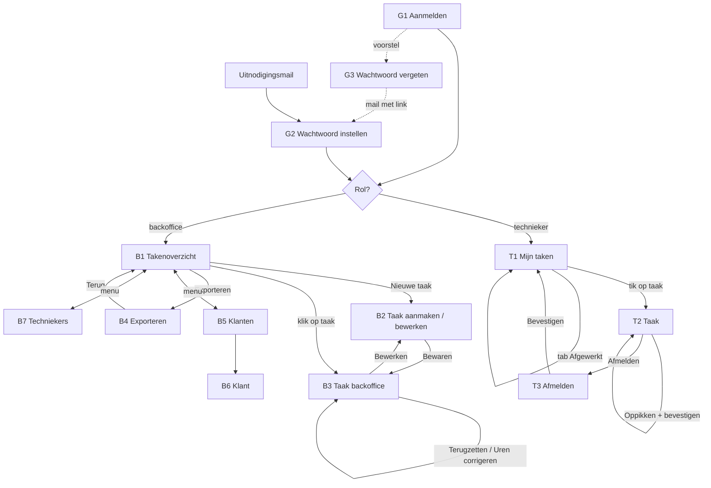
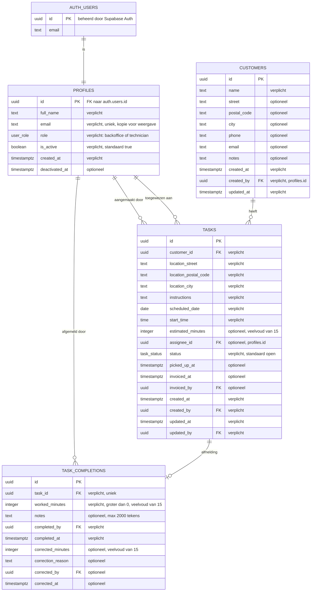

# Ontwerp: Taakplanning

|                  |                                                                                      |
| ---------------- | ------------------------------------------------------------------------------------ |
| **Onderwerp**    | taakplanning                                                                         |
| **Status**       | Versie 1: ter goedkeuring door Jurgen (eventueel samen met de klant)                 |
| **Gebaseerd op** | `docs/analysis/taakplanning.md` versie 2, met aannames A12 tot A22                   |
| **Stack**        | `docs/tech-stack.md`, ADR-0001 (TypeScript + Next.js), ADR-0002 (Supabase + Drizzle) |
| **Mockups**      | `docs/design/screens/taakplanning/index.html`                                        |
| **Datum**        | 23/11/2026                                                                           |

> **Kort.** Twee kleine toepassingen in één: een **gsm-scherm voor de technieker** (mijn taken,
> oppikken, afmelden) en een **laptopscherm voor de backoffice** (taken inplannen en opvolgen,
> uren nakijken, exporteren voor de facturatie, klanten en techniekers beheren).
> Het ontwerp volgt de aannames A12–A22. Waar het ontwerp iets toevoegt of een keuze maakt die
> niet in de analyse staat, staat dat in hoofdstuk 9 (voorstellen) of hoofdstuk 10 (keuzes voor Jurgen).

---

## 1. Schermoverzicht

Elk scherm heeft een code: **G** = gemeenschappelijk, **T** = technieker (gsm eerst),
**B** = backoffice en zaakvoerder (laptop eerst, maar bruikbaar op gsm).

| Code | Scherm                         | Doel                                                                                    | User stories               | Mockup(s)                                                                                             |
| ---- | ------------------------------ | --------------------------------------------------------------------------------------- | -------------------------- | ----------------------------------------------------------------------------------------------------- |
| G1   | Aanmelden                      | Aanmelden met e-mail en wachtwoord; daarna naar het startscherm van de rol              | US-03, US-06, US-08        | `aanmelden.html`                                                                                      |
| G2   | Wachtwoord instellen           | Na de uitnodigingsmail zelf een wachtwoord kiezen                                       | US-08                      | `wachtwoord-instellen.html`                                                                           |
| G3   | Wachtwoord vergeten (voorstel) | Een nieuwe link vragen om het wachtwoord opnieuw in te stellen                          | Voorstel P1                | `wachtwoord-vergeten.html`                                                                            |
| T1   | Mijn taken                     | Lijst van de eigen taken; tab "Te doen" (standaard) en tab "Afgewerkt"                  | US-03, US-05               | `t-mijn-taken.html`, `t-mijn-taken-afgewerkt.html`                                                    |
| T2   | Taak (technieker)              | Alle info om de taak uit te voeren; knop **Oppikken** of **Afmelden** naargelang status | US-03, US-11, US-05, US-09 | `t-taak-toegewezen.html`, `t-taak-opgepikt.html`, `t-taak-afgewerkt.html`                             |
| T3   | Afmelden                       | Gewerkte uren (per kwartier) en notities invullen                                       | US-05                      | `t-afmelden.html`                                                                                     |
| B1   | Takenoverzicht                 | Alle taken met status, technieker, datum; filteren; afgewerkte taken factureren         | US-06, US-14               | `b-taken.html`, `b-taken-afgewerkt.html`                                                              |
| B2   | Taak aanmaken / bewerken       | Eén formulier: klant, locatie, instructies, datum, startuur, duur, technieker           | US-01, US-02, US-04, US-07 | `b-taak-nieuw.html`, `b-taak-bewerken.html`                                                           |
| B3   | Taak (backoffice)              | Detail met tijdlijn; acties Bewerken, Terugzetten, Uren corrigeren, Gefactureerd        | US-04, US-06, US-12, US-14 | `b-taak-toegewezen.html`, `b-taak-opgepikt.html`, `b-taak-afgewerkt.html`, `b-taak-gefactureerd.html` |
| B4   | Exporteren                     | Afgewerkte taken van een periode downloaden als bestand voor Excel                      | US-13                      | `b-export.html`                                                                                       |
| B5   | Klanten                        | Klantenlijst met zoeken                                                                 | US-07                      | `b-klanten.html`                                                                                      |
| B6   | Klant aanmaken / bewerken      | Gegevens van één klant                                                                  | US-07                      | `b-klant.html`                                                                                        |
| B7   | Techniekers                    | Techniekers uitnodigen en uitschakelen                                                  | US-08                      | `b-techniekers.html`                                                                                  |

Dialogen (geen apart scherm, wel in de mockups te openen): **Oppikken bevestigen** (T2),
**Terugzetten** (B3), **Uren corrigeren** (B3), **Technieker toevoegen** en **Technieker uitschakelen** (B7),
**Markeer als gefactureerd** (B1, B3).

Totaal: 13 schermen (waarvan 1 voorstel), 21 mockupbestanden plus `index.html`.

---

## 2. Navigatie



- **Technieker**: één hoofdscherm (Mijn taken). Bovenaan enkel de naam en "Uitloggen".
  Geen menu nodig.
- **Backoffice**: vaste menubalk bovenaan met **Taken**, **Klanten**, **Techniekers**, en rechts de naam en "Uitloggen".
- Na aanmelden gaat elke gebruiker automatisch naar het startscherm van zijn rol.
  Een technieker die een backoffice-adres opent, krijgt "Deze pagina is niet voor jou bedoeld" met een knop naar Mijn taken (en omgekeerd).

> Woordgebruik: in de toepassing betekent **"Afmelden"** bij een taak "de taak als gedaan melden".
> Om verwarring te vermijden heet uitloggen in de menubalk **"Uitloggen"**.

---

## 3. Schermen in detail

Algemene regels voor alle schermen:

- Datums als `di 24/11/2026`, uren als `14:00`, gewerkte uren als `1u30`. Tijdzone altijd Europe/Brussels.
- Statuslabels met vaste kleur: **Open** (grijs), **Toegewezen** (blauw), **Opgepikt** (oranje), **Afgewerkt** (groen), **Gefactureerd** (paars). Het label staat er altijd ook in tekst, nooit enkel kleur.
- Foutmeldingen bij een veld staan onder het veld, in rood, en zeggen wat de gebruiker moet doen. Bovenaan het formulier komt een samenvatting ("Vul de 2 gemarkeerde velden in.") met de focus erop.
- Na een geslaagde actie: korte bevestiging bovenaan ("Taak bewaard.").
- Lukt een actie niet door een technisch probleem of geen internet: "Dat is niet gelukt. Controleer je internetverbinding en probeer opnieuw." De ingevulde gegevens blijven staan.
- Doet iemand anders intussen iets met dezelfde taak (bv. de backoffice zet terug terwijl de technieker afmeldt): "Deze taak is intussen gewijzigd. Bekijk de taak opnieuw." met een knop die de pagina herlaadt.
- Alle knoppen en velden zijn met het toetsenbord bereikbaar; elk veld heeft een zichtbaar label; tikdoelen op gsm minstens 44 px hoog.

### G1 Aanmelden

- **Inhoud**: naam van het bedrijf, velden **E-mailadres** en **Wachtwoord**, knop **Aanmelden**. Link "Wachtwoord vergeten?" (voorstel P1).
- **Acties**: aanmelden; daarna naar T1 (technieker) of B1 (backoffice).
- **Foutmeldingen**:
  - Leeg veld: "Vul je e-mailadres in." / "Vul je wachtwoord in."
  - Verkeerde combinatie: "Dit e-mailadres en wachtwoord passen niet bij elkaar. Probeer opnieuw." (Nooit zeggen welk van de twee fout is.)
  - Uitgeschakelde gebruiker: "Je account is uitgeschakeld. Neem contact op met kantoor."
- **Lege toestand**: n.v.t.
- **Rechten**: iedereen; aangemelde gebruikers worden doorgestuurd naar hun startscherm.

### G2 Wachtwoord instellen

- **Inhoud**: "Welkom, Kevin. Kies een wachtwoord om de planning te gebruiken." Velden **Nieuw wachtwoord** en **Herhaal wachtwoord**, met de regel "Minstens 8 tekens". Knop **Wachtwoord bewaren**.
- **Acties**: bewaren; daarna meteen aangemeld en naar het startscherm van de rol.
- **Foutmeldingen**: "Je wachtwoord moet minstens 8 tekens hebben." / "De twee wachtwoorden zijn niet gelijk." / Verlopen link: "Deze link is niet meer geldig. Vraag kantoor om een nieuwe uitnodiging."
- **Rechten**: enkel bereikbaar via een geldige link uit de uitnodigingsmail.

### G3 Wachtwoord vergeten (voorstel P1)

- **Inhoud**: veld **E-mailadres**, knop **Stuur mij een link**. Na versturen altijd dezelfde melding: "Als dit e-mailadres bij ons gekend is, krijg je binnen enkele minuten een mail." (verraadt niet welke adressen bestaan).
- De link in de mail leidt naar G2.

### T1 Mijn taken (technieker, gsm)

- **Inhoud**:
  - Tabs **Te doen** (standaard) en **Afgewerkt**.
  - **Te doen**: taken met status Toegewezen of Opgepikt, gesorteerd op datum en startuur. Een opgepikte taak staat altijd bovenaan in een oranje kader "Bezig". Daaronder gegroepeerd per dag: "Vandaag", "Morgen", daarna `wo 25/11`. Taken met een datum in het verleden die nog niet afgemeld zijn, staan bovenaan met het label "Te laat".
  - Per taak (kaart): startuur, klantnaam, gemeente, eerste regel van de instructies, statuslabel, eventueel geschatte duur.
  - **Afgewerkt**: eigen afgemelde taken van de laatste 30 dagen, nieuwste eerst, met datum, klant en de zelf ingevulde uren. Statussen Afgewerkt en Gefactureerd worden voor de technieker allebei als "Afgewerkt" getoond.
- **Acties**: tik op een taak → T2. Uitloggen.
- **Lege toestand**: "Je hebt geen taken. Nieuwe taken verschijnen hier zodra kantoor ze aan jou toewijst." / tab Afgewerkt: "Je hebt de laatste 30 dagen nog geen taken afgemeld."
- **Rechten**: enkel taken met `assignee_id` = de aangemelde technieker. Geen taken van collega's (V7).

### T2 Taak (technieker, gsm)

- **Inhoud** (van boven naar onder): statuslabel, **datum en startuur**, geschatte duur; **klant** (naam, telefoon als bel-link, opmerkingen zoals "sleutel bij buren"); **locatie** (adres, aantikbaar om te openen in de kaarten-app, US-09); **instructies** (volledige tekst).
- **Grote knop onderaan het scherm** (blijft zichtbaar bij scrollen):
  - Status Toegewezen: **Oppikken**. Opent een bevestiging: "Taak oppikken? Kantoor ziet dan dat je onderweg bent naar Bakkerij De Gouden Korst. Je kan dit niet zelf ongedaan maken." Knoppen **Ja, ik vertrek** en **Annuleren**.
  - Status Opgepikt: oranje melding "Opgepikt om 08:12" en knop **Afmelden** → T3.
  - Status Afgewerkt/Gefactureerd: geen knop. Blok "Afgemeld op ma 23/11 om 11:47 — 1u30 gewerkt" en de notities, enkel lezen.
- **Foutmeldingen**:
  - "Je hebt al een andere taak opgepikt (Fam. Van Dyck). Meld die eerst af." Zie keuze K5: standaard laten we dit **toe** zonder blokkeren; deze melding is enkel nodig als Jurgen kiest voor "maximaal één opgepikte taak".
  - Taak intussen teruggezet of aan een collega gegeven: "Deze taak is niet meer aan jou toegewezen. Bel kantoor als dit niet klopt." en terug naar T1.
- **Rechten**: enkel eigen taken; andere id → "Deze taak bestaat niet of is niet aan jou toegewezen." (geen verschil tonen tussen beide, zodat niets uitlekt).

### T3 Afmelden (technieker, gsm)

- **Inhoud**: klantnaam en datum ter herkenning; **Gewerkte uren** met grote knoppen **−** en **+** per kwartier, de waarde groot in het midden (`1u30`) en snelkeuzes `0u30`, `1u00`, `1u30`, `2u00`. Hulptekst: "Enkel de tijd bij de klant. De verplaatsing telt niet mee." **Notities** (niet verplicht), groot tekstvak met voorbeeldtekst "Bv. filter vervangen, toestel lekt licht aan binnenunit". Knop **Taak afmelden**, link **Annuleren**.
- Start op 0u00; de knop − is uitgeschakeld op 0u00; maximum 16u00.
- **Foutmeldingen**: "Vul de gewerkte uren in. Dat moet minstens 0u15 zijn." / Notitie te lang (> 2000 tekens): "Je notitie is te lang. Houd het korter dan 2000 tekens."
- **Na bevestigen**: terug naar T1 met "Taak afgemeld. Bedankt!".
- **Rechten**: enkel eigen taak met status Opgepikt.

### B1 Takenoverzicht (backoffice, laptop)

- **Inhoud**:
  - Titel "Taken", knoppen rechts: **Nieuwe taak** (hoofdactie) en **Exporteren**.
  - Statusfilter als tabs met aantallen: **Actief** (Open + Toegewezen + Opgepikt + Afgewerkt, standaard), Open, Toegewezen, Opgepikt, Afgewerkt, Gefactureerd, Alle.
  - Filters: **Technieker** (keuzelijst, ook uitgeschakelde techniekers), **Periode van / tot** (op geplande datum). Knop "Filters wissen".
  - Tabel: Datum + startuur, Klant (+ gemeente), Instructies (eerste regel), Technieker, Status, Uren. Bij Opgepikt staat onder het label "sinds 08:12". Bij gecorrigeerde uren een klein label "gecorrigeerd".
  - Sortering: geplande datum en startuur, oudste eerst; bij Afgewerkt en Gefactureerd nieuwste eerst.
  - Op gsm-breedte wordt de tabel een lijst van kaarten.
- **Tab Afgewerkt** (facturatie): extra kolom met selectievakjes en een vak "Alles selecteren". Zodra iets geselecteerd is, verschijnt een balk: "3 taken geselecteerd — **Markeer als gefactureerd**". Bevestiging: "3 taken markeren als gefactureerd? De uren kunnen daarna niet meer gewijzigd worden."
- **Acties**: rij aanklikken → B3; Nieuwe taak → B2; Exporteren → B4; markeren als gefactureerd.
- **Lege toestand**: zonder taken: "Er zijn nog geen taken. Maak je eerste taak aan." + knop **Nieuwe taak**. Met filter zonder resultaat: "Geen taken gevonden voor deze filter." + knop "Filters wissen".
- **Rechten**: enkel backoffice.

### B2 Taak aanmaken / bewerken (backoffice)

Eén formulier in drie blokken. Verplichte velden met een sterretje en de legende "* verplicht".

1. **Klant** *: zoekveld (typ een deel van de naam, telefoon of gemeente; toont max. 8 resultaten).
   - Klant gekozen: kaartje met naam, adres en telefoon, en link "Andere klant kiezen".
   - Niet gevonden: knop **+ Nieuwe klant** opent extra velden: Naam *, Telefoon, E-mail, Opmerkingen. Het adres van de nieuwe klant wordt het adres uit blok 2. De klant wordt bewaard samen met de taak.
2. **Locatie** *: Straat en nummer *, Postcode *, Gemeente *. Bij het kiezen van een klant worden deze ingevuld met het klantadres; aanpasbaar per taak (US-07). Hulptekst: "Wijzig je hier het adres, dan geldt dat enkel voor deze taak."
3. **Taak**: Instructies * (tekstvak, eerste regel is de korte omschrijving in lijsten: hulptekst zegt dat), Datum *, Startuur * (per kwartier), Geschatte duur (niet verplicht, per kwartier), **Technieker**: keuzelijst met enkel actieve techniekers + optie "Nog niet toewijzen".

- **Knoppen**: **Taak bewaren** (hoofdactie), **Annuleren**.
- **Statusregel bij bewaren**: technieker gekozen → Toegewezen; "Nog niet toewijzen" → Open.
- **Bewerken**:
  - Kan bij Open, Toegewezen en Opgepikt. Bij Afgewerkt en Gefactureerd is er geen knop Bewerken (US-04).
  - Bij Toegewezen kan de technieker gewijzigd worden (taak verschuift naar de lijst van de nieuwe technieker). "Nog niet toewijzen" wordt dan niet meer aangeboden (geen overgang terug naar Open in de analyse; zie voorstel P2).
  - Bij Opgepikt is de keuzelijst Technieker uitgeschakeld met de uitleg "Deze taak is opgepikt. Gebruik 'Terugzetten' om een andere technieker te kiezen."
- **Foutmeldingen**: "Kies een klant of maak een nieuwe klant aan." / "Vul de straat en het huisnummer in." / "Vul een geldige postcode in (4 cijfers)." / "Vul de gemeente in." / "Beschrijf wat de technieker moet doen." / "Kies een datum." / "Kies een startuur." / Gekozen technieker intussen uitgeschakeld: "Kevin Wouters is niet meer actief. Kies een andere technieker."
  - Datum in het verleden is toegestaan (bv. iets achteraf inplannen), maar toont de waarschuwing "Deze datum ligt in het verleden."
- **Rechten**: enkel backoffice.

### B3 Taak (backoffice)

- **Inhoud**: titel = klantnaam, statuslabel, geplande datum en startuur, technieker. Blokken **Klant**, **Locatie**, **Instructies**, en een **Tijdlijn**: Aangemaakt (wie, wanneer), Toegewezen aan, Opgepikt om, Afgemeld om, Uren gecorrigeerd, Gefactureerd (wie, wanneer).
- Blok **Afmelding** (vanaf Afgewerkt): **Gewerkte uren** groot (de geldende uren), notities van de technieker, afgemeld door en om. Bij een correctie: "Oorspronkelijk door Kevin Wouters ingevuld: 2u00. Gecorrigeerd naar 1u30 door Sofie Peeters op 23/11 om 14:05. Reden: …"
- **Acties per status**:

  | Status       | Acties                                                                                                                      |
  | ------------ | --------------------------------------------------------------------------------------------------------------------------- |
  | Open         | **Bewerken** (o.a. technieker kiezen)                                                                                       |
  | Toegewezen   | **Bewerken** (o.a. andere technieker)                                                                                       |
  | Opgepikt     | **Terugzetten**, Bewerken (zonder technieker)                                                                               |
  | Afgewerkt    | **Markeer als gefactureerd**, Uren corrigeren                                                                               |
  | Gefactureerd | **Markering ongedaan maken** (bevestiging: "De taak staat dan terug op Afgewerkt en de uren kunnen weer gewijzigd worden.") |

- **Dialoog Terugzetten**: uitleg "Gebruik dit als de taak niet kon doorgaan, bv. de klant was niet thuis." Velden: Technieker (standaard de huidige, enkel actieve), Datum, Startuur (standaard de huidige). Knop **Terugzetten**. Resultaat: status Toegewezen; tijdstip van oppikken wordt gewist.
- **Dialoog Uren corrigeren**: toont "Ingevuld door Kevin Wouters: 2u00". Velden **Nieuwe uren** * (per kwartier) en **Reden** *. Knop **Correctie bewaren**. Foutmeldingen: "Vul de nieuwe uren in. Dat moet minstens 0u15 zijn." / "Geef een reden voor de correctie, bv. 'pauze niet afgetrokken'." / Status intussen Gefactureerd: "Deze taak is al gefactureerd. Maak eerst de markering ongedaan als je de uren wilt wijzigen."
- **Lege toestand**: n.v.t. (onbestaande taak: "Deze taak bestaat niet (meer)." met link naar B1).
- **Rechten**: enkel backoffice.

### B4 Exporteren (backoffice)

- **Inhoud**: uitleg "Download de afgewerkte taken van een periode. Het bestand opent in Excel." Velden **Van** * en **Tot en met** * (standaard: de vorige maand), keuze **Welke taken**: "Enkel nog te factureren (Afgewerkt)" (standaard) of "Afgewerkt en gefactureerd". Voorbeeld van de kolommen. Knop **Download**.
- **Periode** = de datum waarop de technieker de taak afmeldde.
- **Kolommen in het bestand**: Datum, Klant, Adres, Technieker, Omschrijving (instructies), Gewerkte uren (decimaal, `1,5`), Notities, Status. Gewerkte uren = gecorrigeerde uren als die er zijn, anders de uren van de technieker.
- **Na de download**: melding "Het bestand met 12 taken is gedownload. Markeer de taken als gefactureerd zodra je ze gefactureerd hebt." met link naar B1, tab Afgewerkt, met dezelfde periode.
- **Foutmeldingen**: "Er zijn geen afgewerkte taken tussen 01/11/2026 en 30/11/2026. Er is niets te exporteren." / "De einddatum moet na de begindatum liggen." / "Kies een begin- en einddatum."
- **Rechten**: enkel backoffice.

### B5 Klanten (backoffice)

- **Inhoud**: zoekveld (naam, gemeente, telefoon), knop **Nieuwe klant**, tabel: Naam, Adres, Telefoon, Aantal taken, Laatste taak. Klik → B6.
- **Lege toestand**: "Er zijn nog geen klanten. Klanten worden ook automatisch toegevoegd als je een taak voor een nieuwe klant aanmaakt." + knop **Nieuwe klant**. Zoeken zonder resultaat: "Geen klant gevonden voor 'xyz'."
- **Rechten**: enkel backoffice.

### B6 Klant aanmaken / bewerken (backoffice)

- **Inhoud**: Naam *, Straat en nummer, Postcode, Gemeente, Telefoon, E-mail, Opmerkingen (bv. "Sleutel bij de buren op nr. 14"). Bij bewerken eronder: lijst van de taken van deze klant (datum, status, technieker), klik → B3. Knop **Nieuwe taak voor deze klant** → B2 met de klant ingevuld.
- **Knoppen**: **Klant bewaren**, Annuleren.
- **Foutmeldingen**: "Vul de naam van de klant in." / "Dit e-mailadres is niet geldig. Controleer het of laat het leeg." / "Vul een geldige postcode in (4 cijfers)."
- Een adreswijziging bij de klant past bestaande taken **niet** aan (de taak heeft een eigen locatie).
- **Rechten**: enkel backoffice. Verwijderen van klanten zit niet in de analyse (zie voorstel P6, GDPR).

### B7 Techniekers (backoffice)

- **Inhoud**: knop **Technieker toevoegen**; tabel: Naam, E-mailadres, Status (Actief / Uitgenodigd / Uitgeschakeld), Open taken (Toegewezen + Opgepikt). Per actieve technieker een knop **Uitschakelen**.
- **Dialoog Technieker toevoegen**: Naam *, E-mailadres *. Knop **Uitnodiging versturen**. Resultaat: "Uitnodiging verstuurd naar kevin.wouters@…". De technieker staat als "Uitgenodigd" tot hij een wachtwoord instelde. Bij een uitgenodigde technieker de knop **Uitnodiging opnieuw versturen**.
- **Dialoog Uitschakelen**: "Bram Claes uitschakelen? Hij kan zich dan niet meer aanmelden. Zijn afgewerkte taken en uren blijven bewaard." Knop **Uitschakelen**.
- **Foutmeldingen**: "Vul de naam in." / "Vul een geldig e-mailadres in." / "Er bestaat al een gebruiker met dit e-mailadres." / Uitschakelen met open taken: "Uitschakelen kan nog niet. Kevin Wouters heeft nog taken die niet afgewerkt zijn (6). Wijs die eerst aan een andere technieker toe." met knop "Toon zijn taken" naar B1 gefilterd op deze technieker.
- **Lege toestand**: "Er zijn nog geen techniekers. Voeg je eerste technieker toe; hij krijgt een mail om een wachtwoord te kiezen."
- **Rechten**: enkel backoffice (A15: backoffice en zaakvoerder).

### Rechten samengevat

| Scherm     | Technieker            | Backoffice / zaakvoerder |
| ---------- | --------------------- | ------------------------ |
| G1, G2, G3 | Ja                    | Ja                       |
| T1, T2, T3 | Ja, enkel eigen taken | Nee (zie voorstel P7)    |
| B1 tot B7  | Nee                   | Ja                       |

---

## 4. Statussen en overgangen

| Van          | Naar         | Wie        | Voorwaarde                                               | Server Action    |
| ------------ | ------------ | ---------- | -------------------------------------------------------- | ---------------- |
| (nieuw)      | Open         | Backoffice | Geen technieker gekozen                                  | `createTask`     |
| (nieuw)      | Toegewezen   | Backoffice | Actieve technieker gekozen                               | `createTask`     |
| Open         | Toegewezen   | Backoffice | Actieve technieker gekozen                               | `updateTask`     |
| Toegewezen   | Toegewezen   | Backoffice | Andere actieve technieker                                | `updateTask`     |
| Toegewezen   | Opgepikt     | Technieker | Taak is aan hem toegewezen; hij is actief                | `pickUpTask`     |
| Opgepikt     | Toegewezen   | Backoffice | Eventueel andere technieker/datum; `picked_up_at` gewist | `resetTask`      |
| Opgepikt     | Afgewerkt    | Technieker | Eigen taak; uren > 0 en veelvoud van 15 min              | `completeTask`   |
| Afgewerkt    | Afgewerkt    | Backoffice | Uren corrigeren met reden                                | `correctHours`   |
| Afgewerkt    | Gefactureerd | Backoffice | Een of meerdere taken                                    | `markInvoiced`   |
| Gefactureerd | Afgewerkt    | Backoffice | Markering ongedaan maken; `invoiced_at/by` gewist        | `unmarkInvoiced` |

Alle andere overgangen worden geweigerd. De regels staan in één pure TypeScript-module
(`src/lib/tasks/transitions.ts`) met unit tests voor elke combinatie van rol en status.
Elke overgang wordt in de database uitgevoerd als **voorwaardelijke update**
(`UPDATE … WHERE id = $1 AND status = 'assigned' AND assignee_id = $user`). Raakt die 0 rijen,
dan is de taak intussen gewijzigd en krijgt de gebruiker de melding uit hoofdstuk 3.

---

## 5. Datamodel

Binnen ADR-0002: gebruikers en wachtwoorden in **Supabase Auth** (`auth.users`); alle eigen tabellen
in het schema `public`, beheerd met **Drizzle**-migraties; **RLS aan op elke tabel** in de migratie die ze aanmaakt.
Tabel- en veldnamen in het Engels.



### Enums

- `user_role`: `backoffice`, `technician` (zaakvoerder = `backoffice`, A15).
- `task_status`: `open`, `assigned`, `picked_up`, `completed`, `invoiced` (getoond als Open, Toegewezen, Opgepikt, Afgewerkt, Gefactureerd).

### Regels in de database (check constraints)

- `tasks`: `status = 'open'` ⇔ `assignee_id IS NULL`.
- `tasks`: `picked_up_at IS NOT NULL` als `status IN ('picked_up','completed','invoiced')`.
- `tasks`: `invoiced_at` en `invoiced_by` allebei gevuld ⇔ `status = 'invoiced'`.
- `tasks.estimated_minutes`, `task_completions.worked_minutes`, `corrected_minutes`: `> 0` en `% 15 = 0`.
- `task_completions`: `corrected_minutes`, `correction_reason`, `corrected_by`, `corrected_at` zijn samen leeg of samen gevuld.
- Een `task_completions`-rij bestaat enkel voor taken met status `completed` of `invoiced` (gecontroleerd in de Server Action, in dezelfde transactie).

### Keuzes in het model

- **Uren als minuten (integer)**: geen afrondingsfouten. Weergave `1u30`, export `1,5`.
- **Geldende uren** = `coalesce(corrected_minutes, worked_minutes)`; de oorspronkelijke uren blijven altijd bewaard (A19).
- **Locatie op de taak** is een kopie van het klantadres op het moment van aanmaken, aanpasbaar per taak (US-07). Latere wijzigingen aan de klant veranderen oude taken niet; dat is ook juist voor de facturatie.
- **Datum + startuur** als `date` + `time` zonder tijdzone (lokale Belgische planning, A22). Tijdstippen van gebeurtenissen (`*_at`) als `timestamptz`.
- **Afmelding in een aparte tabel** (1 op 1), zodat de correctievelden netjes bij de afmelding horen.
- **Geen statusgeschiedenis-tabel**: de tijdlijn in B3 gebruikt de velden hierboven. Bij Terugzetten gaat het vorige oppiktijdstip verloren; zie voorstel P5 als de klant dat wil bewaren.
- **Indexen**: `tasks(assignee_id, status, scheduled_date)`, `tasks(status, scheduled_date)`, `task_completions(completed_at)`, `customers(lower(name))`.
- **Verwijderen**: niets wordt in de eerste versie verwijderd. Foreign keys `ON DELETE RESTRICT`. `profiles.id` → `auth.users.id` met `ON DELETE RESTRICT` (een gebruiker wordt uitgeschakeld, nooit verwijderd, zodat uren traceerbaar blijven).

### Row Level Security

- RLS staat aan op `profiles`, `customers`, `tasks` en `task_completions`, in dezelfde migratie die de tabel aanmaakt.
- **Geen enkele policy voor de rollen `anon` en `authenticated`**: via de publieke Supabase-API is alle toegang tot deze tabellen geweigerd. De browser gebruikt `supabase-js` enkel voor aanmelden, uitloggen en sessies (ADR-0002, regel 1).
- Drizzle verbindt server-side met de database (connection string als environment variable, nooit `NEXT_PUBLIC_`). Alle autorisatie zit in de Server Actions (ADR-0002, regel 3); RLS is het vangnet tegen rechtstreekse API-toegang.
- Een test in de CI-pipeline (of een migratietest) controleert dat elke tabel in `public` RLS aan heeft, zodat een vergeten tabel opvalt.

---

## 6. Technische aanpak (Next.js App Router)

> Let op: het project gebruikt **Next.js 16**. Daar heet `middleware.ts` nu **`proxy.ts`**. De developer leest de gidsen in `node_modules/next/dist/docs/` (zie `AGENTS.md`).

### Mappenstructuur (voorstel)

```text
src/
  proxy.ts                         # sessie verversen (Supabase SSR), niet-aangemelden naar /login
  app/
    login/page.tsx                 # G1
    forgot-password/page.tsx       # G3 (voorstel P1)
    auth/confirm/route.ts          # verwerkt de link uit uitnodigings- en resetmail
    set-password/page.tsx          # G2
    page.tsx                       # stuurt door naar /my-tasks of /tasks volgens rol
    (technician)/
      layout.tsx                   # requireRole('technician'); smalle gsm-layout
      my-tasks/page.tsx            # T1 (?tab=done)
      my-tasks/[id]/page.tsx       # T2
      my-tasks/[id]/complete/page.tsx  # T3
      my-tasks/actions.ts          # pickUpTask, completeTask
    (backoffice)/
      layout.tsx                   # requireRole('backoffice'); menubalk
      tasks/page.tsx               # B1 (filters via searchParams)
      tasks/new/page.tsx           # B2
      tasks/[id]/page.tsx          # B3
      tasks/[id]/edit/page.tsx     # B2 in bewerkmodus
      tasks/export/page.tsx        # B4 (formulier)
      tasks/export/download/route.ts   # GET: levert het CSV-bestand
      tasks/actions.ts             # createTask, updateTask, resetTask, correctHours, markInvoiced, unmarkInvoiced
      customers/page.tsx           # B5
      customers/new/page.tsx       # B6
      customers/[id]/page.tsx      # B6 bewerken
      customers/actions.ts         # createCustomer, updateCustomer, searchCustomers
      technicians/page.tsx         # B7
      technicians/actions.ts       # inviteTechnician, resendInvite, deactivateTechnician
  db/
    schema.ts                      # Drizzle-schema (enige plaats voor tabeldefinities)
    client.ts                      # 'server-only'; Drizzle-client
  lib/
    auth/session.ts                # getCurrentUser(), requireRole(); leest sessie + profiel, checkt is_active
    supabase/server.ts, browser.ts, admin.ts   # admin.ts = service role, 'server-only'
    tasks/transitions.ts           # pure statusregels (unit tests)
    tasks/queries.ts               # leesfuncties voor lijsten en detail
    time/format.ts                 # 90 → "1u30", 90 → "1,5", datums nl-BE, Europe/Brussels
    validation/*.ts                # Zod-schema's, gedeeld door formulier en Server Action
    export/csv.ts                  # CSV opbouwen (unit tests)
  components/ui/                   # shadcn/ui-componenten
  components/                      # StatusBadge, HoursStepper, CustomerPicker, AppHeader
```

URL's zijn in het Engels (code-conventie); de gebruiker ziet ze nauwelijks.
Wil Jurgen Nederlandse URL's (`/mijn-taken`), dan is dat enkel een hernoeming.

### Authenticatie en rollen

- **Aanmelden** met e-mail en wachtwoord via Supabase Auth (`@supabase/ssr`, cookies). Sessies blijven lang geldig, zodat een technieker niet elke dag opnieuw moet aanmelden.
- **Rol en actief/uitgeschakeld** staan in `profiles`. `requireRole()` haalt bij elk verzoek de gebruiker op (`supabase.auth.getUser()`, niet enkel de cookie vertrouwen) en daarna het profiel via Drizzle. Geen profiel of `is_active = false` → uitloggen en melding op G1.
- **Uitnodigen**: `inviteTechnician` gebruikt server-side `auth.admin.inviteUserByEmail` (service role key) en maakt in dezelfde stap het profiel aan. De link in de mail gaat naar `/auth/confirm` → `/set-password`.
- **Uitschakelen**: `is_active = false` (werkt onmiddellijk door de controle in `requireRole`) en daarnaast de gebruiker in Supabase Auth blokkeren (`ban_duration`), zodat hij ook geen nieuwe sessie krijgt.
- **Eerste backoffice-gebruiker** (zaakvoerder of backoffice-medewerker): via een eenmalig script `pnpm seed:backoffice <naam> <e-mail>` dat Jurgen lokaal draait met de service role key. Geen scherm om backoffice-gebruikers toe te voegen (zie voorstel P4).

### Server Actions en validatie

- Elke Server Action volgt hetzelfde patroon:
  1. `requireRole(...)` (rol + actief);
  2. input valideren met het Zod-schema (ook al valideert het formulier al in de browser);
  3. eigendom en status controleren (bv. taak is van deze technieker) via de overgangsregels;
  4. voorwaardelijke update in een transactie;
  5. `revalidatePath` en een resultaat `{ ok: true } | { ok: false, fieldErrors, formError }` met Nederlandse meldingen.
- Formulieren werken met `useActionState`; Client Components enkel voor de urenstepper, de klantenzoeker, de selectievakjes in B1 en de dialogen.
- `markInvoiced` krijgt een lijst id's; enkel taken met status Afgewerkt worden gemarkeerd, de rest wordt gemeld ("2 taken waren al gefactureerd").
- **Autorisatietests**: per Server Action een test dat een technieker geen backoffice-actie kan doen, een technieker geen taak van een collega kan oppikken of afmelden, en een uitgeschakelde gebruiker niets kan.

### Export

- Route handler `GET /tasks/export/download?from=…&to=…&scope=completed|all` (backoffice-only, zelfde `requireRole`).
- Formaat: **CSV met puntkomma als scheidingsteken, UTF-8 met BOM, decimale komma**. Belgische Excel opent dit rechtstreeks met de juiste kolommen en accenten, en er is geen extra dependency nodig. Bestandsnaam `taken-2026-11-01-tot-2026-11-30.csv`.
- Beveiliging tegen formule-injectie: celwaarden die beginnen met `=`, `+`, `-`, `@` krijgen een `'` ervoor (OWASP CSV injection).
- Echt `.xlsx` is mogelijk met een extra dependency: zie keuze K3.

### Tijd en taal

- Alle weergave in `nl-BE` en tijdzone `Europe/Brussels` via `Intl.DateTimeFormat` (standaardbibliotheek). "Vandaag/Morgen" in T1 rekent in Belgische tijd, niet in de tijdzone van de server.

### Dependencies (vragen goedkeuring, zie CLAUDE.md)

Alle onderstaande vallen binnen de beslist stack, maar zijn nog niet geïnstalleerd:

| Package                                                                                                             | Waarvoor                                   | Bouwtaak |
| ------------------------------------------------------------------------------------------------------------------- | ------------------------------------------ | -------- |
| `drizzle-orm`, `drizzle-kit` (dev)                                                                                  | Database-laag en migraties (ADR-0002)      | BT-01    |
| `postgres` (postgres.js)                                                                                            | Databasedriver voor Drizzle                | BT-01    |
| `server-only`                                                                                                       | Voorkomt dat servercode in de browser komt | BT-01    |
| `@supabase/supabase-js`, `@supabase/ssr`                                                                            | Authenticatie en sessies (ADR-0002)        | BT-02    |
| `zod`                                                                                                               | Validatie (Beslist)                        | BT-02    |
| shadcn/ui-componenten en hun afhankelijkheden (o.a. Radix UI-pakketten, `class-variance-authority`, `lucide-react`) | UI-componenten (Beslist)                   | BT-04    |

Geen andere dependencies. Datums, CSV en urenberekening met de standaardbibliotheek.

### Hosting (Open)

Het ontwerp gebruikt enkel standaard Next.js (Server Components, Server Actions, route handlers,
`proxy.ts`) en geen leverancierspecifieke diensten. Het werkt dus op elke optie. Impact per optie:

| Optie                                                       | Impact op dit ontwerp                                                                                                                              |
| ----------------------------------------------------------- | -------------------------------------------------------------------------------------------------------------------------------------------------- |
| Vercel met functies in regio Frankfurt (`fra1`)             | Geen aanpassingen. Eenvoudigst. Amerikaans bedrijf: verwerkersovereenkomst en doorgifte nakijken (GDPR). Supabase in Frankfurt, dus korte afstand. |
| EU-provider met container (bv. Scaleway, Hetzner, OVHcloud) | Next.js als `output: 'standalone'` in een Docker-image. Meer beheer (updates, certificaten, monitoring) voor Jurgen of een beheerde laag erboven.  |
| EU-PaaS (bv. Scalingo, Clever Cloud)                        | Geen codewijzigingen; build-instellingen per platform. Middenweg tussen gemak en EU-leverancier.                                                   |

In alle gevallen moet de site-URL in Supabase Auth (redirect-URL's voor de uitnodigingsmail) ingesteld worden. Keuze aan Jurgen (K1).

---

## 7. Opdeling in bouwtaken

Elke bouwtaak = één branch en één pull request, met tests, en lint/typecheck/test groen.
Volgorde is bindend: latere taken bouwen op eerdere.

| #     | Bouwtaak                             | Inhoud                                                                                                                                                                                                                                                                       | User stories               | Hangt af van                 |
| ----- | ------------------------------------ | ---------------------------------------------------------------------------------------------------------------------------------------------------------------------------------------------------------------------------------------------------------------------------- | -------------------------- | ---------------------------- |
| BT-01 | Databasekoppeling Drizzle + Supabase | Dependencies (na goedkeuring), `src/db/client.ts` (server-only), `drizzle.config.ts`, scripts `db:generate` en `db:migrate`, `.env.example` (zonder waarden), test die controleert dat elke tabel in `public` RLS aan heeft. Nog geen tabellen.                              | Basis                      | Goedkeuring K2, dependencies |
| BT-02 | Gebruikersprofielen en rollen        | Migratie `profiles` + enum `user_role` + RLS; Supabase-clients (server, browser, admin); `getCurrentUser`/`requireRole`; seed-script eerste backoffice-gebruiker; unit tests voor `requireRole`.                                                                             | US-08 (basis)              | BT-01                        |
| BT-03 | Aanmelden en uitloggen               | G1, `proxy.ts` (sessie verversen, niet-aangemelden naar `/login`), uitloggen, doorsturen volgens rol, uitgeschakelde gebruiker geweigerd, route groups `(technician)` en `(backoffice)` met lege layouts en "niet voor jou bedoeld"-pagina. E2E: aanmelden als beide rollen. | US-03, US-06 (toegang)     | BT-02                        |
| BT-04 | UI-basis                             | shadcn/ui opzetten (Button, Input, Label, Textarea, Select, Badge, Card, Dialog, Table, Checkbox, Tabs, Alert); AppHeader per rol; `StatusBadge`; `time/format.ts` (uren `1u30`/`1,5`, datums nl-BE, Europe/Brussels) met unit tests.                                        | Basis                      | BT-03                        |
| BT-05 | Datamodel taken en klanten           | Migraties `customers`, `tasks`, `task_completions`, enum `task_status`, check constraints, indexen, RLS. `tasks/transitions.ts` met unit tests voor alle overgangen uit hoofdstuk 4. Zod-schema's voor taak, klant, afmelding, correctie.                                    | Basis voor alle            | BT-02                        |
| BT-06 | Techniekers uitnodigen               | B7 (lijst + dialoog toevoegen + opnieuw versturen), `/auth/confirm`, G2 Wachtwoord instellen. Tests: dubbel e-mailadres, rolcontrole.                                                                                                                                        | US-08                      | BT-04, BT-05                 |
| BT-07 | Technieker uitschakelen              | Dialoog uitschakelen in B7; weigeren bij open taken; Supabase Auth ban; tests (geen aanmelding meer, afgewerkte taken blijven zichtbaar).                                                                                                                                    | US-08                      | BT-06                        |
| BT-08 | Taak aanmaken en toewijzen           | B2 nieuw: klantenzoeker, nieuwe klant inline, locatie overnemen/aanpassen, technieker kiezen (enkel actieven), status Open/Toegewezen. Server Action `createTask` met tests.                                                                                                 | US-01, US-02, US-07 (deel) | BT-05                        |
| BT-09 | Takenoverzicht                       | B1: statustabs met aantallen, filters technieker en periode (via URL), tabel en kaarten op gsm, "sinds" bij Opgepikt, lege toestanden.                                                                                                                                       | US-06                      | BT-08                        |
| BT-10 | Taakdetail backoffice en bewerken    | B3 (info + tijdlijn + afmelding lezen) en B2 in bewerkmodus; opnieuw toewijzen bij Toegewezen; geen bewerken bij Afgewerkt/Gefactureerd. `updateTask` met tests.                                                                                                             | US-06, US-02, US-04 (deel) | BT-09                        |
| BT-11 | Mijn taken (technieker)              | T1 (tabs Te doen/Afgewerkt, groeperen per dag, Te laat) en T2 enkel lezen. Tests: enkel eigen taken, sortering. E2E op gsm-viewport.                                                                                                                                         | US-03                      | BT-08                        |
| BT-12 | Taak oppikken                        | Knop + bevestiging in T2, `pickUpTask` (voorwaardelijke update, tijdstip). Tests: andermans taak, verkeerde status, gelijktijdige wijziging.                                                                                                                                 | US-11                      | BT-11                        |
| BT-13 | Taak afmelden                        | T3 met urenstepper per kwartier, notities; `completeTask`; T2 toont afmelding enkel lezen. Tests: uren 0, geen kwartier, andermans taak, niet opgepikt.                                                                                                                      | US-05                      | BT-12                        |
| BT-14 | Taak terugzetten                     | Dialoog in B3, `resetTask` (andere technieker/datum, `picked_up_at` wissen). Tests.                                                                                                                                                                                          | US-04                      | BT-10, BT-12                 |
| BT-15 | Uren corrigeren                      | Dialoog in B3, `correctHours` met reden; oorspronkelijke uren zichtbaar; geweigerd bij Gefactureerd. Tests.                                                                                                                                                                  | US-12                      | BT-10, BT-13                 |
| BT-16 | Export voor facturatie               | B4 + route handler CSV (puntkomma, BOM, decimale komma, geldende uren, CSV-injectie afgeschermd), melding bij lege periode. Unit tests op `export/csv.ts`.                                                                                                                   | US-13                      | BT-13, BT-15                 |
| BT-17 | Markeren als gefactureerd            | Selectievakjes + balk in B1 (tab Afgewerkt), knop in B3, `markInvoiced`/`unmarkInvoiced`. Tests.                                                                                                                                                                             | US-14                      | BT-09, BT-13                 |
| BT-18 | Klantenbeheer                        | B5 en B6 (lijst, zoeken, aanmaken, wijzigen, taken van de klant, "Nieuwe taak voor deze klant").                                                                                                                                                                             | US-07                      | BT-08                        |
| BT-19 | Adres openen in kaarten-app (Could)  | Adres in T2 als link naar de kaarten-app (`https://maps.google.com/?q=…` of `geo:`); bel-link voor telefoon.                                                                                                                                                                 | US-09                      | BT-11                        |
| BT-20 | End-to-end hoofdstroom               | Playwright: aanmaken → toewijzen → oppikken (gsm) → afmelden → corrigeren → exporteren → gefactureerd. Draait in CI tegen een testdatabase (keuze K4).                                                                                                                       | Alle Must                  | BT-01 t.e.m. BT-17           |

Totaal: **20 bouwtaken**. BT-18 en BT-19 kunnen later of weggelaten worden zonder de Must-stories te raken.
Na BT-17 is de volledige Must-flow bruikbaar.

---

## 8. Traceerbaarheid

| User story                            | Prioriteit | Scherm(en)                                      | Bouwtaak(en)        |
| ------------------------------------- | ---------- | ----------------------------------------------- | ------------------- |
| US-01 Taak aanmaken                   | Must       | B2, B1                                          | BT-05, BT-08        |
| US-02 Taak toewijzen                  | Must       | B2, B3                                          | BT-08, BT-10        |
| US-03 Mijn taken bekijken             | Must       | G1, T1, T2                                      | BT-03, BT-11        |
| US-04 Toewijzing wijzigen/terugzetten | Should     | B2, B3 (dialoog Terugzetten)                    | BT-10, BT-14        |
| US-05 Taak afmelden                   | Must       | T2, T3, T1 (tab Afgewerkt)                      | BT-13               |
| US-06 Takenoverzicht en opvolging     | Must       | B1, B3                                          | BT-09, BT-10        |
| US-07 Klanten bijhouden               | Should     | B2 (klantenzoeker), B5, B6                      | BT-08, BT-18        |
| US-08 Techniekers beheren             | Must       | B7, G2                                          | BT-02, BT-06, BT-07 |
| US-09 Locatie openen in navigatie     | Could      | T2                                              | BT-19               |
| US-10 Foto's bij afmelding            | Could      | Niet in de eerste versie (analyse hoofdstuk 10) | —                   |
| US-11 Taak oppikken                   | Must       | T2 (dialoog Oppikken)                           | BT-12               |
| US-12 Gewerkte uren corrigeren        | Must       | B3 (dialoog Uren corrigeren)                    | BT-15               |
| US-13 Exporteren voor facturatie      | Must       | B4                                              | BT-16               |
| US-14 Markeren als gefactureerd       | Should     | B1 (tab Afgewerkt), B3                          | BT-17               |

Alle Must-stories (US-01, 02, 03, 05, 06, 08, 11, 12, 13) zijn gedekt.

---

## 9. Voorstellen (niet in de analyse, ter beslissing)

Deze punten zitten **niet** in de bouwtaken. Ze worden enkel gebouwd als Jurgen (met de klant) ze goedkeurt.

| #   | Voorstel                                                                                                                    | Waarom                                                                                                    | In mockup?                  |
| --- | --------------------------------------------------------------------------------------------------------------------------- | --------------------------------------------------------------------------------------------------------- | --------------------------- |
| P1  | **Wachtwoord vergeten** (G3). Supabase Auth biedt dit standaard; kleine bouwtaak na BT-03.                                  | Zonder dit moet kantoor bij elk vergeten wachtwoord een nieuwe uitnodiging sturen.                        | Ja, gemarkeerd als voorstel |
| P2  | **Taak annuleren of verwijderen** (status Open of Toegewezen), en een toegewezen taak terug op "Nog niet toewijzen" zetten. | Afspraken worden in de praktijk afgezegd; nu blijft zo'n taak in de lijst staan.                          | Nee                         |
| P3  | **Technieker opnieuw activeren** na uitschakelen.                                                                           | Bv. seizoenswerkers of iemand die terugkomt. Zonder dit is een nieuw e-mailadres nodig.                   | Nee                         |
| P4  | **Backoffice-gebruikers via het scherm toevoegen** (rol kiezen in B7, scherm dan "Gebruikers").                             | Nu moet Jurgen het seed-script draaien als er een nieuwe kantoormedewerker komt.                          | Nee                         |
| P5  | **Taaknummer** (bv. "Taak 1042") en/of een eenvoudige **statusgeschiedenis**.                                               | Handig aan de telefoon en op de factuur; geschiedenis bewaart ook een teruggezet oppikmoment.             | Nee                         |
| P6  | **Soort werk** als keuzeveld (Nazicht / Onderhoud / Herstelling) bij een taak, en in de export.                             | Maakt lijsten en facturatie overzichtelijker dan de eerste regel van de instructies.                      | Nee                         |
| P7  | De zaakvoerder ook als **technieker** laten werken (één account met beide rollen).                                          | In kleine aircobedrijven rijdt de zaakvoerder vaak zelf uit. Vraagt een kleine uitbreiding van de rollen. | Nee                         |
| P8  | **Klantgegevens anonimiseren** (GDPR-recht op vergetelheid) met behoud van uren voor de boekhouding.                        | Analyse noemt bewaartermijn (V15); verwijderen zit nergens in de eerste versie.                           | Nee                         |

Afwijkingen van de aannames A12–A22: **geen**. Twee invullingen die de analyse openliet:

- De technieker ziet na een correctie **zijn eigen ingevulde uren**, niet de gecorrigeerde (hangt samen met V21). Eenvoudig om te keren.
- De tab "Afgewerkt" in Mijn taken toont de **laatste 30 dagen**.

---

## 10. Keuzes die Jurgen nog moet maken

| #   | Keuze                                                                                                                                                                                                                                                                                                         | Nodig vóór                           |
| --- | ------------------------------------------------------------------------------------------------------------------------------------------------------------------------------------------------------------------------------------------------------------------------------------------------------------- | ------------------------------------ |
| K1  | **Hosting** (Open in tech-stack): zie de impacttabel in hoofdstuk 6. Het ontwerp werkt op alle opties.                                                                                                                                                                                                        | Livegang; redirect-URL's vanaf BT-06 |
| K2  | **Goedkeuring dependencies** uit hoofdstuk 6 (allemaal binnen de beslist stack).                                                                                                                                                                                                                              | BT-01                                |
| K3  | **Exportformaat**: CSV dat in Excel opent (voorstel, geen dependency) of echt `.xlsx` (extra dependency, bv. `exceljs`; mooiere opmaak, kolombreedtes).                                                                                                                                                       | BT-16                                |
| K4  | **Testdatabase voor end-to-end tests in CI**: (a) lokale Supabase via de Supabase CLI in GitHub Actions (gratis, Docker, niets extern), of (b) een apart Supabase-testproject (eenvoudiger opzetten, extra kosten en secrets in GitHub). Beide vragen een aanpassing van de CI-configuratie, dus goedkeuring. | BT-03 (eerste E2E), uiterlijk BT-20  |
| K5  | **Meerdere taken tegelijk opgepikt?** Het ontwerp laat het toe (geen blokkering). Alternatief: maximaal één opgepikte taak per technieker, met melding. Vraag eventueel aan de klant.                                                                                                                         | BT-12                                |
| K6  | **E-mail voor uitnodigingen**: de ingebouwde mailserver van Supabase is enkel voor testen (beperkt aantal mails per uur). Voor gebruik bij de klant is een eigen SMTP-dienst nodig, liefst in de EU, met afzender op het domein van de klant of van Elmija. Dit is configuratie in Supabase, geen code.       | Livegang                             |
| K7  | Voorstellen **P1 tot P8** goedkeuren of schrappen.                                                                                                                                                                                                                                                            | Voor de betrokken bouwtaak           |

### Te bevestigen bij de klant (uit de analyse, met impact op dit ontwerp)

- **V7** (techniekers zien elkaars taken?): nu nee. Ja → extra tab "Alle taken" in T1.
- **V10** (backoffice meldt af namens technieker?): nu nee. Ja → afmeldformulier ook in B3.
- **V17** (smartphone en bereik in kelders?): de toepassing werkt enkel met internet. Bij slecht bereik blijven ingevulde gegevens staan en kan opnieuw geprobeerd worden; offline werken zit niet in scope.
- **V20** (factureren per kwartier/half uur/uur): bepaalt enkel de stapgrootte van de urenstepper (nu 15 min).
