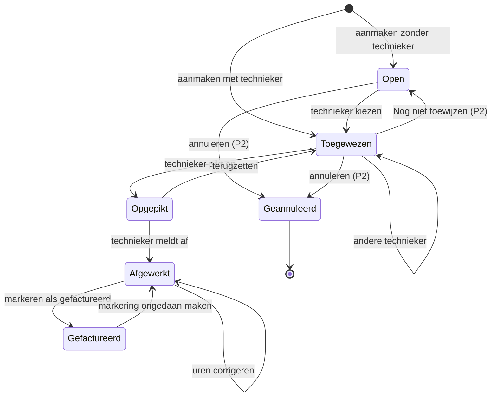
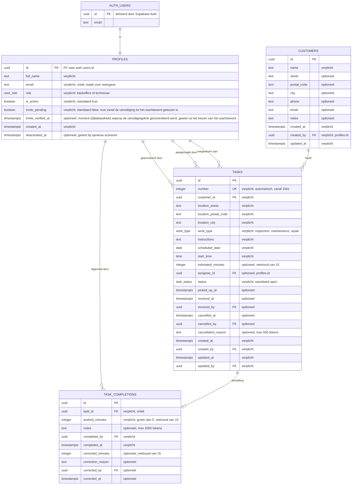

# Ontwerp: Taakplanning

|                  |                                                                                                    |
| ---------------- | -------------------------------------------------------------------------------------------------- |
| **Onderwerp**    | taakplanning                                                                                       |
| **Status**       | Versie 2: beslissingen van Jurgen van 24/11/2026 (K2–K5, K7) verwerkt; ter goedkeuring door Jurgen |
| **Gebaseerd op** | `docs/analysis/taakplanning.md` versie 2, met aannames A12 tot A22                                 |
| **Stack**        | `docs/tech-stack.md`, ADR-0001 (TypeScript + Next.js), ADR-0002 (Supabase + Drizzle)               |
| **Mockups**      | `docs/design/screens/taakplanning/index.html`                                                      |
| **Datum**        | 24/11/2026 (versie 1: 23/11/2026)                                                                  |

> **Kort.** Twee kleine toepassingen in één: een **gsm-scherm voor de technieker** (mijn taken,
> oppikken, afmelden) en een **laptopscherm voor de backoffice** (taken inplannen en opvolgen,
> uren nakijken, exporteren voor de facturatie, klanten en techniekers beheren).
> Het ontwerp volgt de aannames A12–A22. De voorstellen die Jurgen goedkeurde (P1, P2, P3, P5, P6)
> zitten nu in de schermen, het datamodel en de bouwtaken (hoofdstuk 9). Wat niet in deze versie
> komt, staat in hoofdstuk 10 (Later). Hoofdstuk 11 toont welke keuzes beslist zijn en welke nog open staan.

### Wijzigingen ten opzichte van versie 1

- **Taaknummer** (P5): elke taak krijgt een oplopend nummer (`#1042`), zichtbaar in alle lijsten, in de taakdetails en in de export.
- **Soort werk** (P6): verplicht keuzeveld Nazicht / Onderhoud / Herstelling in het taakformulier, zichtbaar in lijsten, details en export.
- **Taak annuleren** (P2): nieuwe status **Geannuleerd** (vanuit Open of Toegewezen), en een toegewezen taak kan terug op "Nog niet toewijzen" (Open).
- **Technieker opnieuw activeren** (P3) in B7.
- **Wachtwoord vergeten** (P1) is nu een gewoon onderdeel van het ontwerp (G3).
- **Meerdere opgepikte taken tegelijk** blijft toegelaten (K5); de blokkerende melding is geschrapt.
- **Export als CSV** (K3) en **end-to-end tests in CI met een lokale Supabase** (K4) zijn beslist.
- Bouwtaken: drie nieuwe (BT-06b, BT-07b, BT-14b); de bestaande nummers blijven gelijk.

---

## 1. Schermoverzicht

Elk scherm heeft een code: **G** = gemeenschappelijk, **T** = technieker (gsm eerst),
**B** = backoffice en zaakvoerder (laptop eerst, maar bruikbaar op gsm).

| Code | Scherm                    | Doel                                                                                           | User stories / voorstellen         | Mockup(s)                                                                                             |
| ---- | ------------------------- | ---------------------------------------------------------------------------------------------- | ---------------------------------- | ----------------------------------------------------------------------------------------------------- |
| G1   | Aanmelden                 | Aanmelden met e-mail en wachtwoord; daarna naar het startscherm van de rol                     | US-03, US-06, US-08, P1            | `aanmelden.html`                                                                                      |
| G2   | Wachtwoord instellen      | Na de uitnodigingsmail of de mail "wachtwoord vergeten" zelf een wachtwoord kiezen             | US-08, P1                          | `wachtwoord-instellen.html`                                                                           |
| G3   | Wachtwoord vergeten       | Een link vragen om het wachtwoord opnieuw in te stellen                                        | P1                                 | `wachtwoord-vergeten.html`                                                                            |
| T1   | Mijn taken                | Lijst van de eigen taken; tab "Te doen" (standaard) en tab "Afgewerkt"                         | US-03, US-05, P5, P6               | `t-mijn-taken.html`, `t-mijn-taken-afgewerkt.html`                                                    |
| T2   | Taak (technieker)         | Alle info om de taak uit te voeren; knop **Oppikken** of **Afmelden** naargelang status        | US-03, US-11, US-05, US-09, P5     | `t-taak-toegewezen.html`, `t-taak-opgepikt.html`, `t-taak-afgewerkt.html`                             |
| T3   | Afmelden                  | Gewerkte uren (per kwartier) en notities invullen                                              | US-05                              | `t-afmelden.html`                                                                                     |
| B1   | Takenoverzicht            | Alle taken met nummer, soort, status, technieker, datum; filteren; afgewerkte taken factureren | US-06, US-14, P2, P5, P6           | `b-taken.html`, `b-taken-afgewerkt.html`                                                              |
| B2   | Taak aanmaken / bewerken  | Eén formulier: klant, locatie, soort werk, instructies, datum, startuur, duur, technieker      | US-01, US-02, US-04, US-07, P2, P6 | `b-taak-nieuw.html`, `b-taak-bewerken.html`                                                           |
| B3   | Taak (backoffice)         | Detail met tijdlijn; acties Bewerken, Annuleren, Terugzetten, Uren corrigeren, Gefactureerd    | US-04, US-06, US-12, US-14, P2, P5 | `b-taak-toegewezen.html`, `b-taak-opgepikt.html`, `b-taak-afgewerkt.html`, `b-taak-gefactureerd.html` |
| B4   | Exporteren                | Afgewerkte taken van een periode downloaden als CSV-bestand dat in Excel opent                 | US-13, P5, P6                      | `b-export.html`                                                                                       |
| B5   | Klanten                   | Klantenlijst met zoeken                                                                        | US-07                              | `b-klanten.html`                                                                                      |
| B6   | Klant aanmaken / bewerken | Gegevens van één klant, met zijn taken                                                         | US-07, P5                          | `b-klant.html`                                                                                        |
| B7   | Techniekers               | Techniekers uitnodigen, uitschakelen en opnieuw activeren                                      | US-08, P3                          | `b-techniekers.html`                                                                                  |

Dialogen (geen apart scherm, wel in de mockups te openen): **Oppikken bevestigen** (T2),
**Taak annuleren** (B3), **Terugzetten** (B3), **Uren corrigeren** (B3), **Technieker toevoegen**,
**Technieker uitschakelen** en **Technieker opnieuw activeren** (B7), **Markeer als gefactureerd** (B1, B3).

Totaal: 13 schermen, 21 mockupbestanden plus `index.html`. Er kwam geen nieuw scherm bij:
de goedgekeurde voorstellen passen in de bestaande schermen.

---

## 2. Navigatie


- **Technieker**: één hoofdscherm (Mijn taken). Bovenaan enkel de naam en "Uitloggen".
  Geen menu nodig.
- **Backoffice**: vaste menubalk bovenaan met **Taken**, **Klanten**, **Techniekers**, en rechts de naam en "Uitloggen".
- Na aanmelden gaat elke gebruiker automatisch naar het startscherm van zijn rol.
  Een technieker die een backoffice-adres opent, krijgt "Deze pagina is niet voor jou bedoeld" met een knop naar Mijn taken (en omgekeerd).

> Woordgebruik: in de toepassing betekent **"Afmelden"** bij een taak "de taak als gedaan melden".
> Om verwarring te vermijden heet uitloggen in de menubalk **"Uitloggen"**.
> Om dezelfde reden heet de knop om een dialoog te sluiten in de dialoog **Taak annuleren** niet
> "Annuleren" maar **"Taak behouden"**.

---

## 3. Schermen in detail

Algemene regels voor alle schermen:

- Datums als `di 24/11/2026`, uren als `14:00`, gewerkte uren als `1u30`. Tijdzone altijd Europe/Brussels.
- Statuslabels met vaste kleur: **Open** (grijs), **Toegewezen** (blauw), **Opgepikt** (oranje), **Afgewerkt** (groen), **Gefactureerd** (paars), **Geannuleerd** (rood). Het label staat er altijd ook in tekst, nooit enkel kleur.
- **Taaknummer** (P5): in lijsten als `#1042` (klein, grijs, vóór of boven de klantnaam), in de taakdetails als `Taak #1042` boven de titel. De gebruiker vult het nummer nooit zelf in.
- **Soort werk** (P6): getoond als korte tekst `Nazicht`, `Onderhoud` of `Herstelling`, telkens samen met de eerste regel van de instructies of als aparte kolom.
- Foutmeldingen bij een veld staan onder het veld, in rood, en zeggen wat de gebruiker moet doen. Bovenaan het formulier komt een samenvatting ("Vul de 2 gemarkeerde velden in.") met de focus erop.
- Na een geslaagde actie: korte bevestiging bovenaan ("Taak bewaard.").
- Lukt een actie niet door een technisch probleem of geen internet: "Dat is niet gelukt. Controleer je internetverbinding en probeer opnieuw." De ingevulde gegevens blijven staan.
- Doet iemand anders intussen iets met dezelfde taak (bv. de backoffice zet terug terwijl de technieker afmeldt): "Deze taak is intussen gewijzigd. Bekijk de taak opnieuw." met een knop die de pagina herlaadt.
- Alle knoppen en velden zijn met het toetsenbord bereikbaar; elk veld heeft een zichtbaar label; tikdoelen op gsm minstens 44 px hoog.

### G1 Aanmelden

- **Inhoud**: naam van het bedrijf (instelbaar per klant via `NEXT_PUBLIC_COMPANY_NAME`; leeg = geen naam tonen), velden **E-mailadres** en **Wachtwoord**, knop **Aanmelden**. Link **Wachtwoord vergeten?** naast het label Wachtwoord → G3 (P1).
- **Acties**: aanmelden; daarna naar T1 (technieker) of B1 (backoffice).
- **Foutmeldingen**:
  - Leeg veld: "Vul je e-mailadres in." / "Vul je wachtwoord in."
  - Verkeerde combinatie: "Dit e-mailadres en wachtwoord passen niet bij elkaar. Probeer opnieuw." (Nooit zeggen welk van de twee fout is.)
  - Uitgeschakelde of geblokkeerde gebruiker die probeert **aan te melden**: dezelfde melding als bij een verkeerde combinatie ("Dit e-mailadres en wachtwoord passen niet bij elkaar. Probeer opnieuw."), ook met het juiste wachtwoord. Het scherm verraadt zo niet dat een account bestaat of uitgeschakeld is. Beslist door Jurgen, 24/11/2026.
  - Gebruiker die **tijdens een lopende sessie** wordt uitgeschakeld: bij het volgende verzoek afgemeld en naar G1 gestuurd met "Je account is uitgeschakeld. Neem contact op met kantoor." (die gebruiker was al aangemeld, dus er lekt niets uit).
  - Te veel pogingen (rate limit van Supabase Auth): "Te veel pogingen, probeer het over enkele minuten opnieuw."
- **Lege toestand**: n.v.t.
- **Rechten**: iedereen; aangemelde gebruikers worden doorgestuurd naar hun startscherm.

### G2 Wachtwoord instellen

Eén scherm voor twee situaties: de **uitnodiging** (US-08) en **wachtwoord vergeten** (P1).
De link in de mail bepaalt welke tekst getoond wordt.

- **Inhoud bij een uitnodiging**: "Welkom, Kevin. Kies een wachtwoord om de planning te gebruiken."
- **Inhoud na wachtwoord vergeten**: "Nieuw wachtwoord kiezen. Kies een nieuw wachtwoord voor kevin@frisair.be."
- Velden **Nieuw wachtwoord** en **Herhaal wachtwoord**, met de regel "Minstens 8 tekens". Knop **Wachtwoord bewaren**.
- **Acties**: bewaren; daarna meteen aangemeld en naar het startscherm van de rol. Knop **Annuleren**: verlaat het scherm zonder wachtwoord te kiezen en meldt de tijdelijke sessie af (naar G1). _Beslist door Jurgen, 25/11/2026._
- **Tussenpagina** (`/auth/confirm`, beslist door Jurgen, 25/11/2026): de link in de mail opent eerst een pagina met "Welkom bij de planning" en de knop **Wachtwoord instellen**. Pas die klik controleert het token en maakt de tijdelijke sessie. Zo verbruiken mailscanners en linkvoorbeelden die de link openen het token niet.
- **Foutmeldingen**: "Je wachtwoord moet minstens 8 tekens hebben." / "De twee wachtwoorden zijn niet gelijk." / "Gebruik een korter wachtwoord." (meer dan 72 bytes, een grens van Supabase)
  - Verlopen link (uitnodiging): "Deze link is niet meer geldig. Vraag kantoor om een nieuwe uitnodiging."
  - Tijdelijke sessie ouder dan 24 uur sinds de klik op de knop (de technieker liet het scherm open staan): afgemeld, met "De link is verlopen. Vraag kantoor om een nieuwe uitnodiging." _Beslist door Jurgen, 25/11/2026._
  - Verlopen link (wachtwoord vergeten): "Deze link is niet meer geldig. Vraag een nieuwe link aan." met een knop naar G3.
- **Rechten**: enkel bereikbaar via een geldige link uit de uitnodigingsmail of de mail "wachtwoord vergeten".

### G3 Wachtwoord vergeten (P1)

- **Inhoud**: korte uitleg, veld **E-mailadres**, knop **Stuur mij een link**, link "Terug naar aanmelden".
- **Na versturen**: altijd dezelfde melding: "Als dit e-mailadres bij ons gekend is, krijg je binnen enkele minuten een mail met een link om een nieuw wachtwoord te kiezen." Zo verraadt het scherm niet welke adressen bestaan.
- De link in de mail leidt naar G2 (variant "wachtwoord vergeten").
- **Foutmeldingen**: "Vul je e-mailadres in." / "Vul een geldig e-mailadres in."
- **Uitgeschakelde gebruiker**: krijgt dezelfde melding, maar kan zich ook met een nieuw wachtwoord niet aanmelden (Supabase-blokkering en controle op `is_active`, zie hoofdstuk 6).
- **Rechten**: iedereen.

### T1 Mijn taken (technieker, gsm)

- **Inhoud**:
  - Tabs **Te doen** (standaard) en **Afgewerkt**.
  - **Te doen**: taken met status Toegewezen of Opgepikt, gesorteerd op datum en startuur. Opgepikte taken staan altijd bovenaan in een oranje kader "Bezig"; dat kunnen er meerdere zijn (K5). Daaronder gegroepeerd per dag: "Vandaag", "Morgen", daarna `wo 25/11`. Taken met een datum in het verleden die nog niet afgemeld zijn, staan bovenaan met het label "Te laat".
  - Per taak (kaart): startuur, eventueel geschatte duur, taaknummer (`#1042`), klantnaam, gemeente, **soort werk** en de eerste regel van de instructies, statuslabel.
  - **Afgewerkt**: eigen afgemelde taken van de laatste 30 dagen, nieuwste eerst, met datum, taaknummer, klant en de zelf ingevulde uren. Statussen Afgewerkt en Gefactureerd worden voor de technieker allebei als "Afgewerkt" getoond.
  - **Geannuleerde taken** verschijnen niet in Mijn taken (in geen enkele tab).
- **Acties**: tik op een taak → T2. Uitloggen.
- **Lege toestand**: "Je hebt geen taken. Nieuwe taken verschijnen hier zodra kantoor ze aan jou toewijst." / tab Afgewerkt: "Je hebt de laatste 30 dagen nog geen taken afgemeld."
- **Rechten**: enkel taken met `assignee_id` = de aangemelde technieker. Geen taken van collega's (V7).

### T2 Taak (technieker, gsm)

- **Inhoud** (van boven naar onder): statuslabel en `Taak #1042`, **klantnaam** als titel, **soort werk**, **datum en startuur**, geschatte duur; **locatie** (adres, aantikbaar om te openen in de kaarten-app, US-09); **klant** (naam, telefoon als bel-link, opmerkingen zoals "sleutel bij buren"); **instructies** (volledige tekst).
- **Grote knop onderaan het scherm** (blijft zichtbaar bij scrollen):
  - Status Toegewezen: **Oppikken**. Opent een bevestiging: "Taak oppikken? Kantoor ziet dan dat je onderweg bent naar Bakkerij De Gouden Korst. Je kan dit niet zelf ongedaan maken." Knoppen **Ja, ik vertrek** en **Annuleren**.
  - Status Opgepikt: oranje melding "Opgepikt om 08:12" en knop **Afmelden** → T3.
  - Status Afgewerkt/Gefactureerd: geen knop. Blok "Afgemeld op ma 23/11 om 11:47 — 1u30 gewerkt" en de notities, enkel lezen.
- **Meerdere opgepikte taken** (K5): een technieker mag een taak oppikken terwijl hij al een andere opgepikt heeft. Er is geen melding of blokkering.
- **Foutmeldingen**:
  - Taak intussen teruggezet of aan een collega gegeven: "Deze taak is niet meer aan jou toegewezen. Bel kantoor als dit niet klopt." en terug naar T1.
  - Taak intussen geannuleerd (P2): "Deze taak is geannuleerd door kantoor. Je hoeft niets meer te doen." met een knop "Terug naar mijn taken". Ook als hij op dat moment op Oppikken tikt.
- **Rechten**: enkel eigen taken; andere id → "Deze taak bestaat niet of is niet aan jou toegewezen." (geen verschil tonen tussen beide, zodat niets uitlekt).

### T3 Afmelden (technieker, gsm)

- **Inhoud**: taaknummer, klantnaam en datum ter herkenning; **Gewerkte uren** met grote knoppen **−** en **+** per kwartier, de waarde groot in het midden (`1u30`) en snelkeuzes `0u30`, `1u00`, `1u30`, `2u00`. Hulptekst: "Enkel de tijd bij de klant. De verplaatsing telt niet mee." **Notities** (niet verplicht), groot tekstvak met voorbeeldtekst "Bv. filter vervangen, toestel lekt licht aan binnenunit". Knop **Taak afmelden**, link **Annuleren**.
- Start op 0u00; de knop − is uitgeschakeld op 0u00; maximum 16u00.
- **Foutmeldingen**: "Vul de gewerkte uren in. Dat moet minstens 0u15 zijn." / Notitie te lang (> 2000 tekens): "Je notitie is te lang. Houd het korter dan 2000 tekens."
- **Na bevestigen**: terug naar T1 met "Taak afgemeld. Bedankt!".
- **Rechten**: enkel eigen taak met status Opgepikt.

### B1 Takenoverzicht (backoffice, laptop)

- **Inhoud**:
  - Titel "Taken", knoppen rechts: **Nieuwe taak** (hoofdactie) en **Exporteren**.
  - Statusfilter als tabs met aantallen: **Actief** (Open + Toegewezen + Opgepikt + Afgewerkt, standaard), Open, Toegewezen, Opgepikt, Afgewerkt, Gefactureerd, **Geannuleerd**, Alle. Geannuleerde taken staan dus nooit in "Actief".
  - Filters: **Technieker** (keuzelijst, ook uitgeschakelde techniekers), **Periode van / tot** (op geplande datum). Knop "Filters wissen".
  - Tabel: **Nr.** (`#1042`), Datum + startuur, Klant (+ gemeente), **Soort**, Instructies (eerste regel), Technieker, Status, Uren. Bij Opgepikt staat onder het label "sinds 08:12". Bij gecorrigeerde uren een klein label "gecorrigeerd".
  - Sortering: geplande datum en startuur, oudste eerst; bij Afgewerkt, Gefactureerd en Geannuleerd nieuwste eerst.
  - Op gsm-breedte wordt de tabel een lijst van kaarten.
- **Tab Afgewerkt** (facturatie): extra kolom met selectievakjes en een vak "Alles selecteren". Zodra iets geselecteerd is, verschijnt een balk: "3 taken geselecteerd — **Markeer als gefactureerd**". Bevestiging: "3 taken markeren als gefactureerd? De uren kunnen daarna niet meer gewijzigd worden." Ook hier staan taaknummer en soort werk in elke rij.
- **Acties**: rij aanklikken → B3; Nieuwe taak → B2; Exporteren → B4; markeren als gefactureerd.
- **Lege toestand**: zonder taken: "Er zijn nog geen taken. Maak je eerste taak aan." + knop **Nieuwe taak**. Met filter zonder resultaat: "Geen taken gevonden voor deze filter." + knop "Filters wissen". Tab Geannuleerd leeg: "Er zijn geen geannuleerde taken."
- **Rechten**: enkel backoffice.

### B2 Taak aanmaken / bewerken (backoffice)

Eén formulier in drie blokken. Verplichte velden met een sterretje en de legende "* verplicht".

1. **Klant** *: zoekveld (typ een deel van de naam, telefoon of gemeente; toont max. 8 resultaten).
   - Klant gekozen: kaartje met naam, adres en telefoon, en link "Andere klant kiezen".
   - Niet gevonden: knop **+ Nieuwe klant** opent extra velden: Naam *, Telefoon, E-mail, Opmerkingen. Het adres van de nieuwe klant wordt het adres uit blok 2. De klant wordt bewaard samen met de taak.
2. **Locatie** *: Straat en nummer *, Postcode *, Gemeente *. Bij het kiezen van een klant worden deze ingevuld met het klantadres; aanpasbaar per taak (US-07). Hulptekst: "Wijzig je hier het adres, dan geldt dat enkel voor deze taak."
3. **Taak**:
   - **Soort werk** * (P6): drie keuzerondjes naast elkaar: **Nazicht**, **Onderhoud**, **Herstelling**. Geen standaardkeuze, zodat er bewust gekozen wordt.
   - Instructies * (tekstvak, eerste regel is de korte omschrijving in lijsten: hulptekst zegt dat), Datum *, Startuur * (per kwartier), Geschatte duur (niet verplicht, per kwartier), **Technieker**: keuzelijst met enkel actieve techniekers + optie "Nog niet toewijzen".

- **Knoppen**: **Taak bewaren** (hoofdactie), **Annuleren** (verlaat het formulier zonder te bewaren).
- **Statusregel bij bewaren**: technieker gekozen → Toegewezen; "Nog niet toewijzen" → Open.
- **Taaknummer**: wordt bij het bewaren automatisch toegekend en staat daarna bovenaan B3 en in de bevestiging ("Taak #1051 bewaard.").
- **Bewerken**:
  - Titel "Taak #1043 bewerken".
  - Kan bij Open, Toegewezen en Opgepikt. Bij Afgewerkt, Gefactureerd en Geannuleerd is er geen knop Bewerken (US-04).
  - Bij Toegewezen kan de technieker gewijzigd worden (taak verschuift naar de lijst van de nieuwe technieker), of op **"Nog niet toewijzen"** gezet worden (P2): de taak gaat dan terug naar Open en verdwijnt uit de lijst van de technieker. Hulptekst onder de keuzelijst zegt dat.
  - Bij Opgepikt is de keuzelijst Technieker uitgeschakeld met de uitleg "Deze taak is opgepikt. Gebruik 'Terugzetten' om een andere technieker te kiezen."
  - Soort werk kan gewijzigd worden zolang de taak bewerkt kan worden.
- **Foutmeldingen**: "Kies een klant of maak een nieuwe klant aan." / "Vul de straat en het huisnummer in." / "Vul een geldige postcode in (4 cijfers)." / "Vul de gemeente in." / "Kies het soort werk: nazicht, onderhoud of herstelling." / "Beschrijf wat de technieker moet doen." / "Kies een datum." / "Kies een startuur." / Gekozen technieker intussen uitgeschakeld: "Kevin Wouters is niet meer actief. Kies een andere technieker."
  - Datum in het verleden is toegestaan (bv. iets achteraf inplannen), maar toont de waarschuwing "Deze datum ligt in het verleden."
- **Rechten**: enkel backoffice.

### B3 Taak (backoffice)

- **Inhoud**: `Taak #1043` en statuslabel, titel = klantnaam, daaronder **soort werk**, geplande datum en startuur, technieker. Blokken **Klant**, **Locatie**, **Instructies**, en een **Tijdlijn**: Aangemaakt (wie, wanneer), Toegewezen aan, Opgepikt om, Afgemeld om, Uren gecorrigeerd, Gefactureerd (wie, wanneer), **Geannuleerd** (wie, wanneer, reden).
- Blok **Afmelding** (vanaf Afgewerkt): **Gewerkte uren** groot (de geldende uren), notities van de technieker, afgemeld door en om. Bij een correctie: "Oorspronkelijk door Kevin Wouters ingevuld: 2u00. Gecorrigeerd naar 1u30 door Sofie Peeters op 23/11 om 14:05. Reden: …"
- Blok **Geannuleerd** (enkel bij die status): grijze balk bovenaan "Deze taak is geannuleerd op ma 23/11 om 11:20 door Sofie Peeters. Reden: klant heeft zelf afgezegd." De rest van de taak blijft leesbaar.
- **Acties per status**:

  | Status       | Acties                                                                                                                      |
  | ------------ | --------------------------------------------------------------------------------------------------------------------------- |
  | Open         | **Bewerken** (o.a. technieker kiezen), Taak annuleren                                                                       |
  | Toegewezen   | **Bewerken** (o.a. andere technieker of "Nog niet toewijzen"), Taak annuleren                                               |
  | Opgepikt     | **Terugzetten**, Bewerken (zonder technieker)                                                                               |
  | Afgewerkt    | **Markeer als gefactureerd**, Uren corrigeren                                                                               |
  | Gefactureerd | **Markering ongedaan maken** (bevestiging: "De taak staat dan terug op Afgewerkt en de uren kunnen weer gewijzigd worden.") |
  | Geannuleerd  | Geen acties (enkel lezen)                                                                                                   |

- **Dialoog Taak annuleren** (P2): titel "Taak #1043 annuleren?". Tekst: "Gebruik dit als de afspraak niet meer doorgaat, bv. omdat de klant afzegt. De taak verdwijnt uit de planning en uit de lijst van Kevin Wouters. Ze blijft bewaard onder 'Geannuleerd'. Annuleren kan je niet ongedaan maken: moet het werk toch gebeuren, maak dan een nieuwe taak aan." Veld **Reden** (niet verplicht, max. 500 tekens, voorbeeld "Bv. klant heeft zelf afgezegd"). Knoppen **Taak behouden** en **Taak annuleren** (rood). Resultaat: status Geannuleerd, melding "Taak #1043 is geannuleerd."
  - Opgepikte taak annuleren: eerst **Terugzetten**, dan annuleren. Zo weet de technieker via kantoor dat hij niet hoeft te gaan.
  - Foutmelding als de technieker de taak intussen opgepikt heeft: "Kevin Wouters heeft deze taak intussen opgepikt. Bel hem eerst; zet de taak daarna terug als ze echt niet doorgaat."
- **Dialoog Terugzetten**: uitleg "Gebruik dit als de taak niet kon doorgaan, bv. de klant was niet thuis." Velden: Technieker (standaard de huidige, enkel actieve), Datum, Startuur (standaard de huidige). Knop **Terugzetten**. Resultaat: status Toegewezen; tijdstip van oppikken wordt gewist.
- **Dialoog Uren corrigeren**: toont "Ingevuld door Kevin Wouters: 2u00". Velden **Nieuwe uren** * (per kwartier) en **Reden** *. Knop **Correctie bewaren**. Foutmeldingen: "Vul de nieuwe uren in. Dat moet minstens 0u15 zijn." / "Geef een reden voor de correctie, bv. 'pauze niet afgetrokken'." / Status intussen Gefactureerd: "Deze taak is al gefactureerd. Maak eerst de markering ongedaan als je de uren wilt wijzigen."
- **Lege toestand**: n.v.t. (onbestaande taak: "Deze taak bestaat niet (meer)." met link naar B1).
- **Rechten**: enkel backoffice.

### B4 Exporteren (backoffice)

- **Inhoud**: uitleg "Download de afgewerkte taken van een periode. Het bestand opent in Excel." Velden **Van** * en **Tot en met** * (standaard: de vorige maand), keuze **Welke taken**: "Enkel nog te factureren (Afgewerkt)" (standaard) of "Afgewerkt en gefactureerd". Voorbeeld van de kolommen. Knop **Download**.
- **Formaat** (K3, beslist): CSV dat rechtstreeks in Excel opent, zie hoofdstuk 6.
- **Periode** = de datum waarop de technieker de taak afmeldde.
- **Kolommen in het bestand**: **Taaknummer**, Datum, Klant, Adres, Technieker, **Soort werk**, Omschrijving (instructies), Gewerkte uren (decimaal, `1,5`), Notities, Status. Gewerkte uren = gecorrigeerde uren als die er zijn, anders de uren van de technieker. Geannuleerde taken komen nooit in de export.
- **Na de download**: melding "Het bestand met 12 taken is gedownload. Markeer de taken als gefactureerd zodra je ze gefactureerd hebt." met link naar B1, tab Afgewerkt, met dezelfde periode.
- **Foutmeldingen**: "Er zijn geen afgewerkte taken tussen 01/11/2026 en 30/11/2026. Er is niets te exporteren." / "De einddatum moet na de begindatum liggen." / "Kies een begin- en einddatum."
- **Rechten**: enkel backoffice.

### B5 Klanten (backoffice)

- **Inhoud**: zoekveld (naam, gemeente, telefoon), knop **Nieuwe klant**, tabel: Naam, Adres, Telefoon, Aantal taken, Laatste taak. Klik → B6.
- **Lege toestand**: "Er zijn nog geen klanten. Klanten worden ook automatisch toegevoegd als je een taak voor een nieuwe klant aanmaakt." + knop **Nieuwe klant**. Zoeken zonder resultaat: "Geen klant gevonden voor 'xyz'."
- **Rechten**: enkel backoffice.

### B6 Klant aanmaken / bewerken (backoffice)

- **Inhoud**: Naam *, Straat en nummer, Postcode, Gemeente, Telefoon, E-mail, Opmerkingen (bv. "Sleutel bij de buren op nr. 14"). Bij bewerken eronder: lijst van de taken van deze klant (taaknummer, datum, soort werk, technieker, status, ook geannuleerde), klik → B3. Knop **Nieuwe taak voor deze klant** → B2 met de klant ingevuld.
- **Knoppen**: **Klant bewaren**, Annuleren.
- **Foutmeldingen**: "Vul de naam van de klant in." / "Dit e-mailadres is niet geldig. Controleer het of laat het leeg." / "Vul een geldige postcode in (4 cijfers)."
- Een adreswijziging bij de klant past bestaande taken **niet** aan (de taak heeft een eigen locatie).
- **Rechten**: enkel backoffice. Verwijderen of anonimiseren van klanten zit niet in deze versie (zie hoofdstuk 10, P8).

### B7 Techniekers (backoffice)

- **Inhoud**: knop **Technieker toevoegen**; tabel: Naam, E-mailadres, Status (Actief / Uitgenodigd / Uitgeschakeld), Open taken (Toegewezen + Opgepikt; geannuleerde tellen niet mee). Per actieve technieker een knop **Uitschakelen**, per uitgeschakelde technieker een knop **Opnieuw activeren** (P3).
- **Dialoog Technieker toevoegen**: Naam *, E-mailadres *. Knop **Uitnodiging versturen**. Resultaat: "Uitnodiging verstuurd naar kevin.wouters@…". De technieker staat als "Uitgenodigd" tot hij een wachtwoord instelde. Bij een uitgenodigde technieker de knop **Uitnodiging opnieuw versturen**. Die werkt ook als de technieker de link al opende maar nog geen wachtwoord koos: dan komt er een nieuwe link (zie hoofdstuk 6). _Beslist door Jurgen, 25/11/2026._
- **Dialoog Uitschakelen**: "Bram Claes uitschakelen? Hij kan zich dan niet meer aanmelden. Zijn afgewerkte taken en uren blijven bewaard." Knop **Uitschakelen**.
- **Dialoog Opnieuw activeren** (P3): "Tom Hendrickx opnieuw activeren? Hij kan zich dan weer aanmelden met zijn vorige wachtwoord. Weet hij dat niet meer, dan gebruikt hij 'Wachtwoord vergeten' op het aanmeldscherm." Knop **Opnieuw activeren**. Resultaat: status Actief, melding "Tom Hendrickx is opnieuw actief. Je kan hem weer taken toewijzen."
- **Foutmeldingen**: "Vul de naam in." / "Vul een geldig e-mailadres in." / "Er bestaat al een gebruiker met dit e-mailadres." / Uitschakelen met open taken: "Uitschakelen kan nog niet. Kevin Wouters heeft nog taken die niet afgewerkt zijn (6). Wijs die eerst aan een andere technieker toe." met knop "Toon zijn taken" naar B1 gefilterd op deze technieker.
- **Lege toestand**: "Er zijn nog geen techniekers. Voeg je eerste technieker toe; hij krijgt een mail om een wachtwoord te kiezen."
- **Rechten**: enkel backoffice (A15: backoffice en zaakvoerder).

### Rechten samengevat

| Scherm     | Technieker            | Backoffice / zaakvoerder   |
| ---------- | --------------------- | -------------------------- |
| G1, G2, G3 | Ja                    | Ja                         |
| T1, T2, T3 | Ja, enkel eigen taken | Nee (zie hoofdstuk 10, P7) |
| B1 tot B7  | Nee                   | Ja                         |

---

## 4. Statussen en overgangen

Er komt één status bij: **Geannuleerd** (`cancelled`), een eindstatus voor taken die niet meer doorgaan (P2).



| Van          | Naar         | Wie        | Voorwaarde                                                                   | Server Action    |
| ------------ | ------------ | ---------- | ---------------------------------------------------------------------------- | ---------------- |
| (nieuw)      | Open         | Backoffice | Geen technieker gekozen                                                      | `createTask`     |
| (nieuw)      | Toegewezen   | Backoffice | Actieve technieker gekozen                                                   | `createTask`     |
| Open         | Toegewezen   | Backoffice | Actieve technieker gekozen                                                   | `updateTask`     |
| Toegewezen   | Toegewezen   | Backoffice | Andere actieve technieker                                                    | `updateTask`     |
| Toegewezen   | Open         | Backoffice | "Nog niet toewijzen" gekozen; `assignee_id` gewist (P2)                      | `updateTask`     |
| Toegewezen   | Opgepikt     | Technieker | Taak is aan hem toegewezen; hij is actief (andere opgepikte taken mogen, K5) | `pickUpTask`     |
| Opgepikt     | Toegewezen   | Backoffice | Eventueel andere technieker/datum; `picked_up_at` gewist                     | `resetTask`      |
| Opgepikt     | Afgewerkt    | Technieker | Eigen taak; uren > 0 en veelvoud van 15 min                                  | `completeTask`   |
| Afgewerkt    | Afgewerkt    | Backoffice | Uren corrigeren met reden                                                    | `correctHours`   |
| Afgewerkt    | Gefactureerd | Backoffice | Een of meerdere taken                                                        | `markInvoiced`   |
| Gefactureerd | Afgewerkt    | Backoffice | Markering ongedaan maken; `invoiced_at/by` gewist                            | `unmarkInvoiced` |
| Open         | Geannuleerd  | Backoffice | Reden niet verplicht; `cancelled_at/by` gevuld (P2)                          | `cancelTask`     |
| Toegewezen   | Geannuleerd  | Backoffice | Idem; `assignee_id` blijft bewaard voor de historiek (P2)                    | `cancelTask`     |

Alle andere overgangen worden geweigerd, ook alles vanuit Geannuleerd. De module (BT-05) geeft per verzoek `{ allowed: true }` of `{ allowed: false, reason }` met een reden die de Server Action naar de melding van hoofdstuk 3 vertaalt. Ook een niet-actieve gebruiker mag niets, en de backoffice kan nooit namens een technieker oppikken of afmelden (V10). Elke overgang wordt aangevraagd met de naam van de Server Action (`action`); is die niet de actie die bij de overgang hoort, dan weigert `checkTransition` met `wrong_action` (bv. `picked_up` naar `assigned` is enkel Terugzetten via `resetTask`, nooit via een gewone bewerking). Gewoon bewerken met behoud van de status is een overgang naar dezelfde status via `updateTask`, en mag bij een Open taak, een Toegewezen taak (met dezelfde of een andere actieve technieker, bv. enkel de datum wijzigen) en een Opgepikte taak (de technieker blijft; wijzigen kan enkel via Terugzetten), zoals in B2. Bij Afgewerkt, Gefactureerd en Geannuleerd is er geen bewerking. `canEditTask` volgt dezelfde regels. Assigneren heeft geen eigen actie: dat is `createTask` of `updateTask`. De regels staan in één pure TypeScript-module
(`src/lib/tasks/transitions.ts`) met unit tests voor elke combinatie van rol en status.
Elke overgang wordt in de database uitgevoerd als **voorwaardelijke update**
(`UPDATE … WHERE id = $1 AND status = 'assigned' AND assignee_id = $user`). Raakt die 0 rijen,
dan is de taak intussen gewijzigd en krijgt de gebruiker de melding uit hoofdstuk 3
(of de specifieke melding bij een geannuleerde of intussen opgepikte taak).

---

## 5. Datamodel

Binnen ADR-0002: gebruikers en wachtwoorden in **Supabase Auth** (`auth.users`); alle eigen tabellen
in het schema `public`, beheerd met **Drizzle**-migraties; **RLS aan op elke tabel** in de migratie die ze aanmaakt.
Tabel- en veldnamen in het Engels.



### Enums

- `user_role`: `backoffice`, `technician` (zaakvoerder = `backoffice`, A15).
- `task_status`: `open`, `assigned`, `picked_up`, `completed`, `invoiced`, `cancelled` (getoond als Open, Toegewezen, Opgepikt, Afgewerkt, Gefactureerd, Geannuleerd).
- `work_type` (P6): `inspection`, `maintenance`, `repair` (getoond als Nazicht, Onderhoud, Herstelling). De Nederlandse labels staan op één plaats in de code (bv. `src/lib/tasks/labels.ts`) en worden ook in de export gebruikt.

### Regels in de database (check constraints)

- `tasks`: `status = 'open'` ⇒ `assignee_id IS NULL`; `status IN ('assigned','picked_up','completed','invoiced')` ⇒ `assignee_id IS NOT NULL`. Bij `cancelled` mag `assignee_id` leeg of gevuld zijn (de laatste technieker blijft zichtbaar).
- `tasks`: `picked_up_at IS NOT NULL` als `status IN ('picked_up','completed','invoiced')`; `picked_up_at IS NULL` als `status IN ('open','assigned','cancelled')`.
- `tasks`: `invoiced_at` en `invoiced_by` allebei gevuld ⇔ `status = 'invoiced'`.
- `tasks`: `cancelled_at` en `cancelled_by` allebei gevuld ⇔ `status = 'cancelled'`; `cancellation_reason` enkel gevuld bij `cancelled`, max. 500 tekens.
- `tasks.number`: uniek, `GENERATED ALWAYS AS IDENTITY (START WITH 1001)`.
- `tasks.estimated_minutes`, `task_completions.worked_minutes`, `corrected_minutes`: `> 0` en `% 15 = 0`.
- `task_completions`: `corrected_minutes`, `correction_reason`, `corrected_by`, `corrected_at` zijn samen leeg of samen gevuld.
- `task_completions`: `correction_reason` is nooit leeg of enkel spaties; `notes` max. 2000 tekens (gebouwd in BT-05, zie "Keuzes in het model").
- Maxima voor uren (16u00 bij afmelden, geschatte duur, correctie) staan **niet** in de database maar in de Zod-schema's (`src/lib/tasks/limits.ts`): een maximum kan zo zonder migratie aangepast worden.
- Een `task_completions`-rij bestaat enkel voor taken met status `completed` of `invoiced` (gecontroleerd in de Server Action, in dezelfde transactie).

### Keuzes in het model

- **Uitnodiging in het profiel** (BT-06, beslist door Jurgen, 25/11/2026): `invite_pending` en `invite_verified_at` (beide additief, geen gegevens verwijderd of hernoemd). Een uitgenodigde technieker heeft meteen een profiel en een Auth-account, maar zolang `invite_pending` waar is geldt zijn sessie nergens behalve op G2 (zie hoofdstuk 6). De status "Uitgenodigd" in B7 volgt uit `invite_pending`; er is geen aparte statuskolom. Een Auth-account dat de applicatie zelf aanmaakte krijgt `invited_by_app: true` in `app_metadata` (enkel via de admin-API te zetten).
- **Uren als minuten (integer)**: geen afrondingsfouten. Weergave `1u30`, export `1,5`.
- **Geldende uren** = `coalesce(corrected_minutes, worked_minutes)`; de oorspronkelijke uren blijven altijd bewaard (A19).
- **Locatie op de taak** is een kopie van het klantadres op het moment van aanmaken, aanpasbaar per taak (US-07). Latere wijzigingen aan de klant veranderen oude taken niet; dat is ook juist voor de facturatie.
- **Datum + startuur** als `date` + `time` zonder tijdzone (lokale Belgische planning, A22). Tijdstippen van gebeurtenissen (`*_at`) als `timestamptz`.
- **Afmelding in een aparte tabel** (1 op 1), zodat de correctievelden netjes bij de afmelding horen.
- **Taaknummer (P5)** als identity-kolom in PostgreSQL: de database kent het nummer toe, er is geen eigen teller in de code nodig en twee gelijktijdige taken kunnen nooit hetzelfde nummer krijgen. Er kunnen gaten in de nummering zitten (bv. na een mislukte bewaring). Dat is geen probleem: het taaknummer is een referentie voor telefoon en factuur, geen wettelijk factuurnummer. Start bij 1001, zodat nummers er vanaf dag één even lang uitzien.
- **Soort werk (P6)** als enum en **verplicht**: een lege waarde maakt lijsten en export minder bruikbaar. Er zijn nog geen bestaande taken (A10), dus verplicht maken vraagt geen datamigratie. Een vierde soort toevoegen is later een kleine migratie (`ALTER TYPE … ADD VALUE`), die niets verwijdert.
- **Annuleren in plaats van verwijderen (P2)**: een geannuleerde taak krijgt status `cancelled` en blijft bewaard. Waarom: (1) het ontwerp verwijdert niets in de eerste versie en gebruikt overal `ON DELETE RESTRICT`; (2) de backoffice en de technieker kunnen achteraf zien dat een afspraak geschrapt is en waarom, in plaats van dat een taak "verdwijnt"; (3) echt verwijderen vraagt extra regels (wat met een klant die enkel via die taak bestaat, wat met een technieker die de taak net opende) en is niet terug te draaien. Annuleren kan enkel vanuit Open en Toegewezen, dus een geannuleerde taak heeft nooit uren en komt nooit in de export.
- **Geen statusgeschiedenis-tabel**: de tijdlijn in B3 gebruikt de velden hierboven. De statusgeschiedenis uit P5 is weggelaten, omdat ze niet eenvoudig past: ze vraagt een extra tabel, een extra schrijfactie in elke Server Action die de status van een taak wijzigt (acht in totaal), en een tijdlijn die uit twee bronnen moet komen. De enige winst voor de gebruiker is dat bij Terugzetten het vorige oppiktijdstip bewaard blijft. Zie hoofdstuk 10.
- **Indexen**: `tasks(assignee_id, status, scheduled_date)`, `tasks(status, scheduled_date)`, `tasks(number)` (uniek), `task_completions(completed_at)`, `customers(lower(name))`.
  Gebouwd in BT-05 met twee extra indexen: `tasks(scheduled_date)` (B1 filtert op periode over alle statussen heen; een index die met `status` begint helpt daar niet) en `tasks(customer_id)` (B6, taken van een klant). `tasks(number)` is een uniekheidsconstraint (`tasks_number_unique`) met de bijhorende index.
- **Verwijderen**: niets wordt in de eerste versie verwijderd. Foreign keys `ON DELETE RESTRICT`. `profiles.id` → `auth.users.id` met `ON DELETE RESTRICT` (een gebruiker wordt uitgeschakeld, nooit verwijderd, zodat uren traceerbaar blijven).

### Row Level Security

- RLS staat aan op `profiles`, `customers`, `tasks` en `task_completions`, in dezelfde migratie die de tabel aanmaakt.
- **Geen enkele policy voor de rollen `anon` en `authenticated`**: via de publieke Supabase-API is alle toegang tot deze tabellen geweigerd. De browser gebruikt `supabase-js` enkel voor aanmelden, uitloggen, sessies en het aanvragen van een nieuwe wachtwoordlink (ADR-0002, regel 1).
- Drizzle verbindt server-side met de database (connection string als environment variable, nooit `NEXT_PUBLIC_`). Alle autorisatie zit in de Server Actions (ADR-0002, regel 3); RLS is het vangnet tegen rechtstreekse API-toegang.
- Een test in de CI-pipeline controleert dat elke tabel in `public` RLS aan heeft, zodat een vergeten tabel opvalt.

---

## 6. Technische aanpak (Next.js App Router)

> Let op: het project gebruikt **Next.js 16**. Daar heet `middleware.ts` nu **`proxy.ts`**. De developer leest de gidsen in `node_modules/next/dist/docs/` (zie `AGENTS.md`).

### Mappenstructuur (voorstel)

```text
src/
  proxy.ts                         # sessie verversen (Supabase SSR), niet-aangemelden naar /login
  app/
    login/page.tsx                 # G1
    forgot-password/page.tsx       # G3 (P1)
    forgot-password/actions.ts     # requestPasswordReset
    auth/confirm/page.tsx          # tussenpagina met de knop "Wachtwoord instellen" (verbruikt het token niet)
    auth/confirm/actions.ts        # confirmInvite: controleert het token (verifyOtp) bij de klik
    auth/invite-expired/route.ts   # beëindigt een tijdelijke sessie van meer dan 24 uur
    set-password/page.tsx          # G2 (?mode=invite|reset)
    page.tsx                       # stuurt door naar /my-tasks of /tasks volgens rol
    (technician)/
      layout.tsx                   # requireRole('technician'); smalle gsm-layout
      my-tasks/page.tsx            # T1 (?tab=done)
      my-tasks/[id]/page.tsx       # T2
      my-tasks/[id]/complete/page.tsx  # T3
      my-tasks/actions.ts          # pickUpTask, completeTask
    (backoffice)/
      layout.tsx                   # requireRole('backoffice'); menubalk
      tasks/page.tsx               # B1 (filters via searchParams, ?status=cancelled)
      tasks/new/page.tsx           # B2
      tasks/[id]/page.tsx          # B3
      tasks/[id]/edit/page.tsx     # B2 in bewerkmodus
      tasks/export/page.tsx        # B4 (formulier)
      tasks/export/download/route.ts   # GET: levert het CSV-bestand
      tasks/actions.ts             # createTask, updateTask, cancelTask, resetTask, correctHours, markInvoiced, unmarkInvoiced
      customers/page.tsx           # B5
      customers/new/page.tsx       # B6
      customers/[id]/page.tsx      # B6 bewerken
      customers/actions.ts         # createCustomer, updateCustomer, searchCustomers
      technicians/page.tsx         # B7
      technicians/actions.ts       # inviteTechnician, resendInvite, deactivateTechnician, reactivateTechnician
  db/
    schema/                        # Drizzle-schema: één bestand per domein, geëxporteerd via index.ts (enige plaats voor tabeldefinities)
    client.ts                      # 'server-only'; Drizzle-client
  lib/
    auth/session.ts                # getCurrentUser(), requireRole(); leest sessie + profiel, checkt is_active
    supabase/server.ts, browser.ts, admin.ts   # admin.ts = service role, 'server-only'
    tasks/transitions.ts           # pure statusregels (unit tests)
    tasks/labels.ts                # Nederlandse labels voor status en soort werk; taaknummer opmaken (#1042)
    tasks/queries.ts               # leesfuncties voor lijsten en detail
    time/format.ts                 # 90 → "1u30", 90 → "1,5", datums nl-BE, Europe/Brussels
    validation/*.ts                # Zod-schema's, gedeeld door formulier en Server Action
    export/csv.ts                  # CSV opbouwen (unit tests)
  components/ui/                   # shadcn/ui-componenten
  components/                      # StatusBadge, WorkTypeLabel, HoursStepper, CustomerPicker, AppHeader
supabase/
  config.toml                      # enkel voor de lokale Supabase (CLI) in CI en bij de developer; geen migraties hier
```

URL's zijn in het Engels (code-conventie); de gebruiker ziet ze nauwelijks.
Wil Jurgen Nederlandse URL's (`/mijn-taken`), dan is dat enkel een hernoeming.

### Authenticatie en rollen

- **Aanmelden** met e-mail en wachtwoord via Supabase Auth (`@supabase/ssr`, cookies). Sessies blijven lang geldig, zodat een technieker niet elke dag opnieuw moet aanmelden.
- **Autorisatie zit overal waar data of acties zijn, niet in de layout** (ADR-0002, regel 3). Elke `page.tsx`, elke Server Action, elke route handler én elke leesfunctie (bv. `lib/tasks/queries.ts`) controleert zelf de rol met `requireRole()` of `checkRoleAccess()`. De controle in de layout van `(technician)` en `(backoffice)` bepaalt enkel wat er rond de pagina getoond wordt (naam, "Uitloggen", de pagina "niet voor jou bedoeld"): een layout wordt bij navigatie binnen de groep niet opnieuw uitgevoerd en houdt de rendering van de pagina zelf niet tegen. De lookup is per verzoek gecachet (`getAuthState`), dus dubbel controleren kost niets extra. Een unit test controleert dat elke `page.tsx` en `route.ts` onder de twee route groups een van beide aanroept.
- **Proxy**: `proxy.ts` ververst enkel de sessie en stuurt bezoekers zonder (geldige) sessie van een beschermde pagina naar `/login`. Hij beslist niet over rollen of over aangemelde gebruikers op `/login`: dat doet de loginpagina met de server-geverifieerde `getAuthState` (anders kunnen `/` en `/login` elkaar blijven doorsturen).
- **Auth niet bereikbaar**: een netwerkfout, serverfout of rate limit van Supabase Auth is geen "niet aangemeld". `getAuthState` geeft dan `unavailable`, de pagina toont "Dat is niet gelukt. Controleer je internetverbinding en probeer opnieuw." en er is geen redirect. Verlopen of ingetrokken sessiecookies worden via de route handler `/auth/clear-session` gewist voor de bezoeker naar `/login` gaat.
- **Rol en actief/uitgeschakeld** staan in `profiles`. `requireRole()` haalt bij elk verzoek de gebruiker op (`supabase.auth.getUser()`, niet enkel de cookie vertrouwen) en daarna het profiel via Drizzle. Geen profiel of `is_active = false` → uitloggen en melding op G1 (bij een lopende sessie: "Je account is uitgeschakeld"; bij het aanmelden zelf: de algemene melding, zie G1).
- **Uitnodigen** (BT-06): `inviteTechnician` gebruikt server-side `auth.admin.inviteUserByEmail` (service role key) en maakt daarna het profiel aan met `invite_pending = true`; faalt dat, dan wordt de Auth-gebruiker weer verwijderd. Het adres van de link komt uit de omgevingsvariabele `SITE_URL`, nooit uit de `Host`-header. Een Auth-account zonder profiel wordt enkel hergebruikt als de applicatie het zelf aanmaakte (kenmerk `invited_by_app` in `app_metadata`); een ander account geeft "Er bestaat al een gebruiker met dit e-mailadres." Een adres met een bestaand profiel (ook backoffice) wordt geweigerd.
- **Zelfregistratie uit** (beslist door Jurgen, 25/11/2026): in elk Supabase-project staat "Allow new users to sign up" uit (`enable_signup = false` lokaal en in CI). Gebruikers komen enkel via een uitnodiging of het seed-script; de admin-API blijft werken.
- **Uitnodigingslink in twee stappen** (beslist door Jurgen, 25/11/2026): de mail linkt naar `/auth/confirm?token_hash=…&type=invite`. Die pagina toont enkel uitleg en een knop; het openen van de link (GET of HEAD) verbruikt het token niet. Pas de klik (Server Action `confirmInvite`) doet `verifyOtp`, bewaart `invite_verified_at` (databaseklok) en stuurt naar `/set-password?mode=invite`. Token en Auth-foutteksten staan nooit in logs of redirects; de redirects zijn relatief en de pagina is `no-store` zonder referrer.
- **Toestand password-pending** (beslist door Jurgen, 25/11/2026): `getAuthState` kent naast `authenticated`, `unauthenticated`, `inactive` en `unavailable` ook `password-pending` (profiel met `invite_pending`) en `invite-expired` (`password-pending`, maar `invite_verified_at` is meer dan 24 uur geleden of ontbreekt). Een pending sessie wordt overal behandeld als "nog niet binnen": pagina's en `requireRole` sturen naar `/set-password?mode=invite`, aanmelden met een wachtwoord is niet mogelijk, enkel `setPassword` en `signOut` accepteren hem. Een verlopen pending sessie wordt via `/auth/invite-expired` afgemeld, met de melding "De link is verlopen…". De 24 uur lopen op de databaseklok vanaf de klik; er is geen cookie of veld dat de client kan wijzigen.
- **Opnieuw versturen na openen** (beslist door Jurgen, 25/11/2026): Supabase stuurt geen uitnodiging meer naar een bevestigd adres. `resendInvite` probeert eerst een nieuwe uitnodiging en stuurt anders Supabase's eigen mail van het type `recovery` (`resetPasswordForEmail`, eigen mailsjabloon `supabase/templates/recovery.html`) met dezelfde `/auth/confirm`-tussenpagina. In BT-06 accepteert `confirmInvite` dat type enkel voor een technieker met `invite_pending`; BT-06b opent het voor "Wachtwoord vergeten".
- **Wachtwoord vergeten (P1)**: `requestPasswordReset` valideert het e-mailadres met Zod en roept `auth.resetPasswordForEmail` aan met als terugkeeradres `/auth/confirm`. De Server Action geeft altijd hetzelfde resultaat terug, of het adres nu bestaat of niet. `/auth/confirm` herkent het type `recovery` en stuurt door naar `/set-password?mode=reset`. Supabase beperkt zelf het aantal mails per uur; zolang K6 (eigen mailserver) open is, geldt de lage limiet van de ingebouwde testmailserver.
- **Uitschakelen**: `is_active = false` en `deactivated_at` gevuld (werkt onmiddellijk door de controle in `requireRole`) en daarnaast de gebruiker in Supabase Auth blokkeren (`ban_duration`), zodat hij ook geen nieuwe sessie krijgt, ook niet via een wachtwoordlink.
- **Opnieuw activeren (P3)**: `reactivateTechnician` zet `is_active = true`, wist `deactivated_at` en heft de blokkering in Supabase Auth op (`ban_duration: 'none'`). Het oude wachtwoord blijft geldig; er wordt geen nieuwe uitnodiging verstuurd. Enkel voor gebruikers met rol `technician` en status uitgeschakeld.
- **Eerste backoffice-gebruiker** (zaakvoerder of backoffice-medewerker): via een eenmalig script `pnpm seed:backoffice <naam> <e-mail>` dat Jurgen lokaal draait met de service role key. Geen scherm om backoffice-gebruikers toe te voegen (zie hoofdstuk 10, P4).

### Server Actions en validatie

- Elke Server Action volgt hetzelfde patroon:
  1. `requireRole(...)` (rol + actief);
  2. input valideren met het Zod-schema (ook al valideert het formulier al in de browser);
  3. eigendom en status controleren (bv. taak is van deze technieker) via de overgangsregels;
  4. voorwaardelijke update in een transactie;
  5. `revalidatePath` en een resultaat `{ ok: true } | { ok: false, fieldErrors, formError }` met Nederlandse meldingen.
- Formulieren werken met `useActionState`; Client Components enkel voor de urenstepper, de klantenzoeker, de selectievakjes in B1 en de dialogen.
- `markInvoiced` krijgt een lijst id's; enkel taken met status Afgewerkt worden gemarkeerd, de rest wordt gemeld ("2 taken waren al gefactureerd").
- `cancelTask` (P2): voorwaardelijke update `WHERE status IN ('open','assigned')`; vult `cancelled_at`, `cancelled_by` en eventueel `cancellation_reason`. Raakt de update 0 rijen omdat de taak intussen opgepikt is, dan de specifieke melding uit B3.
- `updateTask` met "Nog niet toewijzen" bij een toegewezen taak (P2): `status = 'open'`, `assignee_id = NULL`, voorwaardelijk op `status = 'assigned'`.
- Het Zod-schema voor een taak bevat `workType: z.enum(['inspection','maintenance','repair'])` met de Nederlandse foutmelding uit B2.
- **Autorisatietests**: per Server Action een test dat een technieker geen backoffice-actie kan doen, een technieker geen taak van een collega kan oppikken of afmelden, een uitgeschakelde gebruiker niets kan, en een geannuleerde taak niet meer opgepikt, bewerkt of afgemeld kan worden.

### Export (K3: CSV, beslist)

- Route handler `GET /tasks/export/download?from=…&to=…&scope=completed|all` (backoffice-only, zelfde `requireRole`).
- Formaat: **CSV met puntkomma als scheidingsteken, UTF-8 met BOM, decimale komma**. Belgische Excel opent dit rechtstreeks met de juiste kolommen en accenten, en er is geen extra dependency nodig. Bestandsnaam `taken-2026-11-01-tot-2026-11-30.csv`.
- Kolommen: Taaknummer, Datum, Klant, Adres, Technieker, Soort werk, Omschrijving, Gewerkte uren, Notities, Status (zie B4). Het taaknummer staat als gewoon getal (`1042`), zodat Excel erop kan sorteren.
- Beveiliging tegen formule-injectie: celwaarden die beginnen met `=`, `+`, `-`, `@` krijgen een `'` ervoor (OWASP CSV injection).

### End-to-end tests in CI (K4: lokale Supabase, beslist)

- In GitHub Actions draait een **lokale Supabase via de Supabase CLI** (Docker op de runner). Niets extern, geen extra kosten, geen secrets van een echt Supabase-project in GitHub.
- Stappen in de CI-job: Supabase CLI installeren met de officiële action `supabase/setup-cli`, `supabase start`, de Drizzle-migraties toepassen op de lokale database (`pnpm db:migrate`), de app bouwen en starten, Playwright draaien, `supabase stop`. De lokale URL en sleutels komen uit `supabase status` en zijn testsleutels die enkel op de runner bestaan.
- Dezelfde lokale database dient ook voor de test "elke tabel heeft RLS aan" en voor de autorisatietests die een echte database nodig hebben.
- `supabase/config.toml` (gemaakt met `supabase init`) komt in de repository. De Supabase-migratiemap wordt niet gebruikt: migraties blijven enkel Drizzle (ADR-0002, regel 4).
- Mails (uitnodiging, wachtwoord vergeten) worden in de lokale Supabase opgevangen door de ingebouwde testmailbox (Inbucket/Mailpit), zodat Playwright de link uit de mail kan openen.
- De Supabase CLI is geen npm-dependency: in CI komt hij via de GitHub Action, lokaal installeert de developer hem zelf (Docker vereist). Dit is een wijziging aan de CI-configuratie, goedgekeurd via K4.

### Tijd en taal

- Alle weergave in `nl-BE` en tijdzone `Europe/Brussels` via `Intl.DateTimeFormat` (standaardbibliotheek). "Vandaag/Morgen" in T1 rekent in Belgische tijd, niet in de tijdzone van de server.

### Dependencies (K2: goedgekeurd op 24/11/2026)

Alle onderstaande vallen binnen de beslist stack en zijn goedgekeurd door Jurgen:

| Package                                                                                                             | Waarvoor                                   | Bouwtaak |
| ------------------------------------------------------------------------------------------------------------------- | ------------------------------------------ | -------- |
| `drizzle-orm`, `drizzle-kit` (dev)                                                                                  | Database-laag en migraties (ADR-0002)      | BT-01    |
| `postgres` (postgres.js)                                                                                            | Databasedriver voor Drizzle                | BT-01    |
| `server-only`                                                                                                       | Voorkomt dat servercode in de browser komt | BT-01    |
| `@supabase/supabase-js`, `@supabase/ssr`                                                                            | Authenticatie en sessies (ADR-0002)        | BT-02    |
| `zod`                                                                                                               | Validatie (Beslist)                        | BT-02    |
| shadcn/ui-componenten en hun afhankelijkheden (o.a. Radix UI-pakketten, `class-variance-authority`, `lucide-react`) | UI-componenten (Beslist)                   | BT-04    |

Geen andere dependencies. Datums, CSV en urenberekening met de standaardbibliotheek. De goedgekeurde
voorstellen (P1, P2, P3, P5, P6) vragen geen extra dependency. Blijkt tijdens de bouw toch een
extra package nodig, dan vraagt de developer opnieuw goedkeuring.

### Hosting (K1, nog open)

Het ontwerp gebruikt enkel standaard Next.js (Server Components, Server Actions, route handlers,
`proxy.ts`) en geen leverancierspecifieke diensten. Het werkt dus op elke optie. Impact per optie:

| Optie                                                       | Impact op dit ontwerp                                                                                                                              |
| ----------------------------------------------------------- | -------------------------------------------------------------------------------------------------------------------------------------------------- |
| Vercel met functies in regio Frankfurt (`fra1`)             | Geen aanpassingen. Eenvoudigst. Amerikaans bedrijf: verwerkersovereenkomst en doorgifte nakijken (GDPR). Supabase in Frankfurt, dus korte afstand. |
| EU-provider met container (bv. Scaleway, Hetzner, OVHcloud) | Next.js als `output: 'standalone'` in een Docker-image. Meer beheer (updates, certificaten, monitoring) voor Jurgen of een beheerde laag erboven.  |
| EU-PaaS (bv. Scalingo, Clever Cloud)                        | Geen codewijzigingen; build-instellingen per platform. Middenweg tussen gemak en EU-leverancier.                                                   |

In alle gevallen moet de site-URL in Supabase Auth (redirect-URL's voor de uitnodigings- en resetmail) ingesteld worden.
Blijft open tot er een demo of echte klant is (K1). De bouwtaken hangen er niet van af: alles wordt lokaal en in CI getest.

---

## 7. Opdeling in bouwtaken

Elke bouwtaak = één branch en één pull request, met tests, en lint/typecheck/test groen.
Volgorde is bindend: latere taken bouwen op eerdere. De nummers van versie 1 zijn behouden;
nieuwe taken hebben een suffix `b` en staan direct na de taak waarop ze voortbouwen.

| #      | Bouwtaak                             | Inhoud                                                                                                                                                                                                                                                                                                                                                                                             | User stories / voorstellen                    | Hangt af van                      |
| ------ | ------------------------------------ | -------------------------------------------------------------------------------------------------------------------------------------------------------------------------------------------------------------------------------------------------------------------------------------------------------------------------------------------------------------------------------------------------- | --------------------------------------------- | --------------------------------- |
| BT-01  | Databasekoppeling Drizzle + Supabase | Dependencies (K2), `src/db/client.ts` (server-only), `drizzle.config.ts`, scripts `db:generate` en `db:migrate`, `.env.example` (zonder waarden). `supabase/config.toml` en CI-job met lokale Supabase via de Supabase CLI (K4). Test die controleert dat elke tabel in `public` RLS aan heeft. Nog geen tabellen.                                                                                 | Basis                                         | —                                 |
| BT-02  | Gebruikersprofielen en rollen        | Migratie `profiles` + enum `user_role` + RLS; Supabase-clients (server, browser, admin); `getCurrentUser`/`requireRole`; seed-script eerste backoffice-gebruiker; unit tests voor `requireRole`.                                                                                                                                                                                                   | US-08 (basis)                                 | BT-01                             |
| BT-03  | Aanmelden en uitloggen               | G1 (nog zonder de link "Wachtwoord vergeten?"; die komt in BT-06b), `proxy.ts` (sessie verversen, niet-aangemelden naar `/login`), uitloggen, doorsturen volgens rol, uitgeschakelde gebruiker geweigerd, route groups `(technician)` en `(backoffice)` met lege layouts en "niet voor jou bedoeld"-pagina. E2E in CI: aanmelden als beide rollen.                                                 | US-03, US-06 (toegang)                        | BT-02                             |
| BT-04  | UI-basis                             | shadcn/ui opzetten (Button, Input, Label, Textarea, Select, RadioGroup, Badge, Card, Dialog, Table, Checkbox, Tabs, Alert); AppHeader per rol; `StatusBadge` (zes statussen), `WorkTypeLabel`; `time/format.ts` (uren `1u30`/`1,5`, datums nl-BE, Europe/Brussels) en `tasks/labels.ts` (labels, `#1042`) met unit tests.                                                                          | Basis, P5, P6                                 | BT-03                             |
| BT-05  | Datamodel taken en klanten           | Migraties `customers`, `tasks` (met `number` identity vanaf 1001, `work_type`, `cancelled_at/by`, `cancellation_reason`), `task_completions`, enums `task_status` (met `cancelled`) en `work_type`, check constraints, indexen, RLS. `tasks/transitions.ts` met unit tests voor alle overgangen uit hoofdstuk 4. Zod-schema's voor taak (met soort werk), klant, afmelding, correctie, annulering. | Basis voor alle, P2, P5, P6                   | BT-02                             |
| BT-06  | Techniekers uitnodigen               | B7 (lijst + dialoog toevoegen + opnieuw versturen), `/auth/confirm` (type invite), G2 Wachtwoord instellen (mode invite). Tests: dubbel e-mailadres, rolcontrole. E2E: uitnodigingsmail uit de lokale testmailbox openen.                                                                                                                                                                          | US-08                                         | BT-04, BT-05                      |
| BT-06b | Wachtwoord vergeten                  | G3, link op G1, `requestPasswordReset` (altijd dezelfde melding), `/auth/confirm` uitbreiden met type recovery, G2 in mode reset (andere titel, andere melding bij verlopen link). Tests: onbekend adres geeft dezelfde melding, uitgeschakelde gebruiker kan zich na reset niet aanmelden. E2E: reset via de lokale testmailbox.                                                                  | P1                                            | BT-06                             |
| BT-07  | Technieker uitschakelen              | Dialoog uitschakelen in B7; weigeren bij open taken (Toegewezen + Opgepikt); Supabase Auth ban; tests (geen aanmelding meer, afgewerkte taken blijven zichtbaar).                                                                                                                                                                                                                                  | US-08                                         | BT-06                             |
| BT-07b | Technieker opnieuw activeren         | Knop en dialoog "Opnieuw activeren" in B7, `reactivateTechnician` (`is_active`, `deactivated_at`, ban opheffen). Tests: enkel backoffice, enkel uitgeschakelde techniekers, daarna weer aanmelden en toewijsbaar in B2.                                                                                                                                                                            | P3                                            | BT-07                             |
| BT-08  | Taak aanmaken en toewijzen           | B2 nieuw: klantenzoeker, nieuwe klant inline, locatie overnemen/aanpassen, **soort werk** (verplicht), technieker kiezen (enkel actieven), status Open/Toegewezen, taaknummer in de bevestiging. Server Action `createTask` met tests.                                                                                                                                                             | US-01, US-02, US-07 (deel), P5, P6            | BT-05                             |
| BT-09  | Takenoverzicht                       | B1: statustabs met aantallen (incl. Geannuleerd; Actief zonder geannuleerde), filters technieker en periode (via URL), tabel met **Nr.** en **Soort**, kaarten op gsm, "sinds" bij Opgepikt, lege toestanden.                                                                                                                                                                                      | US-06, P2 (lijst), P5, P6                     | BT-08                             |
| BT-10  | Taakdetail backoffice en bewerken    | B3 (taaknummer, soort werk, info + tijdlijn + afmelding lezen, weergave van een geannuleerde taak) en B2 in bewerkmodus; opnieuw toewijzen bij Toegewezen, ook terug naar "Nog niet toewijzen" (Open); geen bewerken bij Afgewerkt/Gefactureerd/Geannuleerd. `updateTask` met tests.                                                                                                               | US-06, US-02, US-04 (deel), P2 (deel), P5, P6 | BT-09                             |
| BT-11  | Mijn taken (technieker)              | T1 (tabs Te doen/Afgewerkt, groeperen per dag, Te laat, taaknummer en soort werk op de kaarten, geen geannuleerde taken) en T2 enkel lezen. Tests: enkel eigen taken, sortering, geannuleerde taken niet zichtbaar. E2E op gsm-viewport.                                                                                                                                                           | US-03, P5, P6                                 | BT-08                             |
| BT-12  | Taak oppikken                        | Knop + bevestiging in T2, `pickUpTask` (voorwaardelijke update, tijdstip). Meerdere opgepikte taken toegelaten (K5). Tests: andermans taak, verkeerde status, gelijktijdige wijziging, tweede taak oppikken lukt.                                                                                                                                                                                  | US-11                                         | BT-11                             |
| BT-13  | Taak afmelden                        | T3 met urenstepper per kwartier, notities; `completeTask`; T2 toont afmelding enkel lezen. Tests: uren 0, geen kwartier, andermans taak, niet opgepikt.                                                                                                                                                                                                                                            | US-05                                         | BT-12                             |
| BT-14  | Taak terugzetten                     | Dialoog in B3, `resetTask` (andere technieker/datum, `picked_up_at` wissen). Tests.                                                                                                                                                                                                                                                                                                                | US-04                                         | BT-10, BT-12                      |
| BT-14b | Taak annuleren                       | Knop en dialoog "Taak annuleren" in B3 (Open en Toegewezen), `cancelTask` met reden (niet verplicht), melding in T2 "Deze taak is geannuleerd door kantoor", ook bij oppikken van een intussen geannuleerde taak. Tests: niet vanuit Opgepikt of later, enkel backoffice, gelijktijdig oppikken en annuleren, geannuleerde taak niet meer te bewerken.                                             | P2                                            | BT-10, BT-12                      |
| BT-15  | Uren corrigeren                      | Dialoog in B3, `correctHours` met reden; oorspronkelijke uren zichtbaar; geweigerd bij Gefactureerd. Tests.                                                                                                                                                                                                                                                                                        | US-12                                         | BT-10, BT-13                      |
| BT-16  | Export voor facturatie               | B4 + route handler CSV (puntkomma, BOM, decimale komma, geldende uren, **taaknummer en soort werk**, CSV-injectie afgeschermd, nooit geannuleerde taken), melding bij lege periode. Unit tests op `export/csv.ts`.                                                                                                                                                                                 | US-13, P5, P6                                 | BT-13, BT-15                      |
| BT-17  | Markeren als gefactureerd            | Selectievakjes + balk in B1 (tab Afgewerkt), knop in B3, `markInvoiced`/`unmarkInvoiced`. Tests.                                                                                                                                                                                                                                                                                                   | US-14                                         | BT-09, BT-13                      |
| BT-18  | Klantenbeheer                        | B5 en B6 (lijst, zoeken, aanmaken, wijzigen, taken van de klant met taaknummer en soort werk, "Nieuwe taak voor deze klant").                                                                                                                                                                                                                                                                      | US-07                                         | BT-08                             |
| BT-19  | Adres openen in kaarten-app (Could)  | Adres in T2 als link naar de kaarten-app (`https://maps.google.com/?q=…` of `geo:`); bel-link voor telefoon.                                                                                                                                                                                                                                                                                       | US-09                                         | BT-11                             |
| BT-20  | End-to-end hoofdstroom               | Playwright in CI tegen de lokale Supabase (K4): aanmaken met soort werk → toewijzen → oppikken (gsm) → afmelden → corrigeren → exporteren (taaknummer in het bestand) → gefactureerd. Tweede stroom: taak aanmaken → annuleren → verdwijnt bij de technieker.                                                                                                                                      | Alle Must, P2                                 | BT-01 t.e.m. BT-17 (incl. BT-14b) |

Totaal: **23 bouwtaken** (20 uit versie 1, plus BT-06b, BT-07b en BT-14b).
BT-18 en BT-19 kunnen later of weggelaten worden zonder de Must-stories te raken.
Na BT-17 is de volledige Must-flow bruikbaar. BT-06b, BT-07b en BT-14b kunnen ook later in de reeks
gebouwd worden, zolang hun afhankelijkheden klaar zijn.

---

## 8. Traceerbaarheid

### User stories

| User story                            | Prioriteit | Scherm(en)                                      | Bouwtaak(en)        |
| ------------------------------------- | ---------- | ----------------------------------------------- | ------------------- |
| US-01 Taak aanmaken                   | Must       | B2, B1                                          | BT-05, BT-08        |
| US-02 Taak toewijzen                  | Must       | B2, B3                                          | BT-08, BT-10        |
| US-03 Mijn taken bekijken             | Must       | G1, T1, T2                                      | BT-03, BT-11        |
| US-04 Toewijzing wijzigen/terugzetten | Should     | B2, B3 (dialoog Terugzetten)                    | BT-10, BT-14        |
| US-05 Taak afmelden                   | Must       | T2, T3, T1 (tab Afgewerkt)                      | BT-13               |
| US-06 Takenoverzicht en opvolging     | Must       | B1, B3                                          | BT-09, BT-10        |
| US-07 Klanten bijhouden               | Should     | B2 (klantenzoeker), B5, B6                      | BT-08, BT-18        |
| US-08 Techniekers beheren             | Must       | B7, G2                                          | BT-02, BT-06, BT-07 |
| US-09 Locatie openen in navigatie     | Could      | T2                                              | BT-19               |
| US-10 Foto's bij afmelding            | Could      | Niet in de eerste versie (analyse hoofdstuk 10) | —                   |
| US-11 Taak oppikken                   | Must       | T2 (dialoog Oppikken)                           | BT-12               |
| US-12 Gewerkte uren corrigeren        | Must       | B3 (dialoog Uren corrigeren)                    | BT-15               |
| US-13 Exporteren voor facturatie      | Must       | B4                                              | BT-16               |
| US-14 Markeren als gefactureerd       | Should     | B1 (tab Afgewerkt), B3                          | BT-17               |

Alle Must-stories (US-01, 02, 03, 05, 06, 08, 11, 12, 13) zijn gedekt.

### Goedgekeurde voorstellen (K7, 24/11/2026)

| Voorstel                                      | Scherm(en)                                                                               | Bouwtaak(en)                                           |
| --------------------------------------------- | ---------------------------------------------------------------------------------------- | ------------------------------------------------------ |
| P1 Wachtwoord vergeten                        | G1 (link), G3, G2 (mode reset)                                                           | BT-06b                                                 |
| P2 Taak annuleren / terug naar Open           | B3 (dialoog Taak annuleren), B2 (Nog niet toewijzen), B1 (tab Geannuleerd), T2 (melding) | BT-05, BT-09, BT-10, BT-14b, BT-20                     |
| P3 Technieker opnieuw activeren               | B7 (dialoog Opnieuw activeren)                                                           | BT-07b                                                 |
| P5 Taaknummer                                 | T1, T2, T3, B1, B2, B3, B4, B6                                                           | BT-04, BT-05, BT-08, BT-09, BT-10, BT-11, BT-16, BT-18 |
| P5 Statusgeschiedenis                         | Niet gebouwd (zie hoofdstuk 5 en 10)                                                     | —                                                      |
| P6 Soort werk (Nazicht/Onderhoud/Herstelling) | B2, T1, T2, B1, B3, B4, B6                                                               | BT-04, BT-05, BT-08, BT-09, BT-10, BT-11, BT-16, BT-18 |

---

## 9. Voorstellen: goedgekeurd en verwerkt

Jurgen keurde op 24/11/2026 deze voorstellen goed (K7). Ze zitten nu in de schermen, het datamodel en de bouwtaken.

| #   | Voorstel                                                                                     | Hoe verwerkt                                                                                                                                               |
| --- | -------------------------------------------------------------------------------------------- | ---------------------------------------------------------------------------------------------------------------------------------------------------------- |
| P1  | **Wachtwoord vergeten** (G3)                                                                 | G3 is een gewoon scherm; G2 heeft een variant voor de resetlink. Bouwtaak BT-06b.                                                                          |
| P2  | **Taak annuleren** (Open of Toegewezen) en een toegewezen taak terug op "Nog niet toewijzen" | Nieuwe eindstatus **Geannuleerd** in plaats van echt verwijderen (motivatie in hoofdstuk 5). Terug naar Open via Bewerken. Bouwtaken BT-05, BT-10, BT-14b. |
| P3  | **Technieker opnieuw activeren**                                                             | Knop en dialoog in B7; Supabase-blokkering opgeheven. Bouwtaak BT-07b.                                                                                     |
| P5  | **Taaknummer** (en eventueel een statusgeschiedenis)                                         | Taaknummer: identity-kolom vanaf 1001, overal zichtbaar en in de export. Statusgeschiedenis: **weggelaten**, past niet eenvoudig (hoofdstuk 5 en 10).      |
| P6  | **Soort werk** als keuzeveld (Nazicht / Onderhoud / Herstelling), ook in de export           | Verplicht keuzeveld in B2, enum `work_type`, getoond in alle lijsten en details, kolom in de export.                                                       |

Twee invullingen die de analyse openliet (ongewijzigd sinds versie 1):

- De technieker ziet na een correctie **zijn eigen ingevulde uren**, niet de gecorrigeerde (hangt samen met V21). Eenvoudig om te keren.
- De tab "Afgewerkt" in Mijn taken toont de **laatste 30 dagen**.

Afwijkingen van de aannames A12–A22: **geen**. Wel twee aanvullingen op de analyse door de goedgekeurde voorstellen:
een zesde status Geannuleerd (naast de vijf uit de analyse) en een extra verplicht veld Soort werk (naast de verplichte velden uit A14).

---

## 10. Later (niet in deze versie)

Jurgen besliste op 24/11/2026 dat deze voorstellen niet in deze versie komen. Ze zitten niet in de schermen, het datamodel of de bouwtaken.

| #   | Voorstel                                                                                             | Waarom het voorgesteld werd                                                                               | Wat dat nu betekent                                                                                                                                                                                              |
| --- | ---------------------------------------------------------------------------------------------------- | --------------------------------------------------------------------------------------------------------- | ---------------------------------------------------------------------------------------------------------------------------------------------------------------------------------------------------------------- |
| P4  | **Backoffice-gebruikers via het scherm toevoegen** (rol kiezen in B7, scherm dan "Gebruikers").      | Nu moet Jurgen het seed-script draaien als er een nieuwe kantoormedewerker komt.                          | Een nieuwe backoffice-gebruiker blijft een taak voor Jurgen met `pnpm seed:backoffice`. Bij A12 (één kantoormedewerker plus zaakvoerder) gebeurt dat zelden.                                                     |
| P5  | **Statusgeschiedenis** (het deel van P5 naast het taaknummer).                                       | Bewaart ook een teruggezet oppikmoment en elke statuswijziging met wie en wanneer.                        | Weggelaten omdat het niet eenvoudig past (extra tabel en extra schrijfactie in elke statuswijziging). Bij Terugzetten gaat het vorige oppiktijdstip verloren; de tijdlijn in B3 toont enkel de huidige velden.   |
| P7  | De zaakvoerder ook als **technieker** laten werken (één account met beide rollen).                   | In kleine aircobedrijven rijdt de zaakvoerder vaak zelf uit. Vraagt een kleine uitbreiding van de rollen. | Rijdt de zaakvoerder zelf uit, dan heeft hij een tweede account met een ander e-mailadres nodig, of houdt hij zijn uren buiten de toepassing.                                                                    |
| P8  | **Klantgegevens anonimiseren** (GDPR-recht op vergetelheid) met behoud van uren voor de boekhouding. | De analyse noemt een bewaartermijn (V15); verwijderen zit nergens in de eerste versie.                    | Een vraag tot verwijdering van een klant moet buiten de toepassing opgevolgd worden (manueel door Jurgen, via een migratie of script na goedkeuring). Te herbekijken zodra de klant de bewaartermijn (V15) kent. |

---

## 11. Keuzes van Jurgen

| #   | Keuze                                                                                                                                                                                                                                                                                                                          | Status                           | Beslissing                                                                                                                                                                                                                                       | Nodig vóór                           |
| --- | ------------------------------------------------------------------------------------------------------------------------------------------------------------------------------------------------------------------------------------------------------------------------------------------------------------------------------ | -------------------------------- | ------------------------------------------------------------------------------------------------------------------------------------------------------------------------------------------------------------------------------------------------ | ------------------------------------ |
| K1  | **Hosting** (Open in tech-stack): zie de impacttabel in hoofdstuk 6. Het ontwerp werkt op alle opties.                                                                                                                                                                                                                         | **Open**                         | Blijft open tot er een demo of echte klant is.                                                                                                                                                                                                   | Livegang; redirect-URL's in Supabase |
| K2  | **Goedkeuring dependencies** uit hoofdstuk 6 (allemaal binnen de beslist stack).                                                                                                                                                                                                                                               | Beslist (24/11/2026)             | Goedgekeurd.                                                                                                                                                                                                                                     | BT-01                                |
| K3  | **Exportformaat**: CSV dat in Excel opent of echt `.xlsx` (extra dependency).                                                                                                                                                                                                                                                  | Beslist (24/11/2026)             | **CSV** dat rechtstreeks in Excel opent; geen extra dependency.                                                                                                                                                                                  | BT-16                                |
| K4  | **Testdatabase voor end-to-end tests in CI**: lokale Supabase via de Supabase CLI, of een apart Supabase-testproject.                                                                                                                                                                                                          | Beslist (24/11/2026)             | **Lokale Supabase via de Supabase CLI in GitHub Actions**. De CI-aanpassing hoort bij BT-01 (zie hoofdstuk 6).                                                                                                                                   | BT-01                                |
| K5  | **Meerdere taken tegelijk opgepikt?**                                                                                                                                                                                                                                                                                          | Beslist (24/11/2026)             | **Ja**, een technieker mag meerdere taken tegelijk opgepikt hebben (zoals ontworpen). Geen melding of blokkering.                                                                                                                                | BT-12                                |
| K6  | **E-mail voor uitnodigingen en wachtwoord vergeten**: de ingebouwde mailserver van Supabase is enkel voor testen (beperkt aantal mails per uur). Voor gebruik bij de klant is een eigen SMTP-dienst nodig, liefst in de EU, met afzender op het domein van de klant of van Elmija. Dit is configuratie in Supabase, geen code. | **Open**                         | Blijft open tot er een demo of echte klant is. Raakt nu ook P1 (resetmails).                                                                                                                                                                     | Livegang                             |
| K7  | Voorstellen **P1 tot P8** goedkeuren of schrappen.                                                                                                                                                                                                                                                                             | Beslist (24/11/2026)             | **Goedgekeurd**: P1, P2, P3, P5 (taaknummer; statusgeschiedenis enkel als die eenvoudig past, en die is weggelaten), P6. **Niet in deze versie**: P4, P7, P8 (hoofdstuk 10).                                                                     | Voor de betrokken bouwtaak           |
| K8  | **Maxima voor uren en tekst**: geschatte duur (B2), nieuwe uren bij "Uren corrigeren" (B3) en lengte van de reden van een correctie.                                                                                                                                                                                           | **Beslist** (Jurgen, 25/11/2026) | Geschatte duur max. **8u00**; gecorrigeerde uren max. **16u00** (zoals bij afmelden); reden van een correctie max. **500 tekens** (zoals bij annuleren). Constanten in `src/lib/tasks/limits.ts`, enkel in de Zod-schema's (geen databaseregel). | BT-08, BT-15                         |

### Te bevestigen bij de klant (uit de analyse en de goedgekeurde voorstellen, met impact op dit ontwerp)

- **V7** (techniekers zien elkaars taken?): nu nee. Ja → extra tab "Alle taken" in T1.
- **V10** (backoffice meldt af namens technieker?): nu nee. Ja → afmeldformulier ook in B3.
- **V17** (smartphone en bereik in kelders?): de toepassing werkt enkel met internet. Bij slecht bereik blijven ingevulde gegevens staan en kan opnieuw geprobeerd worden; offline werken zit niet in scope.
- **V20** (factureren per kwartier/half uur/uur): bepaalt enkel de stapgrootte van de urenstepper (nu 15 min).
- **Soort werk** (P6): zijn Nazicht, Onderhoud en Herstelling de juiste drie soorten, en is het goed dat het veld verplicht is? Een andere lijst is een kleine aanpassing vóór BT-05; daarna een kleine migratie.
- **Annuleren** (P2): volstaat een vrije reden die niet verplicht is, of wil de klant een vaste lijst redenen? Nu: vrije tekst, niet verplicht.
